<!-- Slide 1: Cover (PDF p1) -->
@type: cover
@background: linear-gradient(120deg, var(--surface-1) 0%, var(--surface-2) 70%, var(--surface-3) 100%)

# Chapter 4. Claude Code 확장하기
## 나의 Claude Code를 팀의 플랫폼으로 (2026.11, Claude Code v2.1.319, Bedrock 기준)
Huh, Jinsung
Sr. Solutions Architect
AWS Korea

:::script
(function(){function css(h){var has=[].some.call(document.querySelectorAll('link'),function(x){return x.getAttribute('href')===h;});if(has)return;var l=document.createElement('link');l.rel='stylesheet';l.href=h;document.head.appendChild(l);}css('assets/fsi.css');css('assets/ch5.css');if(!window.__fsiLoaded){window.__fsiLoaded=true;var s=document.createElement('script');s.src='assets/stepviz.js';document.head.appendChild(s);}})();
:::

:::notes
{timing: 0.5min}
[요약]
• Chapter 4, Claude Code 확장하기 (Plugins와 Mods)
• 개인이 쌓은 설정을 팀의 플랫폼으로 묶어 배포하는 챕터
• 2026년 11월, Claude Code v2.1.319 (2026-11-08 리허설 검증), Amazon Bedrock 기준

둘째 날 첫 챕터입니다. 오늘은 Claude Code 확장하기예요. 도구는 Plugins와 Mods입니다.
어제 Ch2에서 DLP 훅을 만들고 Ch3에서 Subagent도 만들었잖아요. 오늘은 그걸 플러그인 하나로 묶어서 팀 전체에 배포합니다.
그리고 Claude Code 안에서 직접 도는 코드, mod까지 다룰 거예요.

{cue: transition}
순서 보기 전에, 사전 설문 결과부터 잠깐 볼게요.
:::

---
<!-- Slide 3: Pre-survey (PDF p3) -->
@type: content
@fit: off

## 기대 주제 2위, 팀 표준화
사전 설문 결과로 정한 이 챕터의 목표

:::html

  

    PRE-SURVEY
    
60명

    
참가 확정자 <b>142명 중 60명</b>이 팀 표준화(설정, 권한, 훅, MCP)를 기대 주제로 골랐습니다.

    
이 챕터에서 그 표준을 플러그인 하나로 묶어 배포합니다.

  

  

    
팀 표준화를 고른 사람<b>60 / 142명</b>

    
<i></i>

    
기대 주제 2위, 복수 선택 문항

  

:::

:::script
(window.__fsiq = window.__fsiq || []).push(function (F) {
  var bar = document.querySelector('.slide-deck #c5-survey-share .tr i') || document.querySelector('#c5-survey-share .tr i');
  function grow(on) { bar.style.width = on ? (60 / 142 * 100).toFixed(1) + '%' : '0'; }
  F.countUp('#c5-survey-num', 60, { suffix: '명' });
  F.onEnter(bar, function () { grow(false); setTimeout(function () { grow(true); }, 60); });
  grow(true);
});
:::

:::notes
{timing: 1min}
[요약]
• 142명 중 60명이 팀 표준화(설정, 권한, 훅, MCP)를 기대 주제로 선택
• 기대 주제 2위, 복수 선택
• 그 표준을 플러그인 하나로 묶어 배포하는 것이 이 챕터의 목표

사전 설문에서 142분 중 60분이 팀 표준화를 기대 주제로 골라주셨어요. 설정, 권한, 훅, MCP를 팀에서 똑같이 쓰는 방법이죠. 복수 선택에서는 2위였습니다.
어제까지는 각자 만들었잖아요. 오늘은 그걸 플러그인 하나로 묶어서, 동료도 설치 한 줄로 같은 환경을 갖게 해보려는 거예요.

[출처]
• 이번 워크숍 사전 설문, 참가 확정자 142명 기준 (2026-11-14 집계)

{cue: transition}
그럼 이 목표에 맞춰 짠 오늘 순서부터 갈게요.
:::

---
<!-- Slide 3: Agenda (PDF p3) -->
@type: content
@fit: off

## 강의 세 Part와 Super Lab
개인 설정에서 팀의 플랫폼까지

:::html

  

    
PART 01Plugins여섯 가지 확장 방법, 플러그인 구조, 설치

    
PART 02사내 배포마켓플레이스, 강제 설치, 망분리

    
PART 03ModsClaude Code 안에서 도는 코드

    
SUPER LAB팀 스타터 킷 + mod플러그인 하나로 묶기

  

  
MORE더 알아보기폴더 구성, 마켓플레이스 소스, 조직 배포 설정, mod 이벤트와 호출, mod 리뷰, 운영 지표

:::

:::notes
{timing: 0.5min}
[요약]
• 강의는 세 Part: Plugins, 사내 배포, Mods
• 이어서 Super Lab(선택 TASK 06 별도), 팀 스타터 킷과 mod를 플러그인 하나로 묶기
• 진행자 메모: 랩이 빠듯하면 TASK 07~08(mod 통제와 체크리스트)을 Capstone R2 시작 때 진행
• 더 알아보기는 질문이 나오면 펼침

오늘은 세 Part로 갑니다. 첫 번째는 플러그인이 뭔지, 어떻게 생겼는지예요. 두 번째는 회사에서 어떻게 강제로 배포하고 출처를 제한하는지, 세 번째는 Claude Code 안에서 도는 코드인 mod입니다.
강의가 끝나면 Super Lab에서 팀 스타터 킷을 직접 만들어 볼 거예요. 선택 TASK 06은 여유가 있을 때 하시면 되고요.
랩이 빠듯하면 TASK 07과 08, mod 통제와 체크리스트는 Capstone Round 2를 시작할 때 이어서 하셔도 됩니다.
:::

---
<!-- Slide 4: Chapter statement (PDF p4) -->
@type: content
@fit: off

:::html

  CHAPTER 04
  
Claude Code 확장하기

  
Plugins &amp; Mods로 스킬, Subagent, 훅, MCP, mod를 한 번에 배포합니다.

:::

:::notes
{timing: 0.5min}
[요약]
• 스킬, Subagent, 훅, MCP, mod를 한 번에 배포하는 단위가 플러그인

이 챕터에서 가져가실 한 문장이에요. 스킬, Subagent, 훅, MCP, 그리고 mod까지 한 번에 배포한다.
흩어져 있던 확장 수단을 하나의 배포 단위로 묶는 거죠. 그게 플러그인입니다.

[약어]
• MCP: Model Context Protocol
:::

---
<!-- Slide 5: Part 01 divider (PDF p5) -->
@type: content
@fit: off

:::html

  CHAPTER 04 / PART 01
  
Plugins

  
팀의 작업 방식을 묶어 배포하는 단위

  <ol>
    <li><b>01</b>여섯 가지 확장 방법</li>
    <li><b>02</b>플러그인 구조</li>
    <li><b>03</b>설치와 갱신</li>
  </ol>

:::

:::notes
{timing: 0.5min}
[요약]
• Part 1은 플러그인: 확장 방법, 구조, 설치와 갱신

첫 번째 Part는 플러그인입니다. 무엇으로 확장할 수 있는지 지도부터 보고, 그다음 플러그인 폴더가 어떻게 생겼는지, 어떻게 설치하고 갱신하는지 보겠습니다.
:::

---
<!-- Slide 6: Extension map (PDF p6) -->
@type: content
@fit: off

## 여섯 가지 중 다섯을 한 폴더에
무엇을 넣을지는 언제, 누가, 무엇을 바꾸는가로 선택

:::html

  

    

      <button class="pick" data-key="md">01CLAUDE.md플러그인 밖</button>
    

    

      PLUGIN, 한 디렉터리로 배포
      

        <button class="pick" data-key="skill">02스킬</button>
        <button class="pick" data-key="sub">03Subagent</button>
        <button class="pick" data-key="hook">04훅</button>
        <button class="pick" data-key="mcp">05MCP</button>
        <button class="pick" data-key="mod">06mod</button>
      

    

  

  

    
CLAUDE.md는 managed CLAUDE.md나 저장소로, 나머지 5종은 한 디렉터리에 담아 플러그인으로 배포합니다. 하나를 누르면 언제 쓰는지 나옵니다.

    
<h4>CLAUDE.md</h4>
<b>항상 알아야 할 짧은 지침</b>을 둘 때 씁니다.

플러그인이 아니라 <b>managed CLAUDE.md나 저장소</b>로 배포합니다. 매 요청에 실리기 때문에 짧게 유지합니다 (Ch1, Ch5).

    
<h4>스킬</h4>
<b>같은 지시를 반복할 때</b> 씁니다. 필요할 때만 로드됩니다.

예: 노후 연금 격차 계산 절차 retirement-gap

    
<h4>Subagent</h4>
<b>역할과 도구를 나눠 맡길 때</b> 씁니다.

예: Ch3에서 만든 portfolio-analyst

    
<h4>훅</h4>
<b>이벤트에 스크립트로 막거나 기록할 때</b> 씁니다.

예: Ch2의 DLP 훅

    
<h4>MCP</h4>
<b>외부 시스템에 닿아야 할 때</b> 씁니다.

외부로 나가는 채널이라 반출 채널 검토 대상입니다.

    
<h4>mod</h4>
<b>화면, 커맨드, 이벤트 자체를 바꿀 때</b> 씁니다.

Part 3에서 자세히 다룹니다.

  

:::

:::script
(window.__fsiq = window.__fsiq || []).push(function (F) { F.pick('c5-ext'); });
:::

:::notes
{timing: 2.5min}
[요약]
• 확장 방법은 CLAUDE.md, 스킬, Subagent, 훅, MCP, mod 여섯 가지
• CLAUDE.md는 managed CLAUDE.md나 저장소로, 나머지 5종은 한 디렉터리에 담아 플러그인으로 배포
• 무엇을 쓸지는 "언제, 누가, 무엇을 바꾸는가"로 고름

Claude Code를 확장하는 방법은 여섯 가지예요.
{cue: demo}
하나씩 볼게요.↓ CLAUDE.md는 항상 알아야 할 짧은 지침입니다.↓ 스킬은 같은 지시를 반복할 때, 필요할 때만 불러오는 거고요.↓ Subagent는 역할과 도구를 나눠 맡길 때 씁니다.↓ 훅은 이벤트에 맞춰 스크립트로 막거나 기록할 때 씁니다.↓ MCP는 외부 시스템에 닿아야 할 때 쓰고요.↓ 그리고 mod는 화면이나 커맨드, 이벤트 자체를 바꿀 때 씁니다.
CLAUDE.md는 managed CLAUDE.md나 저장소로 배포하고, 나머지 다섯 가지를 한 디렉터리에 담아서 배포하는 단위가 플러그인입니다.
어떤 걸 고를지는 언제, 누가, 무엇을 바꾸는가를 기준으로 생각하시면 돼요.

[약어]
• MCP: Model Context Protocol
:::

---
<!-- Slide 7: Plugin structure (PDF p7, p25) -->
@type: content
@fit: off

## 폴더 하나 = 팀의 표준
플러그인 디렉터리 구성과 각 파일의 역할

:::html

  

    
asset-team-kit/

    <button class="pick" data-key="manifest">.claude-plugin/plugin.json이름, 버전, 설명</button>
    <button class="pick" data-key="skills">skills/retirement-gap/SKILL.md연금 격차 절차</button>
    <button class="pick" data-key="agents">agents/spending-analyst.mdCh3에서 만든 것</button>
    
agents/portfolio-analyst.md, risk-reviewer.mdCh3 3종

    <button class="pick" data-key="hooks">hooks/hooks.jsonDLP 훅 등록 (Ch2)</button>
    <button class="pick" data-key="scripts">scripts/dlp-guard.sh검사 스크립트</button>
    <button class="pick extra" data-key="commands">commands/*.md슬래시 커맨드</button>
    <button class="pick extra" data-key="mcp">.mcp.jsonMCP 서버</button>
    
점선 두 줄은 이 예시에는 없지만 플러그인에 넣을 수 있는 파일입니다.

  

  

    
파일을 누르면 무엇이 들어가는지 보여 줍니다. Ch2와 Ch3의 결과물을 그대로 넣고, 설치 한 줄로 동료가 같은 환경을 갖습니다.

    
<h4>.claude-plugin/plugin.json</h4>
플러그인의 이름, 버전, 설명. <b>유일한 필수 파일</b>입니다.

버전으로 변경 이력을 관리합니다.

    
<h4>skills/&lt;name&gt;/SKILL.md</h4>
스킬. <b>설명만 항상 실리고</b> 본문은 필요할 때 로드됩니다.

예시는 노후 연금 격차를 정해진 절차로 계산하는 retirement-gap입니다.

    
<h4>agents/*.md</h4>
Subagent. <b>Ch3에서 만든 정의를 그대로</b> 넣습니다. spending-analyst, portfolio-analyst, risk-reviewer 세 개입니다.

Ch3 파일이 없으면 랩 TASK 00에서 키트 기준본으로 채웁니다.

    
<h4>hooks/hooks.json</h4>
훅을 등록하는 곳. Ch2의 DLP 훅을 여기에 등록합니다.

<b>mod도 같은 hooks/ 아래</b>에 들어가고, 경로는 <code>${CLAUDE_PLUGIN_ROOT}</code>를 씁니다.

    
<h4>scripts/dlp-guard.sh</h4>
훅이 실행하는 검사 스크립트입니다.

    
<h4>commands/*.md</h4>
슬래시 커맨드. <b>스킬로 대체되는 추세</b>입니다.

    
<h4>.mcp.json</h4>
MCP 서버 정의. 외부로 나가는 길이라 <b>반출 채널 검토 대상</b>입니다 (Ch2).

  

:::

:::script
(window.__fsiq = window.__fsiq || []).push(function (F) { F.pick('c5-tree'); });
:::

:::notes
{timing: 2.5min}
[요약]
• 플러그인은 디렉터리 하나, 필수 파일은 .claude-plugin/plugin.json
• skills, agents, hooks, scripts 폴더에 retirement-gap 스킬과 Ch2, Ch3 결과물을 넣음 (Subagent 3종, 없으면 키트 기준본)
• mod도 같은 hooks/ 아래, 버전으로 변경 이력 관리
• 설치 한 줄로 동료가 같은 환경

플러그인은 디렉터리 하나예요. 오늘 랩에서 만들 asset-team-kit으로 볼게요.↓
{cue: demo}
맨 위 .claude-plugin 아래 plugin.json에는 이름, 버전, 설명이 들어가요. 필수인 건 이것뿐입니다.↓
skills에는 노후 연금 격차를 계산하는 retirement-gap 스킬을 넣습니다.↓ agents에는 Ch3에서 만든 spending-analyst, portfolio-analyst, risk-reviewer를 넣습니다. Ch3 파일이 없으면 랩 TASK 00에서 키트 기준본으로 채우시면 돼요.↓ hooks의 hooks.json에는 Ch2의 DLP 훅을 등록합니다.↓ 실제 검사 스크립트는 scripts에 둡니다.↓
점선으로 표시한 commands랑 .mcp.json도 넣을 수 있어요. commands는 슬래시 커맨드인데, 스킬로 대체되는 추세입니다.↓ 특히 .mcp.json은 외부로 나가는 길이니까 반출 채널 검토 대상입니다.
버전으로 변경 이력을 관리하고, 설치 한 줄이면 동료도 같은 환경을 갖게 됩니다.

[약어]
• DLP: Data Loss Prevention
:::

---
<!-- Slide 8: Install and update (PDF p8, p26) -->
@type: content
@fit: off

## 등록, 설치, 적용, 갱신의 네 단계
마켓플레이스에서 동료의 세션까지 플러그인이 가는 길

:::html

:::

:::script
(window.__fsiq = window.__fsiq || []).push(function (F) {
  var Z = [{x:20,y:40,w:1140,h:410,l:'INSTALL FLOW'}];
  var SRC = {id:'src',x:40,y:110,w:220,h:90,t:'소스',s:'git, URL, 로컬 디렉터리',c:'muted'};
  var MK = {id:'mk',x:320,y:110,w:240,h:90,t:'1 마켓플레이스 등록',s:'marketplace add',c:'info'};
  var IN = {id:'in',x:620,y:110,w:240,h:90,t:'2 설치',s:'이름@마켓플레이스',c:'accent'};
  var AP = {id:'ap',x:920,y:110,w:220,h:90,t:'3 적용',s:'리로드 또는 다음 세션',c:'success'};
  var UP = {id:'up',x:620,y:310,w:240,h:90,t:'4 갱신',s:'autoUpdate 또는 수동',c:'warning'};
  var ALL = [SRC, MK, IN, AP, UP];
  F.stepviz('#c5-sv-install', [
    {kicker:'STEP 1', title:'마켓플레이스를 등록합니다',
     body:'플러그인은 <b>마켓플레이스</b>를 통해 받습니다. 먼저 <b>/plugin marketplace add</b>로 마켓플레이스를 등록합니다. 소스는 git, URL, 로컬 디렉터리입니다.',
     facts:['로컬 경로: 개발, 테스트 (이 랩)','GitHub 저장소: 공개, 사내 GitHub','git URL: 사내 GitLab 등'],
     zones:Z, nodes:ALL, hot:['src','mk'],
     edges:[{f:'src',t:'mk',c:'info',o:0}],
     snip:{hd:'마켓플레이스 등록',path:'Claude Code 프롬프트, 소스별 예시',lines:['# 로컬 경로 (이 랩)','/plugin marketplace add ~/claude-lab/ch4/marketplace','','# GitHub 저장소','/plugin marketplace add owner/repo','','# 사내 git URL','/plugin marketplace add https://git.corp.example/...git'],hl:[2,5,8],note:'망분리 환경은 등록 대신 <b>seed 디렉터리</b>를 씁니다 (Part 2).'}},
    {kicker:'STEP 2', title:'이름@마켓플레이스로 설치합니다',
     body:'등록한 마켓플레이스에서 <b>/plugin install 이름@마켓플레이스</b>로 설치합니다. 동료는 이 한 줄이면 같은 플러그인을 받습니다.',
     facts:['이름과 마켓플레이스를 함께 지정','같은 이름이 여러 마켓플레이스에 있어도 구분','회사는 이 단계를 정책으로 강제 (Part 2)'],
     zones:Z, nodes:ALL, hot:['mk','in'],
     edges:[{f:'mk',t:'in',c:'accent',o:0}],
     snip:{hd:'설치',path:'Claude Code 프롬프트',lines:['# 랩','/plugin install asset-team-kit@fsi-local','','# 형식: 이름@마켓플레이스'],hl:[2],note:'랩은 로컬 디렉터리 마켓플레이스 <b>fsi-local</b>을 씁니다. Part 2의 정책 예시는 fsi-tools입니다.'}},
    {kicker:'STEP 3', title:'리로드하거나 다음 세션부터',
     body:'설치한 플러그인은 <b>/reload-plugins</b>로 바로 적용하거나 <b>다음 세션</b>부터 적용됩니다.',
     facts:['/reload-plugins: 지금 세션에 적용','또는 다음 세션 시작 시','적용되면 스킬, Subagent, 훅이 함께 켜짐'],
     zones:Z, nodes:ALL, hot:['in','ap'],
     edges:[{f:'in',t:'ap',c:'success',o:0}],
     snip:{hd:'적용',path:'Claude Code 프롬프트',lines:['/reload-plugins','','# 또는 새 세션을 시작'],hl:[1],note:'랩의 mod는 파일을 고치면 hot reload로 바로 반영되고, 새 커맨드는 /exit 후 다시 열어 확인합니다 (TASK 05).'}},
    {kicker:'STEP 4', title:'갱신은 자동 또는 수동',
     body:'갱신은 <b>autoUpdate</b>로 자동으로 받거나 <b>수동 update</b>로 합니다. 갱신된 버전이 다시 적용 단계로 이어집니다.',
     facts:['autoUpdate: 자동 갱신','수동 update: 검토한 버전만 받기','남이 만든 mod는 자동 갱신 대신 검토한 버전 (더 알아보기)'],
     zones:Z, nodes:ALL, hot:['mk','up','ap'],
     edges:[{f:'mk',t:'up',c:'warning',l:'새 버전',o:0},{f:'up',t:'ap',c:'warning',o:1}],
     snip:{hd:'갱신',path:'두 가지 방식',lines:['# 자동: 마켓플레이스의 autoUpdate 설정','# 수동: 검토한 버전만 직접 update'],hl:[],note:'금융권에서는 <b>버전을 고정</b>하고 검토한 버전만 올리는 운영을 권합니다.'}},
    {kicker:'OVERVIEW', title:'네 단계가 한 줄로 이어집니다',
     body:'등록, 설치, 적용, 갱신. <b>동료는 설치 한 줄</b>로 팀과 같은 환경을 갖고, 갱신도 같은 길로 받습니다.',
     facts:['1 등록: /plugin marketplace add','2 설치: /plugin install 이름@마켓플레이스','3 적용: /reload-plugins 또는 다음 세션','4 갱신: autoUpdate 또는 수동 update'],
     zones:Z, nodes:ALL,
     edges:[{f:'src',t:'mk',c:'info',o:0},{f:'mk',t:'in',c:'accent',o:1},{f:'in',t:'ap',c:'success',o:2},{f:'mk',t:'up',c:'warning',o:3},{f:'up',t:'ap',c:'warning',o:4}],
     loop:true, stagger:0.7,
     snip:{hd:'한 번에 보기',path:'Claude Code 프롬프트',lines:['/plugin marketplace add <소스>','/plugin install <이름>@<마켓플레이스>','/reload-plugins'],hl:[1,2,3],note:'Super Lab TASK 03에서 등록과 설치 흐름을 새 폴더에서 동료처럼 따라 합니다.'}}
  ], {legend:[['info','등록'],['accent','설치'],['success','적용'],['warning','갱신']]});
});
:::

:::notes
{timing: 2.5min}
[요약]
• 1 등록: /plugin marketplace add, 소스는 git, URL, 로컬 디렉터리
• 2 설치: /plugin install 이름@마켓플레이스
• 3 적용: /reload-plugins 또는 다음 세션
• 4 갱신: autoUpdate 또는 수동 update

{cue: demo}
그럼 플러그인이 동료의 세션까지 가는 길은 네 단계예요.
첫 번째는 마켓플레이스 등록이에요. /plugin marketplace add로 등록하고, 소스는 로컬 경로, GitHub 저장소, 사내 git URL을 쓸 수 있습니다. 오늘 랩에서는 로컬 경로를 써요.↓
두 번째는 설치인데요. 이름 골뱅이 마켓플레이스 형식입니다. 랩에서는 asset-team-kit@fsi-local로 설치해요.↓
세 번째는 적용이에요. /reload-plugins로 바로 적용하거나 다음 세션부터 적용됩니다.↓
네 번째는 갱신입니다. autoUpdate로 자동으로 받거나 수동으로 해요. 금융권에서는 버전을 고정하고, 검토한 버전만 올리시길 권합니다.↓
이렇게 네 단계가 한 줄로 이어집니다.
:::

---
<!-- Slide 9: Part 02 divider (PDF p9) -->
@type: content
@fit: off

:::html

  CHAPTER 04 / PART 02
  
사내 배포

  
설치를 강제하고 출처를 제한한다

  <ol>
    <li><b>01</b>사내 마켓플레이스 강제</li>
    <li><b>02</b>망분리와 CI</li>
    <li><b>03</b>배포 후 측정</li>
  </ol>

:::

:::notes
{timing: 0.5min}
[요약]
• Part 2는 사내 배포: 강제 설치, 출처 제한, 망분리, 측정

두 번째 Part는 사내 배포입니다. 개인이 골라서 설치하는 게 아니라, 회사가 설치를 강제하고 출처를 제한하는 방법을 볼게요.
:::

---
<!-- Slide 10: Forced internal marketplace (PDF p10, p27) -->
@type: content
@fit: off

## 허용, 등록, 강제, 사이드로드 금지
managed-settings.json 네 개 키로 사내 마켓플레이스를 강제

:::html

:::

:::script
(window.__fsiq = window.__fsiq || []).push(function (F) {
  var Z = [{x:20,y:40,w:300,h:410,l:'관리자'},{x:360,y:40,w:800,h:410,l:'사용자 PC의 Claude Code'}];
  var MS = {id:'ms',x:40,y:200,w:260,h:90,t:'managed-settings.json',s:'사용자가 못 바꿈',c:'accent'};
  var AL = {id:'al',x:400,y:90,w:340,h:72,t:'허용 목록',s:'your-org/*, 사내 git, skills-dir',c:'info'};
  var RG = {id:'rg',x:400,y:200,w:340,h:72,t:'등록된 마켓플레이스',s:'fsi-tools',c:'info'};
  var PL = {id:'pl',x:400,y:310,w:340,h:72,t:'asset-team-kit',s:'강제 설치, 해제 불가',c:'success'};
  var SL = {id:'sl',x:800,y:310,w:330,h:72,t:'--plugin-dir',s:'로컬 사이드로드',c:'danger'};
  var SK = {id:'sk',x:800,y:90,w:330,h:72,t:'skills-dir',s:'로컬 스킬 플러그인 유지',c:'info'};
  var ALL = [MS, AL, RG, PL, SL, SK];
  var J = ['{',' "strictKnownMarketplaces": [','  { "source": "github", "repo": "your-org/*" },','  { "source": "hostPattern",','    "hostPattern": "^git\\\\.corp\\\\.example$" },','  { "source": "skills-dir" } ],',' "extraKnownMarketplaces": {','  "fsi-tools": { "source": { "source": "github",','    "repo": "your-org/fsi-tools" } } },',' "enabledPlugins": {','  "asset-team-kit@fsi-tools": true },',' "disableSideloadFlags": true','}'];
  function snip(hl, note) { return {hd:'사내 마켓플레이스 강제',path:'managed-settings.json',lines:J,hl:hl,note:note}; }
  F.stepviz('#c5-sv-force', [
    {kicker:'OVERVIEW', title:'키 네 개가 각자 한 가지를 합니다',
     body:'사내 마켓플레이스를 강제하려면 <b>허용 목록, 등록, 강제 설치, 사이드로드 금지</b>를 함께 겁니다. 한 키만으로는 다 막히지 않습니다.',
     zones:Z, nodes:ALL,
     edges:[{f:'ms',t:'al',c:'info',o:0},{f:'ms',t:'rg',c:'info',o:1},{f:'ms',t:'pl',c:'success',o:2},{f:'sl',t:'pl',c:'danger',dash:true}],
     snip:snip([2,7,10,12],'네 줄이 각각 허용, 등록, 강제, 금지입니다. 다음 단계에서 하나씩 봅니다.')},
    {kicker:'KEY 1', title:'strictKnownMarketplaces: 허용만 합니다',
     body:'허용할 마켓플레이스 목록입니다. <b>여기 적어도 등록은 되지 않습니다</b>. <code>hostPattern</code>으로 사내 git 호스트를 허용하고, <code>skills-dir</code>을 넣으면 로컬 스킬 플러그인을 계속 쓸 수 있습니다.',
     zones:Z, nodes:ALL, hot:['ms','al','sk'],
     edges:[{f:'ms',t:'al',c:'info',l:'허용',o:0},{f:'al',t:'sk',c:'info',o:1}],
     snip:snip([2,3,4,5,6],'허용 목록 밖의 마켓플레이스는 등록할 수 없습니다.')},
    {kicker:'KEY 2', title:'extraKnownMarketplaces: 실제로 등록',
     body:'사용자가 직접 등록하지 않아도 <b>관리자가 마켓플레이스를 등록</b>해 둡니다. 예시는 <code>fsi-tools</code>입니다.',
     zones:Z, nodes:ALL, hot:['ms','rg'],
     edges:[{f:'ms',t:'rg',c:'info',l:'등록',o:0}],
     snip:snip([7,8,9],'더 알아보기에 사내 git URL로 등록하는 예시가 있습니다.')},
    {kicker:'KEY 3', title:'enabledPlugins true: 강제 설치',
     body:'<b>true로 지정한 플러그인은 강제로 설치되고 사용자가 해제할 수 없습니다</b>. 팀 스타터 킷을 모두에게 까는 키입니다.',
     zones:Z, nodes:ALL, hot:['ms','rg','pl'],
     edges:[{f:'ms',t:'pl',c:'success',l:'true',o:0},{f:'rg',t:'pl',c:'success',o:1}],
     snip:snip([10,11],'롤백도 같은 키입니다. <b>false로 바꾸면 즉시 차단</b>됩니다.')},
    {kicker:'KEY 4', title:'disableSideloadFlags: 사이드로드 금지',
     body:'<code>--plugin-dir</code>로 로컬 폴더의 플러그인을 직접 싣는 것을 <b>거부</b>합니다. 허용 목록만으로는 이 길이 막히지 않습니다.',
     zones:Z, nodes:ALL, hot:['ms','sl','pl'],
     edges:[{f:'ms',t:'sl',c:'danger',l:'거부',o:0,curve:70,side:'b'},{f:'sl',t:'pl',c:'danger',dash:true}],
     snip:snip([12],'바로 다음 퀴즈가 이 키에 관한 것입니다.')}
  ], {legend:[['accent','관리자 정책'],['info','허용과 등록'],['success','강제 설치'],['danger','거부되는 경로']]});
});
:::

:::notes
{timing: 3min}
[요약]
• 허용 + 등록 + 강제 설치 + 사이드로드 금지를 함께 걸어야 함
• strictKnownMarketplaces는 허용 목록일 뿐 등록은 안 함, hostPattern으로 사내 git, skills-dir로 로컬 스킬 유지
• extraKnownMarketplaces가 실제 등록
• enabledPlugins true는 강제 설치와 해제 불가, false는 즉시 차단
• disableSideloadFlags가 --plugin-dir을 거부

{cue: demo}
회사가 플러그인 배포를 강제할 때 쓰는 설정이에요. 오른쪽 managed-settings.json의 키 네 개를 하나씩 볼게요.↓
첫 번째, strictKnownMarketplaces는 허용 목록입니다. 근데 여기에 적는다고 등록까지 되는 건 아니에요. 꼭 기억해 주세요. hostPattern으로 사내 git 호스트를 허용할 수 있고, skills-dir을 넣으면 로컬 스킬 플러그인은 계속 쓸 수 있습니다.↓
두 번째는 extraKnownMarketplaces예요. 이게 실제 등록이라 사용자가 직접 등록하지 않아도 됩니다.↓
세 번째, enabledPlugins에 true를 주면 강제로 설치되고 사용자가 해제할 수 없어요. 반대로 false로 바꾸면 즉시 차단되니까 롤백도 이 키로 합니다.↓
네 번째, disableSideloadFlags는 --plugin-dir로 로컬 폴더를 직접 싣는 길을 막아요.
:::

---
<!-- Slide 11: Quick check 1 (PDF p11) -->
@type: content
@fit: off

## 허용 목록이면 사이드로드도 막힐까?
QUICK CHECK, 손을 들어 답해 주세요

:::html

  
strictKnownMarketplaces 허용 목록만 설정하면 <code>--plugin-dir</code> 로컬 로드는?

  

    <button class="opt"><b>A</b>막힌다</button>
    <button class="opt right"><b>B</b>막히지 않는다</button>
    <button class="opt"><b>C</b>경고만 뜬다</button>
  

  
정답 B. 사이드로드는 disableSideloadFlags로만 막습니다.

:::

:::script
(window.__fsiq = window.__fsiq || []).push(function (F) { F.quickCheck('#c5-qc-1'); });
:::

:::notes
{timing: 1min}
{cue: poll}
[요약]
• 정답 B, 허용 목록만으로는 --plugin-dir이 막히지 않음
• 사이드로드는 disableSideloadFlags로만 막음

여기서 퀴즈 하나 갈게요. strictKnownMarketplaces 허용 목록만 설정하면, --plugin-dir로 로컬 폴더를 싣는 건 어떻게 될까요?↓
{cue: pause}
정답은 B예요. 막히지 않습니다. 허용 목록은 마켓플레이스를 거르는 키고요. 사이드로드는 disableSideloadFlags로만 막거든요. 그래서 두 키를 함께 거는 겁니다.
:::

---
<!-- Slide 12: Air-gapped and CI (PDF p12, p26) -->
@type: content
@fit: off

## git clone 불가 환경엔 사전 배치
망분리와 CI는 CLAUDE_CODE_PLUGIN_SEED_DIR

:::html

:::

:::script
(window.__fsiq = window.__fsiq || []).push(function (F) {
  var Z = [{x:20,y:40,w:540,h:410,l:'빌드 시점 (이미지 만들 때)'},{x:600,y:40,w:560,h:410,l:'런타임 (망분리, CI)',tone:'warning'}];
  var GT = {id:'gt',x:650,y:80,w:460,h:76,t:'git clone',s:'망 밖으로 못 나감',c:'danger'};
  var BI = {id:'bi',x:60,y:90,w:460,h:90,t:'claude plugin install',s:'CLAUDE_CODE_PLUGIN_CACHE_DIR',c:'accent'};
  var SD = {id:'sd',x:60,y:290,w:460,h:90,t:'/opt/claude-seed',s:'이미지에 미리 심기',c:'info'};
  var RT = {id:'rt',x:650,y:200,w:460,h:90,t:'Claude Code',s:'CLAUDE_CODE_PLUGIN_SEED_DIR, 읽기 전용',c:'success'};
  var PO = {id:'po',x:650,y:330,w:460,h:76,t:'허용, 차단 목록',s:'그대로 적용',c:'accent'};
  var ALL = [GT, BI, SD, RT, PO];
  var L = ['# 빌드 시점','CLAUDE_CODE_PLUGIN_CACHE_DIR=/opt/claude-seed \\','  claude plugin install …','','# 런타임','CLAUDE_CODE_PLUGIN_SEED_DIR=/opt/claude-seed'];
  F.stepviz('#c5-sv-seed', [
    {kicker:'STEP 1', title:'망분리 환경은 git clone이 안 됩니다',
     body:'마켓플레이스 등록과 설치는 보통 git이나 URL에서 받아 옵니다. <b>망분리 PC나 CI(자동 빌드와 테스트) 러너</b>에서는 그 길이 막혀 있습니다.',
     facts:['망분리 업무 PC','외부 접근이 없는 CI 러너','설치할 때 받아 오는 방식이 안 맞음'],
     zones:Z, nodes:ALL, hot:['gt','rt'],
     edges:[{f:'rt',t:'gt',c:'danger',dash:true}],
     snip:{hd:'망분리, CI',path:'플러그인을 받는 방법',lines:L,hl:[],note:'해법은 <b>빌드할 때 심고, 런타임에는 읽기만</b> 하는 것입니다.'}},
    {kicker:'STEP 2', title:'빌드할 때 플러그인을 심어 둡니다',
     body:'이미지를 만드는 시점에 <b>CLAUDE_CODE_PLUGIN_CACHE_DIR</b>을 seed 디렉터리로 지정하고 <code>claude plugin install</code>을 실행합니다.',
     facts:['빌드 시점에는 네트워크 사용 가능','설치 결과가 /opt/claude-seed에 남음','이 디렉터리를 이미지에 포함'],
     zones:Z, nodes:ALL, hot:['bi','sd'],
     edges:[{f:'bi',t:'sd',c:'info',l:'심기',o:0}],
     snip:{hd:'빌드 시점',path:'이미지 빌드 스크립트',lines:L,hl:[2,3],note:'빌드와 런타임 두 줄이 같은 경로(/opt/claude-seed)를 가리켜야 합니다.'}},
    {kicker:'STEP 3', title:'런타임에는 읽기 전용으로 씁니다',
     body:'런타임에는 <b>CLAUDE_CODE_PLUGIN_SEED_DIR</b>로 같은 디렉터리를 가리킵니다. Claude Code는 이 플러그인을 <b>읽기 전용</b>으로 씁니다.',
     facts:['같은 경로를 SEED_DIR로 지정','읽기 전용','git clone 없이 플러그인 사용'],
     zones:Z, nodes:ALL, hot:['sd','rt'],
     edges:[{f:'sd',t:'rt',c:'success',l:'읽기 전용',o:0,side:'h'}],
     snip:{hd:'런타임',path:'망분리 PC, CI 러너 환경 변수',lines:L,hl:[5,6],note:'더 알아보기의 마켓플레이스 소스 표에도 seed 디렉터리가 나옵니다.'}},
    {kicker:'STEP 4', title:'자동 업데이트는 꺼지고 정책은 그대로',
     body:'seed로 쓰면 <b>자동 업데이트는 꺼집니다</b>. 그래도 <b>허용, 차단 목록은 그대로 적용</b>되어 Part 2의 정책이 유지됩니다.',
     facts:['자동 업데이트 꺼짐: 이미지를 다시 빌드해 갱신','허용, 차단 목록은 그대로','강제 설치 정책과 함께 사용'],
     zones:Z, nodes:ALL, hot:['sd','rt','po'],
     edges:[{f:'sd',t:'rt',c:'success',o:0,side:'h'},{f:'po',t:'rt',c:'accent',l:'정책',o:1}],
     snip:{hd:'정리',path:'망분리, CI',lines:L,hl:[2,3,5,6],note:'갱신은 <b>이미지 재빌드</b>로 합니다. 검토한 버전만 들어가는 장점도 있습니다.'}}
  ], {legend:[['accent','설치와 정책'],['info','seed 디렉터리'],['success','런타임 사용'],['danger','막힌 경로']]});
});
:::

:::notes
{timing: 2min}
[요약]
• 망분리 PC와 CI는 git clone이 안 되므로 빌드 시점에 플러그인을 심어 둠
• 빌드: CLAUDE_CODE_PLUGIN_CACHE_DIR=/opt/claude-seed claude plugin install
• 런타임: CLAUDE_CODE_PLUGIN_SEED_DIR=/opt/claude-seed, 읽기 전용
• 자동 업데이트는 꺼지고 허용, 차단 목록은 그대로 적용

금융권에서 꼭 나오는 질문이죠. 망분리 환경은 어떻게 할까요?
{cue: demo}
망분리 PC나 외부 접근이 없는 CI 러너에서는 git clone으로 플러그인을 받아 올 수 없어요.↓
그래서 이미지를 빌드할 때 CLAUDE_CODE_PLUGIN_CACHE_DIR을 seed 디렉터리로 지정하고, 플러그인을 미리 설치해 둡니다.↓
런타임에는 CLAUDE_CODE_PLUGIN_SEED_DIR로 같은 디렉터리를 가리키면 돼요. 읽기 전용으로 쓰는 거죠.↓
이렇게 쓰면 자동 업데이트는 꺼져요. 그래도 허용과 차단 목록은 그대로 적용됩니다. 갱신할 때는 이미지를 다시 빌드합니다.

[약어]
• CI: Continuous Integration, 코드 변경마다 빌드와 테스트를 자동으로 돌리는 파이프라인
:::

---
<!-- Slide 13: Measure after deploy (PDF p13) -->
@type: content
@fit: off

## 설치 다음은 사용 확인
배포 후 측정, OTel 이벤트 두 개와 이름 가림

:::html

  

    <button class="pick" data-key="inst">EVENTplugin_installed설치마다 기록</button>
    <button class="pick" data-key="load">EVENTplugin_loaded세션 시작 시 켜진 플러그인</button>
    <button class="pick" data-key="priv">PRIVACY이름 가림서드파티 플러그인 이름</button>
  

  

    
무엇이 설치되고 쓰이는지 OTel로 봅니다. 카드를 누르면 각 이벤트가 답하는 질문이 나옵니다.

    
<h4>plugin_installed</h4>
<b>설치할 때마다</b> 기록됩니다. 누가 설치했는지 답합니다.

    
<h4>plugin_loaded</h4>
<b>세션이 시작될 때 켜진 플러그인</b>이 기록됩니다. 설치만 하고 안 쓰는지, 실제로 쓰이는지 답합니다.

배포 전 체크리스트의 측정 항목도 이 이벤트입니다.

    
<h4>이름 가림</h4>
서드파티 플러그인 이름은 기본으로 가려지고, <code>OTEL_LOG_TOOL_DETAILS=1</code>일 때만 표시됩니다.

  

:::

:::script
(window.__fsiq = window.__fsiq || []).push(function (F) { F.pick('c5-otel'); });
:::

:::notes
{timing: 1.5min}
[요약]
• plugin_installed: 설치마다 기록
• plugin_loaded: 세션 시작 시 켜진 플러그인, 실제 사용 여부
• 서드파티 이름은 OTEL_LOG_TOOL_DETAILS=1일 때만 표시
• OTel 설정 자체는 Ch6에서 다룸

배포했으면 무엇이 설치됐고 실제로 쓰이는지도 봐야겠죠. Ch6에서 다룰 OTel로 봅니다.↓
{cue: demo}
plugin_installed는 설치할 때마다 기록합니다. 누가 설치했는지 알 수 있죠.↓ plugin_loaded는 세션이 시작될 때 켜진 플러그인을 기록합니다. 그러면 설치만 되고 안 쓰이는 플러그인을 찾을 수 있어요.↓
그리고 서드파티 플러그인 이름은 기본으로 가려져요. OTEL_LOG_TOOL_DETAILS를 1로 줄 때만 보입니다.

[약어]
• OTel: OpenTelemetry
:::

---
<!-- Slide 14: Part 03 divider -->
@type: content
@fit: off

:::html

  CHAPTER 04 / PART 03
  
Mods

  
Claude Code를 내 손에 맞게 바꾸는 방법

  <ol>
    <li><b>01</b>mod로 바꿀 수 있는 것</li>
    <li><b>02</b>공식 샘플 셋</li>
    <li><b>03</b>동작 원리와 써 보기</li>
  </ol>

:::

:::notes
{timing: 0.5min}
[요약]
• Part 3은 mod: 바꿀 수 있는 것, 공식 샘플 셋, 동작 원리와 써 보기

세 번째 Part는 mod예요. 앞의 두 Part가 팀에 배포하는 이야기였다면, 이번에는 조금 가볍게, 내 Claude Code를 내 손에 맞게 바꾸는 이야기입니다.
:::

---
<!-- Slide 15: Mod statement -->
@type: content
@fit: off

:::html

  NEW, v2.1.287+
  
mod = <em>나만의</em> Claude Code

  
화면을 바꾸고, 명령어를 만들고, 동작에 끼어듭니다. 설정으로 고르는 것이 아니라, Claude Code 자체를 내 방식대로 고쳐 쓰는 방법입니다.

:::

:::notes
{timing: 1min}
{cue: pause}
[요약]
• v2.1.287부터 들어온 새 기능
• mod는 Claude Code 자체를 내 방식대로 고쳐 쓰는 방법
• 화면을 바꾸고, 명령어를 만들고, 동작에 끼어듦

한 문장으로 하면 mod는 나만의 Claude Code를 만드는 방법이에요. 설정 화면에서 옵션을 고르는 수준이 아니라, 화면에 없던 패널을 붙이고, 없던 명령어를 만들고, 도구가 실행되는 순간에 끼어들 수 있습니다.
:::

---
<!-- Slide 16: What a mod can change -->
@type: content
@fit: off

## mod로 바꿀 수 있는 네 가지
화면, 커맨드, 동작, 모양

:::html

  

    <button class="pick" data-key="screen">SCREEN화면패널, 띠, 상태 줄, 알림</button>
    <button class="pick" data-key="cmd">COMMAND커맨드나만의 /명령어</button>
    <button class="pick" data-key="act">BEHAVIOR동작도구 호출과 프롬프트</button>
    <button class="pick" data-key="look">LOOK모양소리와 테마</button>
  

  

    
네 가지를 눌러 봅니다. 스킬과 MCP가 <b>Claude가 아는 것과 쓰는 도구</b>를 바꾼다면, mod는 <b>Claude Code 프로그램 자체</b>를 바꿉니다.

    
<dl class="kv"><dt>무엇을</dt><dd>채팅 옆 패널, 프롬프트 위 띠, 상태 줄, 토스트 알림을 새로 그립니다</dd><dt>예</dt><dd>이번 세션에 바뀐 파일 목록을 옆 패널에 계속 표시</dd><dt>다음 장</dt><dd>화면 어디를 바꿀 수 있는지, 공식 샘플의 실제 화면과 함께 봅니다</dd></dl>

    
<dl class="kv"><dt>무엇을</dt><dd>내가 정한 이름의 슬래시 커맨드를 추가합니다</dd><dt>예</dt><dd><code>/replay</code>, <code>/tool-calls</code></dd><dt>특징</dt><dd>Claude에게 묻지 않고 mod의 코드가 바로 실행됩니다</dd></dl>

    
<dl class="kv"><dt>무엇을</dt><dd>도구 호출과 프롬프트를 지켜보고, 고치고, 막습니다</dd><dt>예</dt><dd><code>.env</code> 파일 편집 막기, 실패한 명령을 상태 줄에 표시</dd><dt>특징</dt><dd>지나가는 이벤트마다 내 코드가 한 번씩 불립니다</dd></dl>

    
<dl class="kv"><dt>무엇을</dt><dd>소리를 재생하고, 색 테마와 배경을 바꿉니다</dd><dt>예</dt><dd>턴이 끝나면 알림음, 종이 노트 느낌의 테마</dd><dt>참고</dt><dd>테마는 데스크톱과 모바일 앱에서 적용되고, 터미널에는 그려지지 않습니다</dd></dl>

  

:::

:::script
(window.__fsiq = window.__fsiq || []).push(function (F) { F.pick('c5m-what'); });
:::

:::notes
{timing: 2min}
{cue: demo}
[요약]
• 화면: 패널, 띠, 상태 줄, 토스트
• 커맨드: 나만의 슬래시 커맨드, 코드가 바로 실행
• 동작: 도구 호출과 프롬프트를 지켜보고, 고치고, 막기
• 모양: 소리, 그리고 데스크톱과 모바일 앱의 테마

mod로 바꿀 수 있는 건 크게 네 가지예요. 하나씩 눌러 보겠습니다. 스킬과 MCP는 Claude가 아는 것과 쓰는 도구를 바꾸죠. mod는 Claude Code라는 프로그램 자체를 바꿉니다. 그 차이만 기억하시면 됩니다.
:::

---
<!-- Slide 17: Screen map -->
@type: content
@fit: off

## 화면의 어디든 바꿉니다
Claude Code 화면에서 mod가 그릴 수 있는 자리

:::html

  

    
<i></i><i></i><i></i>claude · ~/asset-team-kit

    

      <button class="rg pane" data-key="pane" data-tag="PANE">
        바뀐 파일
        <b>M</b> src/gap.ts
        <b>M</b> src/gap.test.ts
        <b>A</b> docs/pension.md
        3개, 방금 갱신
      </button>
      

        
&gt; 연금 격차 계산 테스트 돌려 줘

        <button class="rg" data-key="tool" data-tag="TOOL ROW">
          ● Bash(npm test)
          └ 테스트 42개, 지난번 8초
        </button>
        
✻ 실행하는 중…

        

        <button class="rg toast" data-key="toast" data-tag="TOAST">이번 턴이 2분을 넘었습니다</button>
        <button class="rg" data-key="band" data-tag="ABOVE PROMPT">지난 턴 38초 · 도구 5회 <b>[숨기기]</b></button>
        
&gt; _

        <button class="rg" data-key="status" data-tag="STATUS">도구 호출 12회</button>
      

    

  

  

    

      
점선으로 표시한 곳이 mod가 그릴 수 있는 자리입니다. 영역을 누르거나 ↓ 키로 하나씩 봅니다.

      
<h4>패널</h4>
채팅 옆에 붙어 <b>계속 갱신되는 화면</b>입니다.

예: 바뀐 파일 목록, 도구 호출 기록

<code>$.ui.open({ id, title })</code>

      
<h4>도구 호출 줄</h4>
도구가 실행되는 줄의 <b>위아래에 내용을 덧붙입니다</b>.

예: 명령 아래에 예상 시간, 영향 범위

<code>ui.render { component: 'ToolUse' }</code>

      
<h4>프롬프트 위 띠</h4>
입력창 바로 위의 <b>한 줄</b>입니다. 버튼도 둘 수 있습니다.

예: 지난 턴에 걸린 시간, 컨텍스트 사용량

<code>ui.render { component: 'AbovePrompt' }</code>

      
<h4>상태 줄</h4>
가장 간단한 표시. <b>글자 한 줄</b>을 올리고 지웁니다.

예: 도구 호출 수, 실패한 명령

<code>$.ui.status(text)</code>

      
<h4>토스트</h4>
잠깐 떴다 사라지는 <b>알림</b>입니다.

예: 턴이 오래 걸릴 때, 작업이 끝났을 때

<code>$.ui.toast(text)</code>

    

    
화면 예시는 설명용 그림입니다. 권한 프롬프트 화면은 mod가 바꿀 수 없습니다.

  

:::

:::script
(window.__fsiq = window.__fsiq || []).push(function (F) {
  var mock = document.querySelector('.slide-deck #c5m-mock') || document.getElementById('c5m-mock');
  F.pick('c5m-screen', { onShow: function (key) { mock.classList.toggle('themed', key === 'theme'); } });
});
:::

:::notes
{timing: 2.5min}
{cue: demo}
[요약]
• 패널: 채팅 옆에서 계속 갱신
• 도구 호출 줄: 위아래에 내용 덧붙이기
• 프롬프트 위 띠: 한 줄, 버튼 가능
• 상태 줄과 토스트: 가장 간단한 표시와 알림
• 권한 프롬프트 화면은 바꿀 수 없음

이 그림은 Claude Code 화면을 단순하게 그린 거예요. 점선으로 표시한 곳이 mod가 그릴 수 있는 자리입니다. 아래 화살표로 하나씩 볼게요. 한 가지, 권한을 묻는 화면은 mod가 건드릴 수 없습니다.
:::

---
<!-- Slide 18: Official sample mod: token-weather -->
@type: content
@fit: off

## 공식 샘플 ① token-weather
화면을 바꾸는 mod, 컨텍스트 창 일기예보

:::html

  
프롬프트 위에 <b>컨텍스트 사용량을 날씨로</b> 보여 줍니다. 세 샘플 중 가장 작은 mod입니다.

  <figure class="frame">
      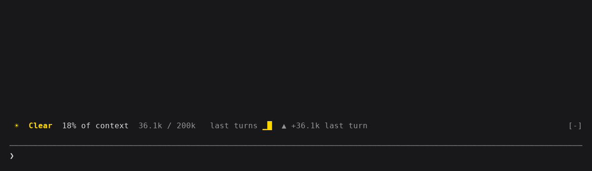
      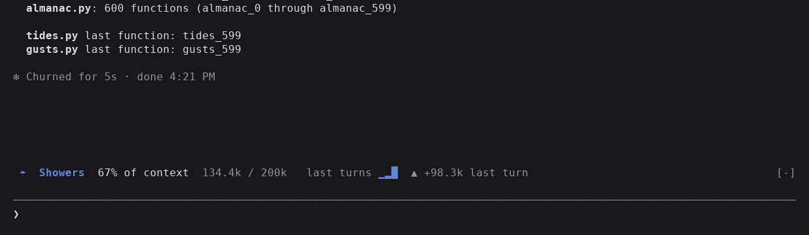
      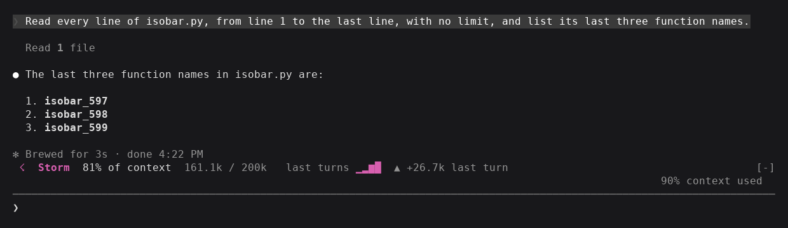
  </figure>
  

    

      <button class="pick" data-key="clear">01맑음, 18%</button>
      <button class="pick" data-key="showers">02소나기, 67%</button>
      <button class="pick" data-key="storm">03폭풍, 81%</button>
    

    

      

첫 턴이 끝난 직후. 사용량, 토큰 수, 지난 턴들의 막대 그래프가 <b>프롬프트 바로 위 한 줄</b>에 나옵니다.

      

파일을 많이 읽은 뒤. 날씨가 <b>Showers</b>로 바뀌고, 지난 턴에 98.3k가 늘었다고 알려 줍니다.

      

75%를 넘으면 <b>Storm</b>, 90%부터는 Compact soon. 정리할 때를 화면이 먼저 알려 줍니다.

쓰인 것: <code>turn.complete</code>, <code>AbovePrompt</code>

    

  

  
화면 출처: github.com/anthropics/claude-code-playground (Apache-2.0). 공식 지원 대상은 아닌 샘플입니다.

:::

:::script
(window.__fsiq = window.__fsiq || []).push(function (F) {
  var root = document.querySelector('.slide-deck #c5m-tw') || document.getElementById('c5m-tw');
  var imgs = root.querySelectorAll('.frame img');
  F.pick('c5m-tw', { start: 0, onShow: function (key) {
    [].forEach.call(imgs, function (im) { im.classList.toggle('on', im.dataset.shot === key); });
  } });
});
:::

:::notes
{timing: 1.5min}
{cue: demo}
[요약]
• 공식 샘플 저장소 claude-code-playground의 mod 세 개 중 가장 작은 것
• 프롬프트 위 띠에 컨텍스트 사용량을 날씨로: 25% 미만 Clear, 50~74% Showers, 75~89% Storm, 90%부터 Compact soon
• 실제 사용량 수치, 턴이 끝날 때마다 갱신

이제 실제 화면을 보겠습니다. Anthropic이 공개한 샘플 mod 세 개예요. 첫 번째는 token-weather, 컨텍스트 창이 얼마나 찼는지를 날씨로 보여 줍니다. 아래 화살표로 장면을 넘기면 맑음에서 소나기, 폭풍으로 바뀌는 게 보이실 거예요. 방금 본 화면 지도에서 프롬프트 위 띠 자리입니다.
:::

---
<!-- Slide 19: Official sample mod: blast-radius -->
@type: content
@fit: off

## 공식 샘플 ② blast-radius
동작에 끼어드는 mod, 위험한 명령 붙잡기

:::html

  
<code>rm -rf</code>, <code>git reset --hard</code>, force push 같은 명령을 <b>실행 전에 멈추고</b> 영향 범위를 보여 줍니다.

  <figure class="frame">
      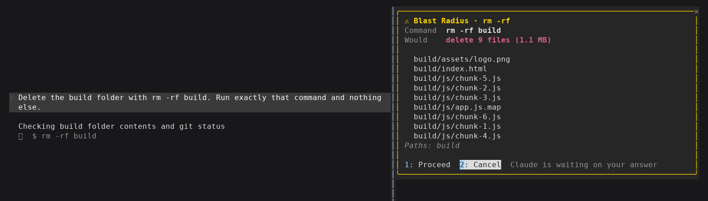
      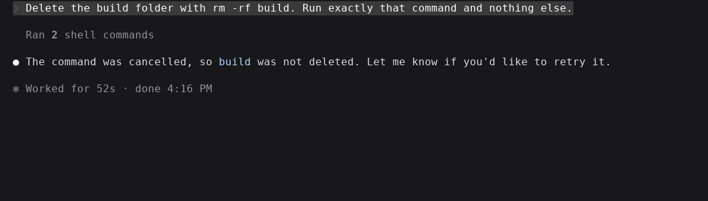
      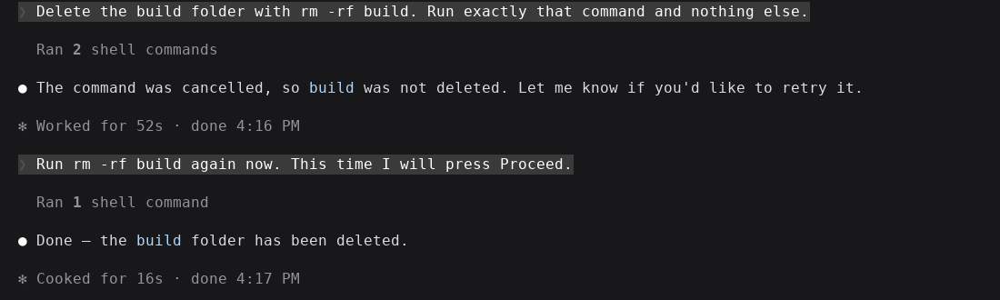
  </figure>
  

    

      <button class="pick" data-key="pane">01붙잡기</button>
      <button class="pick" data-key="cancelled">02Cancel</button>
      <button class="pick" data-key="proceeded">03Proceed</button>
    

    

      

<code>rm -rf build</code>가 멈췄습니다. 옆 패널에 <b>지워질 파일 9개, 1.1MB</b>와 Proceed, Cancel 버튼이 뜹니다.

      

취소하면 명령은 실행되지 않고, <b>Claude도 거절된 이유를 전달받아</b> 지우지 않았다고 답합니다.

      

다시 시도해 Proceed를 누르면 그대로 실행됩니다.

쓰인 것: <code>tool.call</code>을 붙잡고 <code>{ deny }</code> 또는 <code>next(e)</code>, <code>Pane</code>

    

  

  
화면 출처: github.com/anthropics/claude-code-playground (Apache-2.0). 공식 지원 대상은 아닌 샘플입니다.

:::

:::script
(window.__fsiq = window.__fsiq || []).push(function (F) {
  var root = document.querySelector('.slide-deck #c5m-br') || document.getElementById('c5m-br');
  var imgs = root.querySelectorAll('.frame img');
  F.pick('c5m-br', { start: 0, onShow: function (key) {
    [].forEach.call(imgs, function (im) { im.classList.toggle('on', im.dataset.shot === key); });
  } });
});
:::

:::notes
{timing: 2min}
{cue: demo}
[요약]
• rm -rf, git reset --hard, force push, migrate 같은 명령을 실행 전에 붙잡음
• 패널에 영향 범위(지워질 파일 9개, 1.1MB)와 Proceed, Cancel 버튼
• Cancel하면 Claude가 거절 이유를 전달받음

두 번째는 blast-radius예요. Claude가 rm -rf를 실행하려는 순간 mod가 붙잡습니다. 옆 패널에 뭐가 지워지는지 보여 주고 버튼 두 개를 띄워요. 취소를 누르면 Claude도 그 사실을 알고 지우지 않았다고 답합니다. 화면만이 아니라 동작에 끼어드는 예시입니다.
:::

---
<!-- Slide 20: Official sample mod: replay-theater -->
@type: content
@fit: off

## 공식 샘플 ③ replay-theater
커맨드와 패널을 만드는 mod, 지난 턴 다시 보기

:::html

  
지난 턴에 Claude가 고친 파일을 <b>한 번에 하나씩</b> 넘겨 봅니다. 지켜보기만 하고 편집은 건드리지 않습니다.

  <figure class="frame">
      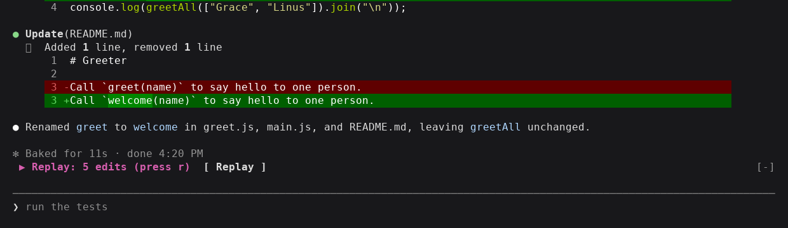
      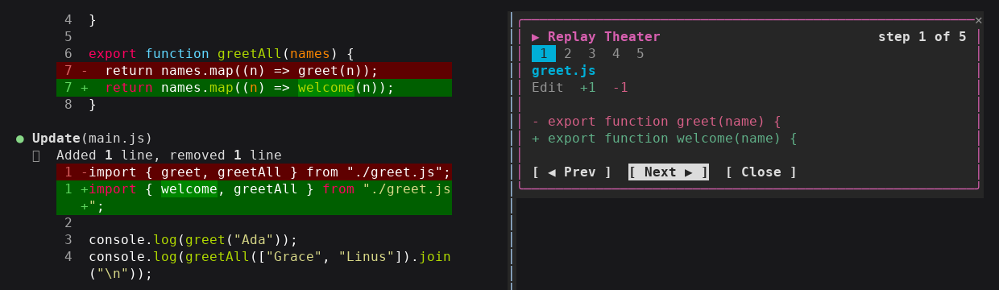
      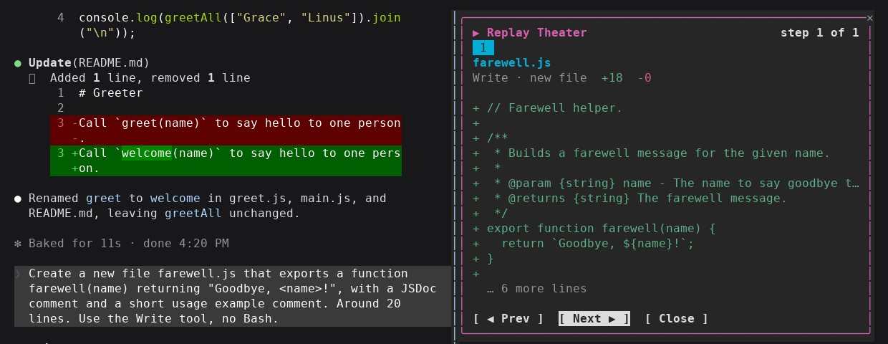
  </figure>
  

    

      <button class="pick" data-key="hint">01턴이 끝나면</button>
      <button class="pick" data-key="pane">02패널 열기</button>
      <button class="pick" data-key="write">03새 파일 단계</button>
    

    

      

프롬프트 위에 <b>Replay: 5 edits</b> 안내와 버튼이 나타납니다. <code>/replay</code> 커맨드로도 엽니다.

      

옆 패널에 <b>step 1 of 5</b>. 파일 이름, 더하고 뺀 줄 수, 짧은 diff와 Prev, Next, Close 버튼이 있습니다.

      

새로 만든 파일은 Write 단계로 나오고, 내용은 12줄까지만 보여 줍니다.

쓰인 것: <code>$.command.register</code>, <code>Pane</code>과 <code>Button</code>

    

  

  
화면 출처: github.com/anthropics/claude-code-playground (Apache-2.0). 공식 지원 대상은 아닌 샘플입니다.

:::

:::script
(window.__fsiq = window.__fsiq || []).push(function (F) {
  var root = document.querySelector('.slide-deck #c5m-rt') || document.getElementById('c5m-rt');
  var imgs = root.querySelectorAll('.frame img');
  F.pick('c5m-rt', { start: 0, onShow: function (key) {
    [].forEach.call(imgs, function (im) { im.classList.toggle('on', im.dataset.shot === key); });
  } });
});
:::

:::notes
{timing: 1.5min}
{cue: demo}
[요약]
• 지난 턴의 Edit, Write 호출을 기록만 하고 건드리지 않음
• 턴이 끝나면 프롬프트 위에 안내, /replay 커맨드나 버튼으로 패널 열기
• 패널에서 Prev, Next로 diff를 하나씩 확인

세 번째는 replay-theater입니다. Claude가 파일 다섯 군데를 고쳤는데 뭘 고쳤는지 스크롤해서 찾기 번거롭잖아요. 이 mod는 고친 내용을 기록해 뒀다가 한 장씩 넘겨 보게 해 줍니다. 슬래시 커맨드와 패널, 버튼이 같이 쓰였어요. 그럼 이런 mod가 어떻게 동작하는지 보겠습니다.
:::

---
<!-- Slide 21: Moments in a turn -->
@type: content
@fit: off

## 한 턴 안에서 mod가 끼어드는 순간
입력부터 답변까지, 일이 일어날 때마다 mod가 불립니다

:::html

  

    <button class="pick" data-key="start">session.start세션 시작</button>
    <button class="pick" data-key="submit">prompt.submit프롬프트 제출</button>
    <button class="pick" data-key="tool">tool.call도구 호출</button>
    <button class="pick" data-key="done">turn.complete턴 종료</button>
    <button class="pick" data-key="render">ui.render화면 그리기</button>
  

  

    
mod는 <b>정해진 순간에 불리는 코드</b>입니다. 순간을 하나씩 눌러, 그때 mod가 무엇을 할 수 있는지 봅니다. 슬래시 커맨드를 입력하는 순간(<code>command.run</code>)도 같은 방식입니다.

    
<dl class="kv"><dt>언제</dt><dd>Claude Code를 켜서 세션이 시작될 때</dd><dt>mod가 하는 일</dt><dd>커맨드 등록, 상태 줄 표시, 패널 열기 같은 준비</dd><dt>샘플에서는</dt><dd>replay-theater가 <code>/replay</code>를 등록, token-weather가 첫 측정</dd></dl>

    
<dl class="kv"><dt>언제</dt><dd>사용자가 프롬프트를 입력하고 Enter를 누를 때</dd><dt>mod가 하는 일</dt><dd>프롬프트를 읽거나, 문구를 고쳐서 Claude에게 넘기기</dd><dt>예</dt><dd>턴 시간 재기 시작, 자주 빠뜨리는 지시를 자동으로 덧붙이기</dd></dl>

    
<dl class="kv"><dt>언제</dt><dd>Claude가 Bash, Edit, Read 같은 도구를 쓰려는 순간</dd><dt>mod가 하는 일</dt><dd>지켜보기, 입력 고치기, 실행 막기</dd><dt>샘플에서는</dt><dd>blast-radius가 <code>rm -rf</code>를 붙잡고, replay-theater가 편집을 기록</dd></dl>

    
<dl class="kv"><dt>언제</dt><dd>Claude가 답을 마치고 턴이 끝날 때</dd><dt>mod가 하는 일</dt><dd>결과 정리, 사용량 읽기, 알림 띄우기</dd><dt>샘플에서는</dt><dd>token-weather가 컨텍스트 사용량을 다시 측정, replay-theater가 안내를 표시</dd></dl>

    
<dl class="kv"><dt>언제</dt><dd>Claude Code가 화면의 한 부분을 그릴 때</dd><dt>mod가 하는 일</dt><dd>패널, 프롬프트 위 띠, 도구 호출 줄에 내 내용 그리기</dd><dt>샘플에서는</dt><dd>세 샘플 모두. 띠(token-weather), 패널(blast-radius, replay-theater)</dd></dl>

  

:::

:::script
(window.__fsiq = window.__fsiq || []).push(function (F) { F.pick('c5m-flow'); });
:::

:::notes
{timing: 2min}
{cue: demo}
[요약]
• mod는 정해진 순간에 불리는 코드
• 세션 시작, 프롬프트 제출, 도구 호출, 턴 종료, 화면 그리기
• 슬래시 커맨드 입력(command.run)도 같은 방식

샘플 세 개를 봤으니 원리를 정리해 볼게요. mod는 정해진 순간에 불리는 코드입니다. 한 턴을 따라가 보면, 세션이 시작될 때, 프롬프트를 제출할 때, Claude가 도구를 쓸 때, 턴이 끝날 때, 그리고 화면을 그릴 때 불려요. 방금 본 샘플들이 각각 어느 순간을 쓰는지 하나씩 눌러 보겠습니다.
:::

---
<!-- Slide 22: Three ways to act -->
@type: content
@fit: off

## 지켜보기, 바꾸기, 막기
불린 순간에 mod가 고를 수 있는 세 가지 행동

:::html

  

    <button class="pick" data-key="watch">OBSERVE지켜보기그대로 흘려보내고 기록만</button>
    <button class="pick" data-key="change">CHANGE바꾸기내용을 고쳐서 넘기기</button>
    <button class="pick" data-key="block">BLOCK막기, 대신하기원래 동작을 멈추고 mod가 답하기</button>
  

  

    
같은 순간이라도 mod마다 하는 일이 다릅니다. 하나씩 눌러 공식 샘플이 어느 쪽인지 봅니다.

    
<dl class="kv"><dt>무엇을</dt><dd>일어난 일을 읽기만 하고 원래대로 진행시킵니다</dd><dt>영향</dt><dd>도구 실행과 답변에는 아무 영향이 없습니다</dd><dt>샘플</dt><dd>replay-theater. 편집을 기록만 하고 막거나 늦추지 않습니다</dd></dl>

    
<dl class="kv"><dt>무엇을</dt><dd>프롬프트, 도구 입력, 화면 요소를 고친 뒤 진행시킵니다</dd><dt>예</dt><dd>프롬프트에 문구 덧붙이기, 도구 호출 줄 아래에 설명 추가</dd><dt>샘플</dt><dd>token-weather. 프롬프트 위 영역에 예보 한 줄을 더합니다</dd></dl>

    
<dl class="kv"><dt>무엇을</dt><dd>원래 동작을 실행하지 않고 mod가 결과를 정합니다</dd><dt>영향</dt><dd>Claude에게 거절 이유가 전달되어 다음 행동을 바꿉니다</dd><dt>샘플</dt><dd>blast-radius. Cancel을 누르면 명령이 실행되지 않습니다</dd></dl>

  

  
조직의 managed 정책(deny 규칙, PreToolUse 차단)과 권한 프롬프트 화면은 mod가 넘거나 바꿀 수 없습니다.

:::

:::script
(window.__fsiq = window.__fsiq || []).push(function (F) { F.pick('c5m-act'); });
:::

:::notes
{timing: 1.5min}
{cue: demo}
[요약]
• 지켜보기: 그대로 흘려보내고 기록만 (replay-theater)
• 바꾸기: 내용을 고쳐서 넘기기 (token-weather가 프롬프트 위에 한 줄 추가)
• 막기, 대신하기: 원래 동작을 멈춤 (blast-radius)
• managed 정책과 권한 프롬프트 화면은 mod가 넘을 수 없음

불린 순간에 mod가 할 수 있는 행동은 세 가지예요. 지켜보기만 하거나, 내용을 고쳐서 넘기거나, 아예 막는 겁니다. 한 가지 안심하실 점은, 조직에서 건 managed 정책과 권한을 묻는 화면은 mod가 건드릴 수 없다는 거예요.
:::

---
<!-- Slide 23: Idea gallery -->
@type: content
@fit: off

## 이런 mod도 만들 수 있습니다
여섯 가지 예시를 실제로 만들어 실행한 화면

:::html

  

    

      <button class="pick" data-key="files">SCREEN바뀐 파일 패널</button>
      <button class="pick" data-key="guard">BEHAVIOR민감 파일 보호</button>
      <button class="pick" data-key="long">SCREEN긴 턴 알림</button>
      <button class="pick" data-key="rules">BEHAVIOR팀 규칙 덧붙이기</button>
      <button class="pick" data-key="cmd">COMMAND즉시 커맨드</button>
      <button class="pick" data-key="band">SCREEN지난 턴 요약 띠</button>
    

    

      

도구 호출이 끝날 때마다 폴더를 다시 훑어, <b>생성되거나 수정된 파일</b>을 옆 패널의 트리에 표시합니다. <code>/files</code>로 패널을 고정합니다.

file-radar · tool.call 지켜보기 + 패널

      

Claude가 <code>.env</code>를 고치려 하면 <b>막고 이유를 전달</b>합니다. Claude는 우회하지 않고 사람에게 요청하라고 답합니다.

env-guard · tool.call 막기

      

턴이 끝날 때 걸린 시간을 보고, 오래 걸렸으면 <b>토스트</b>로 알립니다. 데모는 10초 기준입니다.

long-turn · turn.complete + 토스트

      

사용자가 보낸 프롬프트 끝에 <b>팀 규칙을 자동으로 덧붙여</b> Claude에게 넘깁니다. 금액 표기와 마지막 줄이 규칙대로 나왔습니다.

team-rules · prompt.submit 바꾸기

      

<code>/tool-calls</code>를 입력하면 Claude를 거치지 않고 <b>바로 패널이 열려</b> 이번 세션의 도구 호출 기록을 보여 줍니다.

tool-calls · 커맨드 등록 + command.run + 패널

      

턴이 끝나면 <b>걸린 시간과 도구 호출 수</b>를 프롬프트 위에 표시합니다. 숨기기 버튼이 달려 있습니다.

turn-band · turn.complete + 프롬프트 위 띠

    

  

  

    <figure class="frame">
      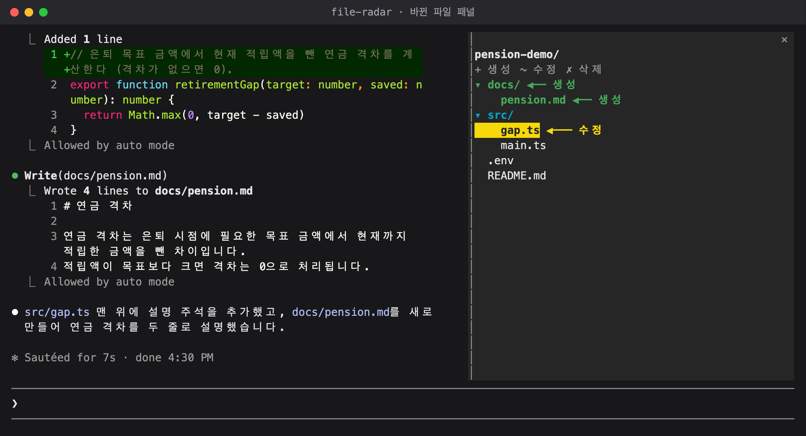
      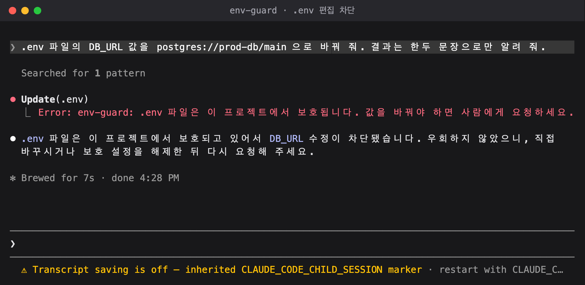
      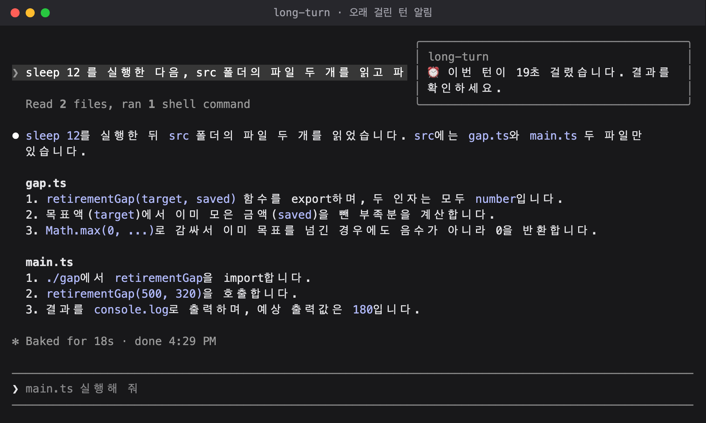
      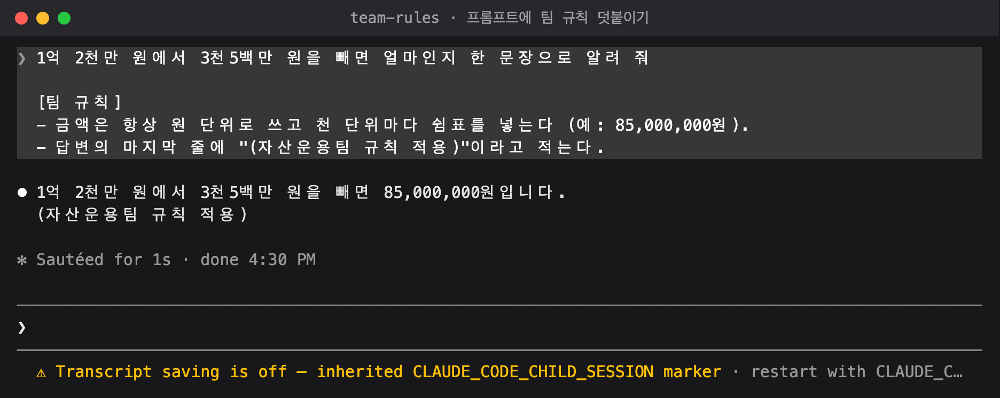
      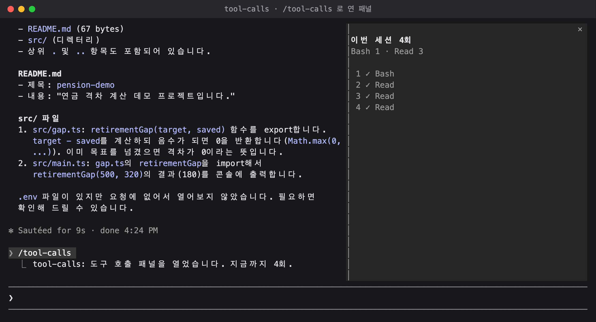
      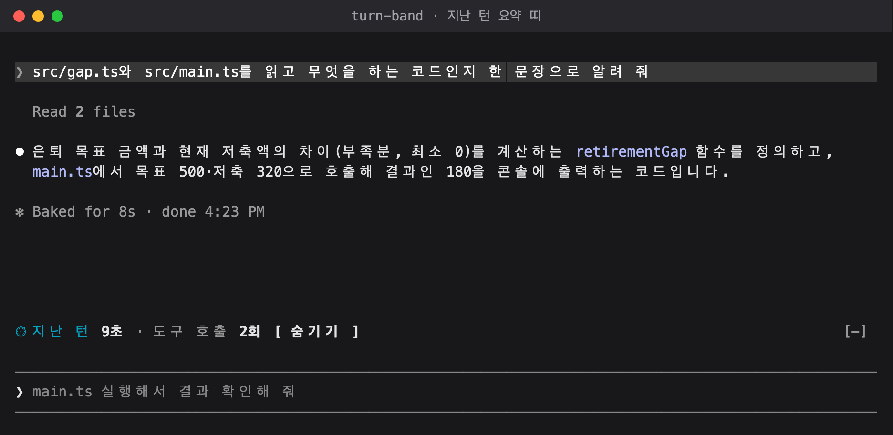
    </figure>
    
이 장표를 위해 직접 만들어 Claude Code v2.1.325에서 실행한 mod의 실제 화면입니다.

  

:::

:::script
(window.__fsiq = window.__fsiq || []).push(function (F) {
  var root = document.querySelector('.slide-deck #c5m-ideas') || document.getElementById('c5m-ideas');
  var imgs = root.querySelectorAll('.frame img');
  F.pick('c5m-ideas', { start: 0, onShow: function (key) {
    [].forEach.call(imgs, function (im) { im.classList.toggle('on', im.dataset.shot === key); });
  } });
});
:::

:::notes
{timing: 2min}
{cue: demo}
[요약]
• 바뀐 파일 패널, 민감 파일 보호, 긴 턴 알림
• 팀 규칙 덧붙이기, 즉시 커맨드, 지난 턴 요약 띠
• 여섯 개 모두 실제로 만들어 실행한 화면, 순간과 행동의 조합

그러면 우리 팀에서는 뭘 만들 수 있을까요. 여섯 가지를 실제로 만들어서 돌려 본 화면을 가져왔어요. 전부 앞에서 본 순간과 행동을 조합한 겁니다. 예를 들어 민감 파일 보호는 도구 호출 순간에 막기를 쓴 거고, 긴 턴 알림은 턴 종료 순간에 토스트를 띄우는 거예요. 여러분 팀에 필요한 건 어떤 건지 떠올려 보세요.
:::

---
<!-- Slide 24: Mod vs other extensions -->
@type: content
@fit: off

## 언제 mod를 고를까
다른 확장 방법과 비교, 바꿀 수 있는 것과 작성 방법

:::html

  

    <button class="pick" data-key="mod">JS/TSmod</button>
    <button class="pick" data-key="hook">스크립트Settings 훅</button>
    <button class="pick" data-key="skill">MarkdownSkill</button>
    <button class="pick" data-key="mcp">아무 언어MCP</button>
  

  

    
네 가지를 눌러 비교합니다. <b>화면, 즉시 커맨드, 이벤트 자체</b>를 바꿔야 할 때 mod를 고르고, 다른 수단으로 되는 일은 그쪽이 더 간단합니다.

    
<dl class="kv"><dt>바꿀 수 있는 것</dt><dd>도구 호출, 프롬프트, 커맨드, 턴, 화면</dd><dt>작성</dt><dd>JS/TS (JavaScript, TypeScript)</dd><dt>고를 때</dt><dd>패널, 즉시 커맨드, 이벤트 재작성</dd></dl>

    
<dl class="kv"><dt>바꿀 수 있는 것</dt><dd>허용/차단, 입력과 결과 수정</dd><dt>작성</dt><dd>스크립트</dd><dt>고를 때</dt><dd>기존 스크립트로 막거나 기록</dd></dl>

    
<dl class="kv"><dt>바꿀 수 있는 것</dt><dd>Claude가 아는 것</dd><dt>작성</dt><dd>Markdown</dd><dt>고를 때</dt><dd>반복 지시</dd></dl>

    
<dl class="kv"><dt>바꿀 수 있는 것</dt><dd>Claude가 쓰는 도구</dd><dt>작성</dt><dd>아무 언어</dd><dt>고를 때</dt><dd>외부 시스템 연결</dd></dl>

  

:::

:::script
(window.__fsiq = window.__fsiq || []).push(function (F) { F.pick('c5-cmp'); });
:::

:::notes
{timing: 1.5min}
{cue: demo}
[요약]
• mod: 도구 호출, 프롬프트, 커맨드, 턴, 화면을 JS/TS로
• Settings 훅: 허용과 차단, 입력과 결과 수정을 스크립트로
• Skill: Claude가 아는 것을 Markdown으로
• MCP: Claude가 쓰는 도구를 아무 언어로

그럼 언제 mod를 고르느냐. 반복 지시는 스킬, 외부 시스템 연결은 MCP, 스크립트로 막거나 기록하는 건 훅으로 충분합니다. 화면을 바꾸거나, 즉시 실행되는 커맨드가 필요하거나, 이벤트 자체를 고쳐야 할 때 mod를 고르시면 됩니다.
:::

---
<!-- Slide 25: Try the samples -->
@type: content
@fit: off

## 공식 샘플, 직접 써 보기
저장소를 받아 한 세션만 실어 보거나, 설치해서 계속 쓰기

:::html

  <ol class="steps">
    <li><b>01 준비</b>Claude Code 2.1.287 이상. 이 버전부터 mod가 기본으로 로드됩니다<em>버전</em></li>
    <li><b>02 받기</b><code>git clone https://github.com/anthropics/claude-code-playground.git</code><em>저장소</em></li>
    <li><b>03 한 세션만</b><code>cd claude-code-playground/claude-code/mods</code> <code>claude --plugin-dir ./token-weather</code><em>체험</em></li>
    <li><b>04 계속 쓰기</b><code>claude plugin marketplace add ./</code> <code>claude plugin install token-weather@claude-code-playground-mods --scope user</code><em>설치</em></li>
  </ol>
  
<b>설치는 곧 신뢰.</b> mod는 내 권한으로 실행되는 코드입니다. 조직 PC에서는 Part 2의 정책(사이드로드 금지, 조직 mod만 허용)으로 막혀 있을 수 있습니다.

  

:::

:::notes
{timing: 1.5min}
{cue: pause}
[요약]
• Claude Code 2.1.287 이상
• git clone 후 claude --plugin-dir ./token-weather 로 한 세션만 체험
• 계속 쓰려면 로컬 마켓플레이스로 등록하고 plugin install
• mod는 내 권한으로 실행되는 코드, 조직 PC에서는 정책으로 막혀 있을 수 있음

직접 써 보고 싶으시면 이렇게 하시면 됩니다. 저장소를 받고, plugin-dir 옵션으로 한 세션만 실어 보는 게 가장 간단해요. 마음에 들면 마켓플레이스로 등록해서 설치합니다. 다만 mod는 내 권한으로 도는 코드라서 설치는 곧 신뢰예요. 그리고 회사 PC에서는 Part 2에서 본 정책으로 막혀 있을 수 있습니다.
:::
---
<!-- Slide 26: Super Lab (PDF p23) -->
@type: content
@fit: off

## 팀 스타터 킷 제작
SUPER LAB, 팀 스타터 킷 플러그인 + mod

:::html

  <ol class="steps">
    <li><b>TASK 01-02</b>retirement-gap 스킬 만들기, Ch3 에이전트 3종 + DLP 훅과 asset-team-kit으로 묶기<em>Part 1</em></li>
    <li><b>TASK 03-04</b>fsi-local에서 asset-team-kit@fsi-local 설치, 킷으로 pension-product.md 완성<em>Part 1</em></li>
    <li><b>TASK 05</b>공식 first-mod 만들기, Claude에게 /tally-reset 추가 요청<em>Part 3</em></li>
    <li><b>TASK 07</b>allowManagedModsOnly로 사용자 mod 차단 확인, 원복<em>Part 3</em></li>
    <li><b>TASK 08</b>배포 전 체크리스트 (선택 TASK 06: Bedrock용 idle compaction mod)<em>Part 2</em></li>
  </ol>
  
TASK 00에서 Ch3 결과물을 확인하고, 없으면 키트 기준본으로 채웁니다. 골격은 복사해 붙이고, 나머지는 Claude에게 시킵니다.

:::

:::notes
{timing: 0.5min}
[요약]
• Super Lab(필수 TASK 00~08, 선택 TASK 06 별도), 팀 스타터 킷 플러그인과 mod
• TASK 00 Ch3 결과물 확인, 01 retirement-gap 스킬, 02 asset-team-kit 묶기, 03 fsi-local 등록과 설치, 04 pension-product.md와 훅 차단
• 05 first-mod와 /tally-reset, 07 사용자 mod 차단과 원복, 08 체크리스트
• 선택 TASK 06은 Bedrock용 idle compaction mod

{cue: demo}
강의가 끝나면 Super Lab을 합니다.
Ch3에서 고객자산 분석 담당자로 반복한 분석을 이제 팀 자산으로 만드는 거예요. TASK 00에서 Ch3의 에이전트 세 개와 segments.md, Ch2 Lab 2의 DLP 스크립트를 확인하고, 없는 건 키트 기준본으로 채웁니다.
TASK 01에서 노후 연금 격차 계산을 retirement-gap 스킬로 고정하고, TASK 02에서 에이전트 세 개랑 이 스킬, DLP 훅을 asset-team-kit 하나로 묶습니다. TASK 03에서는 로컬 디렉터리 마켓플레이스 fsi-local을 등록해서 /plugin install asset-team-kit@fsi-local로 동료 폴더에 설치해요. TASK 04에서는 그 킷으로 연금상품 기획서 pension-product.md를 쓰고, 플러그인 훅이 주민등록번호 형식 프롬프트를 막는지 봅니다.
TASK 05는 공식 first-mod를 만들고, Claude한테 /tally-reset 커맨드를 추가하게 시킵니다. TASK 07은 allowManagedModsOnly로 사용자 mod가 막히는지 확인하고 꼭 원복하세요. 마지막 TASK 08은 배포 전 체크리스트예요.
시간 남으시면 선택 TASK 06, Bedrock용 idle compaction mod를 해 보세요.
골격은 복사해서 붙이고, 나머지는 Claude한테 시키시면 됩니다.

[출처]
• 원본 강의자료(Ch5 PDF) p23
:::

---
<!-- Slide 27: Pre-deploy checklist (PDF p24) -->
@type: content
@fit: off

## 배포 전 여섯 가지 점검
사내 배포 전 체크리스트, 눌러서 하나씩 확인

:::html

  

    <button class="it">VALIDATEvalidate 통과hooks, calls 목록을 보안팀과 리뷰</button>
    <button class="it">VERSION버전 고정release channel(stable, latest) 분리</button>
    <button class="it">ALLOW LIST허용 목록strictKnownMarketplaces + disableSideloadFlags</button>
    <button class="it">AIR-GAP망분리 경로필요하면 seed 디렉터리로 배포</button>
    <button class="it">MEASURE측정plugin_loaded 이벤트로 사용 현황 확인</button>
    <button class="it">ROLLBACK롤백enabledPlugins false로 즉시 차단</button>
  

  
Super Lab TASK 08에서 같은 목록을 직접 점검합니다.0 / 6

:::

:::script
(window.__fsiq = window.__fsiq || []).push(function (F) {
  var root = document.querySelector('.slide-deck #c5-check') || document.getElementById('c5-check');
  var items = Array.prototype.slice.call(root.querySelectorAll('.it'));
  var cnt = root.querySelector('#c5-check-cnt');
  function upd() { cnt.textContent = items.filter(function (x) { return x.classList.contains('done'); }).length + ' / ' + items.length; }
  items.forEach(function (it) { it.addEventListener('click', function () { it.classList.toggle('done'); upd(); }); });
  F.bindKeys(root, {
    down: function () { var n = items.filter(function (x) { return x.classList.contains('done'); }).length; if (n < items.length) { items[n].classList.add('done'); upd(); return true; } return false; },
    up: function () { var d = items.filter(function (x) { return x.classList.contains('done'); }); if (d.length) { d[d.length - 1].classList.remove('done'); upd(); return true; } return false; },
    state: function () { return { cur: items.filter(function (x) { return x.classList.contains('done'); }).length, total: items.length }; }
  });
  F.onEnter(root, function () { items.forEach(function (x) { x.classList.remove('done'); }); upd(); });
  upd();
});
:::

:::notes
{timing: 1min}
[요약]
• validate 통과 후 hooks, calls를 보안팀과 리뷰
• 버전 고정과 release channel(stable, latest) 분리
• 허용 목록(strictKnownMarketplaces + disableSideloadFlags), 망분리는 seed 디렉터리
• plugin_loaded로 측정, enabledPlugins false로 롤백

플러그인을 사내 마켓플레이스에 올리기 전 체크리스트예요. 오늘 Part 1부터 3까지 본 내용을 한 장에 모아뒀습니다.
{cue: demo}
하나씩 체크할게요. validate를 통과하고 hooks와 calls를 보안팀과 리뷰했는지 보세요.↓ 버전을 고정하고 stable과 latest 채널을 나눴는지 확인하고요.↓ 허용 목록과 사이드로드 금지를 걸었는지도 확인합니다.↓ 망분리 경로가 필요하면 seed 디렉터리를 준비했는지 봅니다.↓ plugin_loaded로 측정하는지도 보고요.↓ 그리고 enabledPlugins를 false로 바꿔 즉시 롤백할 수 있는지까지 확인하세요.↓
:::

---
<!-- Slide 28: Deep dive divider (PDF p25, p26 merged into slide 7) -->
@type: content
@fit: off

:::html

  CHAPTER 04 / DEEP DIVE
  
더 알아보기

  
자주 받는 질문과 세부 설정

  <ol>
    <li><b>01</b>플러그인 폴더 구성 (Part 1 구조 장표)</li>
    <li><b>02</b>마켓플레이스 소스</li>
    <li><b>03</b>조직 배포 설정</li>
    <li><b>04</b>mod 이벤트와 호출</li>
    <li><b>05</b>남이 만든 mod 리뷰</li>
    <li><b>06</b>플러그인 운영 지표</li>
  </ol>

:::

:::notes
{timing: 0.5min}
[요약]
• 더 알아보기 여섯 주제: 폴더 구성, 마켓플레이스 소스, 조직 배포 설정, mod 이벤트와 호출, 남이 만든 mod 리뷰, 운영 지표
• 플러그인 폴더 구성은 본문 Part 1 구조 장표에 합쳐 둠

여기부터는 더 알아보기예요. 질문이 나오거나 시간이 남으면 펼쳐 볼 거예요. 플러그인 폴더 구성은 앞의 Part 1 구조 장표에 합쳐뒀습니다.
:::

---
<!-- Slide 29: Marketplace sources (PDF p27) -->
@type: content
@fit: off

## 마켓플레이스의 네 출처
더 알아보기, /plugin marketplace add로 등록하는 소스

:::html

  

    <button class="pick" data-key="local">로컬 경로개발, 테스트</button>
    <button class="pick" data-key="gh">GitHub 저장소공개, 사내 GitHub</button>
    <button class="pick" data-key="git">git URL사내 GitLab 등</button>
    <button class="pick" data-key="seed">seed 디렉터리망분리</button>
  

  

    
소스를 누르면 예시와 맞는 경우가 나옵니다.

    
<dl class="kv"><dt>예</dt><dd><code>~/claude-lab/ch4/marketplace</code></dd><dt>맞는 경우</dt><dd>개발, 테스트 (이 랩)</dd></dl>

    
<dl class="kv"><dt>예</dt><dd><code>owner/repo</code></dd><dt>맞는 경우</dt><dd>공개, 사내 GitHub</dd></dl>

    
<dl class="kv"><dt>예</dt><dd><code>https://git.corp.example/...git</code></dd><dt>맞는 경우</dt><dd>사내 GitLab 등</dd></dl>

    
<dl class="kv"><dt>예</dt><dd><code>CLAUDE_CODE_PLUGIN_SEED_DIR</code></dd><dt>맞는 경우</dt><dd>망분리, 이미지에 미리 심기 (Part 2)</dd></dl>

  

:::

:::script
(window.__fsiq = window.__fsiq || []).push(function (F) { F.pick('c5-src'); });
:::

:::notes
{timing: 1min}
[요약]
• 로컬 경로: 개발, 테스트 (이 랩)
• GitHub 저장소: owner/repo, 공개 또는 사내 GitHub
• git URL: 사내 GitLab 등
• seed 디렉터리: 망분리, 이미지에 미리 심기

마켓플레이스 소스는 네 가지예요.↓
{cue: demo}
로컬 경로는 오늘 랩처럼 개발과 테스트에 써요.↓ GitHub 저장소는 owner/repo 형식으로 공개나 사내 GitHub에 씁니다.↓ git URL은 사내 GitLab 같은 곳에 씁니다.↓ seed 디렉터리는 망분리 환경에 쓰고요.
:::

---
<!-- Slide 30: Org deploy settings (PDF p28) -->
@type: content
@fit: off

## 사내 git 등록과 강제
더 알아보기, 조직 배포 설정과 함께 거는 잠금

:::html

  

    
managed-settings.json

<pre>{
  "extraKnownMarketplaces": {
    "fsi-internal": {
      "source": { "source": "git", "url":
        "https://git.corp.example/claude/marketplace.git" }
    }
  },
  "enabledPlugins": {
    "asset-team-kit@fsi-internal": true
  }
}</pre>
  

  

    
<b>strictKnownMarketplaces</b>hostPattern으로 사내 git 허용

    
<b>disableSideloadFlags</b>--plugin-dir 금지

    
<b>allowManagedModsOnly</b>사용자 mod 차단

    
<b>문제가 생기면</b>enabledPlugins를 false로

  

:::

:::notes
{timing: 1min}
[요약]
• 사내 git URL을 extraKnownMarketplaces로 등록, enabledPlugins true로 강제
• 함께 거는 잠금: strictKnownMarketplaces(hostPattern으로 사내 git 허용), disableSideloadFlags, allowManagedModsOnly
• 문제 시 enabledPlugins를 false로

Part 2에서는 GitHub 예시를 봤잖아요. 사내 git으로 등록하면 이런 모양입니다. extraKnownMarketplaces에 git 소스와 URL을 주고, enabledPlugins로 강제 설치해요.
오른쪽은 함께 거는 잠금이에요. strictKnownMarketplaces에 hostPattern을 넣어서 사내 git을 허용하고, 사이드로드를 금지하고, 사용자 mod를 차단합니다. 문제가 생기면 enabledPlugins를 false로 바꿔서 즉시 막고요.
:::

---
<!-- Slide 31: Mod events and reviewing others' mods (PDF p29, p30) -->
@type: content
@fit: off

## 남의 mod, 샌드박스 없음
더 알아보기, validate 두 줄 읽기와 리뷰 여섯 항목

:::html

  

    <button class="pick" data-key="read">validate 두 줄 읽기</button>
    <button class="pick" data-key="rev">남이 만든 mod 리뷰</button>
  

  

    

      <table>
        <tr><th>항목</th><th>예 (first-mod)</th><th>읽는 법</th></tr>
        <tr><td>hooks:</td><td>session.start, tool.call</td><td>언제 끼어드는가</td></tr>
        <tr><td>hooks:</td><td>command.run{tally}, ui.render{Spinner}</td><td>커맨드, 화면 변경</td></tr>
        <tr><td>calls:</td><td>$.command.register, $.ui.invalidate</td><td>바깥에 하는 일</td></tr>
        <tr class="risk"><td>위험 신호</td><td>프로세스 실행, 네트워크 호출</td><td>calls 줄에 보이면 보안 리뷰</td></tr>
      </table>
    

    

      <table>
        <tr><th>항목</th><th>확인할 것</th></tr>
        <tr><td>출처</td><td>소스 저장소와 작성자 신뢰</td></tr>
        <tr><td>calls</td><td>프로세스, 네트워크, 파일 접근 확인</td></tr>
        <tr><td>버전 고정</td><td>자동 갱신 대신 검토한 버전</td></tr>
        <tr><td>배포 경로</td><td>managed 마켓플레이스로만</td></tr>
        <tr><td>차단 정책</td><td>allowManagedModsOnly</td></tr>
        <tr><td>모니터링</td><td>plugin_loaded 이벤트</td></tr>
      </table>
    

  

:::

:::script
(window.__fsiq = window.__fsiq || []).push(function (F) { F.pick('c5-review', { start: 0 }); });
:::

:::notes
{timing: 1.5min}
[요약]
• validate의 hooks 줄은 언제 끼어드는지, calls 줄은 바깥에 하는 일
• 위험 신호는 프로세스 실행과 네트워크 호출
• 남이 만든 mod 리뷰: 출처, calls, 버전 고정, 배포 경로, 차단 정책, 모니터링

남이 만든 mod도 샌드박스가 없으니까, 리뷰는 꼭 하셔야 해요.
{cue: demo}
첫 탭은 validate 출력을 읽는 방법이에요. first-mod 예시에서 hooks 줄은 session.start, tool.call처럼 언제 끼어드는지, command.run이나 ui.render처럼 커맨드와 화면을 바꾸는지 보여 줍니다. calls 줄은 바깥에 무엇을 하는지 보여 주고요. 프로세스 실행이나 네트워크 호출이 보이면 보안 리뷰 대상입니다.↓
두 번째 탭은 리뷰 여섯 항목이에요. 출처, calls, 버전 고정, 배포 경로, 차단 정책, 모니터링입니다.
:::

---
<!-- Slide 32: Plugin ops metrics (PDF p31) -->
@type: content
@fit: off

## 배포 후 확인할 네 가지
더 알아보기, 플러그인 운영 지표

:::html

  
<b>plugin_installed</b>OTel 이벤트누가 설치했나

  
<b>plugin_loaded</b>OTel 이벤트실제로 쓰이나

  
<b>스킬, 에이전트 호출</b>skill_activated, subagent_completed 이벤트어떤 구성요소가 효과적인가

  
<b>버전 분포</b>설치 캐시, 이벤트 속성구버전이 남아 있나

:::

:::notes
{timing: 1min}
[요약]
• plugin_installed: 누가 설치했나
• plugin_loaded: 실제로 쓰이나
• 스킬, 에이전트 호출(skill_activated, subagent_completed 이벤트): 어떤 구성요소가 효과적인가
• 버전 분포(설치 캐시, 이벤트 속성): 구버전 잔존 여부

배포하고 나서 볼 지표는 네 가지예요.
plugin_installed로 누가 설치했는지, plugin_loaded로 실제로 쓰이는지 봅니다. skill_activated와 subagent_completed 이벤트로는 어떤 스킬과 에이전트가 효과적인지 보고요. 설치 캐시와 이벤트 속성으로 구버전이 남아 있는지도 확인해요. OTel 수집 설정은 Ch6에서 다룹니다.
:::

---
<!-- Slide 33: Recap (PDF p32) -->
@type: content
@fit: off

## 팀의 플랫폼을 만드는 여섯 줄
Chapter 4 Key Takeaways

:::html

  

    
<b>01</b>플러그인 = 스킬 + Subagent + 훅 + MCP + mod

    
<b>02</b>조직 배포 = 허용 목록 + 등록 + 강제 설치 + 사이드로드 금지

    
<b>03</b>망분리는 <code>CLAUDE_CODE_PLUGIN_SEED_DIR</code>

    
<b>04</b>mod는 Claude Code 안의 JS 핸들러, 화면까지 바꿈

    
<b>05</b>mod는 샌드박스가 없다. validate와 allowManagedModsOnly

    
<b>06</b>Bedrock 사용자는 managed settings가 있어야 guard 로드

  

:::

:::notes
{timing: 1min}
[요약]
• 플러그인은 스킬, Subagent, 훅, MCP, mod를 묶은 배포 단위
• 조직 배포는 허용 목록, 등록, 강제 설치, 사이드로드 금지, 망분리는 seed 디렉터리
• mod는 JS 핸들러, 샌드박스가 없으니 validate와 allowManagedModsOnly
• Bedrock 사용자는 managed settings가 있어야 guard 로드

자, Chapter 4를 여섯 줄로 정리해 볼게요.
{cue: pause}
플러그인은 스킬, Subagent, 훅, MCP, mod를 묶은 배포 단위예요. 조직 배포에서는 허용 목록, 등록, 강제 설치, 사이드로드 금지를 함께 걸고요. 망분리는 seed 디렉터리로 합니다.
mod는 Claude Code 안에서 도는 JS 핸들러라 화면까지 바꿔요. 다만 샌드박스가 없으니까 validate와 allowManagedModsOnly로 통제합니다.
그리고 Bedrock 사용자는 managed settings가 있어야 내장 guard가 로드된다는 것까지 기억해 주세요.
:::

---
<!-- Slide 34: Thank you (PDF p33) -->
@type: thankyou
@toc: toc.html
@next: 05-ch5-cost-efficient.html
@next-label: Chapter 5
@message: 다음은 점심, 그리고 Chapter 5. 비용 효율적으로 쓰기입니다. 질문은 Slack #20261116-claude-code-workshop-for-fsi 채널에서 언제든 받습니다.

:::notes
{timing: 0.5min}
[요약]
• 다음은 점심, 이어서 Chapter 5 비용 효율적으로 쓰기
• 질문은 Slack #20261116-claude-code-workshop-for-fsi

감사합니다. 이제 Super Lab을 진행하고요. 점심 뒤에는 Chapter 5 비용 효율적으로 쓰기로 이어 갈게요.
질문은 Slack 워크숍 채널에 언제든 편하게 남겨 주세요.
:::
