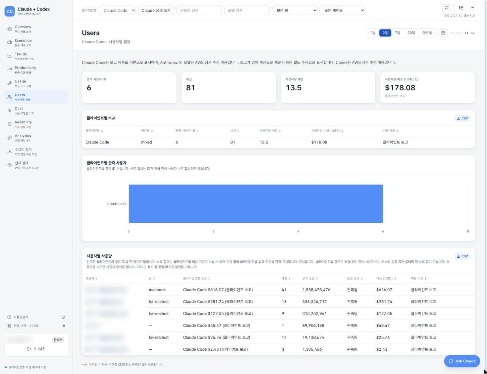

<!-- Slide 1: Cover -->
@type: cover
@background: linear-gradient(120deg, var(--surface-1) 0%, var(--surface-2) 70%, var(--surface-3) 100%)

# Chapter 6. 조직의 비용 보고 통제하기
## 쓴 만큼 보기, 한도 초과 시 차단 (Claude Code v2.1.319, 2026-11-08 리허설 검증)
Oh, Junseok
Sr. Solutions Architect
AWS Korea

:::script
(function(){function css(h){var has=[].some.call(document.querySelectorAll('link'),function(x){return x.getAttribute('href')===h;});if(has)return;var l=document.createElement('link');l.rel='stylesheet';l.href=h;document.head.appendChild(l);}css('assets/fsi.css');css('assets/ch6.css');if(!window.__fsiLoaded){window.__fsiLoaded=true;var s=document.createElement('script');s.src='assets/stepviz.js';document.head.appendChild(s);}})();
:::

:::notes
{timing: 0.5min}
[요약]
• Chapter 6 조직의 비용 보고 통제하기: 쓴 만큼 보기, 한도를 넘으면 막기
• Claude Code v2.1.319(2026-11-08 리허설 검증), Amazon Bedrock 기준
• 강의와 클로드 코드 대시보드(ccdash) 라이브 데모로 진행, 랩 페이지(TASK 01~04)는 자율 실습

마지막 챕터예요. Chapter 5에서는 한 사람이 토큰을 덜 쓰는 방법을 봤다면, 이번에는 조직 전체로 시야를 넓혀요. 회사에서 수백 명이 Claude Code를 쓰기 시작하면 가장 먼저 받는 질문이 "그래서 누가 얼마나 쓰고 있나요?"예요. 그 질문에 답하는 방법과, 정해 둔 금액을 넘으면 막는 방법을 차례로 살펴볼게요. 이번 챕터는 따로 실습 시간이 없고, 강의 중간에 실제 대시보드를 제 화면으로 보여 드릴게요.
{cue: transition}
사전 설문 결과부터 볼게요.
:::
---
<!-- Slide 2: Survey -->
@type: content
@fit: off

## 기대 주제 FinOps, 그리고 비용 가시화
사전 설문 결과로 정한 이 챕터의 목표

:::html

  

    PRE-SURVEY
    
26명

    
참가 확정자 <b>142명 중 26명</b>이 FinOps(모델 라우팅, 토큰 메터링, OTel 대시보드)를 기대 주제로 골랐어요.

    
자유 의견에도 조직 사용 비용의 가시화와 사내 토큰 배분 정책을 묻는 질문이 있었어요. 이 챕터에서는 OTel로 모은 사용량을 대시보드로 보고, 한도로 통제하는 방법을 살펴볼게요.

  

  <figure class="shot">
    
    <figcaption>OTel로 모은 사용량, ccdash Users 화면 (랩 환경, 식별자 가림)</figcaption>
  </figure>

:::

:::script
(window.__fsiq = window.__fsiq || []).push(function (F) { F.countUp('#c6b-survey-num', 26, { suffix: '명' }); });
:::

:::notes
{timing: 1min}
[요약]
• 참가 확정자 142명 중 26명이 FinOps(클라우드 비용 관리: 모델 라우팅, 토큰 계량, 오픈텔레메트리 대시보드)를 기대 주제로 선택
• 자유 의견: 조직 사용 비용의 가시화, 사내 토큰 배분 정책
• 이 챕터: 오픈텔레메트리로 모은 사용량을 대시보드로 보고, 게이트웨이 한도로 막는 법

사전 설문에서 142분 중 26분이 FinOps를 기대 주제로 골라 주셨어요. FinOps는 클라우드 비용을 재무 관점에서 관리하는 활동이에요. 상황에 맞는 모델을 골라 쓰는 것, 토큰을 계량하는 것, 사용량 대시보드를 만드는 것까지 포함해요. 자유 의견에도 "조직 전체 비용을 어떻게 파악하나요", "부서별로 토큰을 어떻게 나눠 주나요" 같은 질문이 있었어요. 오른쪽 화면은 이번 랩에서 실제로 모은 사용량이에요. 사용자별로 세션 수, 토큰, 추정 비용이 나와요. 이 숫자는 오픈텔레메트리라는 표준 방식으로 모았어요. 오늘은 이 데이터가 어떤 길로 모이는지 보고, 게이트웨이로 한도를 거는 방법까지 이어갈게요.

[출처]
• 이번 워크숍 사전 설문, 참가 확정자 142명 기준 (2026-11-14 집계)
• 클로드 코드 대시보드(ccdash) v1.7.0 Users 화면, 랩 환경 데이터 (사용자 식별자 가림)

{cue: transition}
그럼 순서부터 볼게요.
:::
---
<!-- Slide 3: Agenda -->
@type: content
@fit: off

## 강의와 데모
계측, 계약 단가, 게이트웨이 지출 한도, 데모는 ccdash 하나

:::html

  

    
CHAPTER 06조직의 비용 통제OTel 대시보드, modelPricing, 게이트웨이 지출 한도강의와 데모

    
DEMO / 강사 화면ccdash 대시보드텔레메트리 경로, 지출 한도, 계약 단가는 Ch6 랩 페이지(TASK 01~04)에서 자율 실습대시보드 설명 뒤

  

  
MORE더 알아보기자주 묻는 세부 내용은 마지막에 모아 두기

:::

:::notes
{timing: 0.5min}
[요약]
• 이번 챕터는 별도 랩 없이 강의와 라이브 데모로 진행
• 순서: 오픈텔레메트리 계측, 계약 단가 반영(modelPricing), 게이트웨이 지출 한도
• 데모는 클로드 코드 대시보드(ccdash) 하나
• 사용량 전송 경로, 지출 한도, 계약 단가는 Ch6 랩 페이지(TASK 01~04)에서 자율 실습

순서를 먼저 말씀드릴게요. 첫째, Bedrock에서 비용을 어떻게 보는지, 그리고 사람별 사용량을 모으는 계측인 오픈텔레메트리를 설명해요. 둘째, 화면에 나오는 추정 비용을 회사 계약 단가에 맞추는 설정과 AWS 쪽 비용 도구를 봐요. 셋째, 게이트웨이로 그룹별 모델과 지출 한도를 거는 방법을 다뤄요. 데모는 하나예요. 이틀 동안 여러분 실습 PC에서 모은 사용량을 클로드 코드 대시보드로 같이 볼게요. 사용량이 전송되는 경로, 지출 한도, 계약 단가 설정은 Ch6 랩 페이지에 단계별로 있으니, 행사 뒤에 직접 따라 해 보셔도 좋아요.
:::
---
<!-- Slide 4: Part 02 divider -->
@type: content
@fit: off

:::html

  CHAPTER 06
  
조직의 비용 통제

  
쓴 만큼 보기, 한도 초과 시 차단

  <ol>
    <li><b>01</b>Bedrock에서 비용을 보는 법</li>
    <li><b>02</b>OTel 대시보드 (ccdash 데모)</li>
    <li><b>03</b>modelPricing과 AWS 쪽 도구</li>
    <li><b>04</b>Claude Apps Gateway</li>
  </ol>

:::

:::notes
{timing: 0.5min}
[요약]
• Chapter 6 조직의 비용 통제: 쓴 만큼 보기, 한도를 넘으면 막기
• 네 부분: Bedrock 비용 보기, 오픈텔레메트리 대시보드(라이브 데모), 계약 단가와 AWS 도구, Claude Apps Gateway

Chapter 5에서는 개인이 덜 쓰는 방법을 봤어요. 이제 조직이 사용량을 파악하고 통제할 차례예요. 한도를 정하려면 먼저 사용량이 사람과 팀에 연결돼 있어야 해요. 누가 얼마나 쓰는지 모르는 채로 한도를 걸면, 꼭 필요한 사람이 막히거나 엉뚱한 곳에서 비용이 새요. 그래서 오늘은 보기가 먼저고 막기가 나중이에요. 네 부분으로 나눠서, 계측으로 비용이 어디서 생기는지 확인한 뒤 게이트웨이로 한도를 적용하는 데까지 갈게요.
:::
---
<!-- Slide 5: Cost by setup -->
@type: content
@fit: off

## Bedrock 가시성, 콘솔과 자체 계측뿐
어디서 계약했느냐에 따라 달라지는 비용 관리

:::html

  

    <button class="pick" data-key="bedrock">이 워크숍Amazon Bedrock</button>
    <button class="pick" data-key="anthropic">비교Anthropic과 직접 계약</button>
  

  

    
<h4>Amazon Bedrock</h4>
지출 보기AWS 청구 콘솔

지출 한도AWS 예산 도구

사용자별직접 설치한 계측(OTel)

콘솔은 계정이나 태그 단위 금액까지만 보여 줘요. 사람별로 보려면 계측을 직접 설치해야 해요.

    
<h4>Anthropic과 직접 계약</h4>
지출 보기사용량 화면 기본 제공

지출 한도관리 화면에서 설정

사용자별기본 제공

구독(Team, Enterprise)이든 API(Claude Console)든, 화면과 한도가 제품에 들어 있어요.

  

:::

:::script
(window.__fsiq = window.__fsiq || []).push(function (F) { F.pick('c6-setup', { start: 0 }); });
:::

:::notes
{timing: 1min}
[요약]
• Amazon Bedrock(이 워크숍): 총액은 AWS 청구 콘솔, 한도 알림은 AWS 예산 도구(AWS Budgets), 사람별은 직접 계측(오픈텔레메트리)
• 비교: Anthropic과 직접 계약하면 구독(Team, Enterprise)이든 API(Claude Console)든 사용량 화면과 한도가 제품에 포함

비용을 어떻게 보는지는 Claude를 어디서 계약했느냐에 따라 달라요. 이번 워크숍처럼 Amazon Bedrock으로 쓰면 비용이 AWS 청구서에 함께 나와요. AWS 청구 콘솔에서 Bedrock 사용 총액을 보고, AWS 예산 도구인 AWS Budgets로 금액이 넘을 때 알림을 걸 수 있어요. 그런데 콘솔은 계정이나 태그 단위 금액까지만 보여 줄 뿐, 개발자 누가 얼마나 썼는지는 보여 주지 않아요. 그래서 사람별로 보려면 각 PC의 Claude Code가 사용량을 보내도록 계측을 직접 설치해야 해요.↓
비교를 위해 Anthropic과 직접 계약한 경우도 볼게요. 팀 단위 구독인 Team, Enterprise든, 쓴 만큼 내는 API 방식인 Claude Console이든, 사용량 화면과 한도 설정이 제품 안에 들어 있어요. 관리자가 화면에서 바로 사람별 사용량을 보고 한도를 정할 수 있죠. Bedrock에는 이런 화면이 없다는 점을 다음 장에서 이어 볼게요.
:::
---
<!-- Slide 6: Bedrock reality -->
@type: content
@fit: off

:::html

  BEDROCK REALITY
  
Bedrock에는 <em>Analytics</em> 대시보드 미제공

  
계측 설치가 필수, 미설치 사용자는 집계에서 누락

:::

:::notes
{timing: 0.5min}
[요약]
• Bedrock에는 Claude 사용량 분석(Analytics) 화면이 없음
• 계측을 설치해야 보이고, 설치하지 않은 사람은 집계에서 빠짐

{cue: pause}
한 번 더 강조할게요. Bedrock에서 누가 얼마나 썼는지 보려면 별도 계측이 필요해요. Anthropic 직접 계약에서 제공하는 조직 사용량 분석 화면은 Bedrock에는 없어요. AWS 비용 조회는 계정이나 태그 단위 금액이라 사람별 사용량과는 달라요. 계측은 설치한 PC에서만 동작해요. 그래서 설치가 빠진 PC나 수집 서버가 멈춘 시간의 사용량은 집계에서 빠져요. 정책으로 모든 PC에 한꺼번에 켜는 이유가 여기 있어요. 이 계측에 쓰는 표준이 오픈텔레메트리예요. 다음 화면에서 프롬프트 하나가 대시보드의 숫자가 되는 과정을 따라가 볼게요.
:::
---
<!-- Slide 7: Prompt to dashboard scene -->
@type: content
@fit: off

## 프롬프트 하나가 대시보드 숫자가 되기까지
요청 하나가 남기는 기록의 길 (랩 환경 기준)

:::html

  

  

    

    

    <pre class="fs-code"></pre>
    

    
<i></i>

  

:::

:::script
import('./assets/flowscene.js').then(function (m) { m.mount('#c6-flow', {
  aria: '개발자 PC의 Claude Code가 지표와 이벤트를 PC 안의 수집기로 보내고, 수집기가 프롬프트 본문을 지운 뒤 조직이 고른 곳(CloudWatch, ClickHouse, 또는 파일로 내보낸 뒤 DuckDB로 조회)으로 내보내며, 대시보드가 이를 읽어 관리자 화면과 Ask Claude 답변을 만드는 흐름',
  zones: [
    { box: [-0.4, 0, 0, 9.2, 4.2, 0.4], label: '개발자 PC', labelAt: [-0.2, 0, -1.05] },
    { box: [11.0, 0, 0, 7.6, 4.2, 0.4], label: 'OTel 저장소 (조직이 선택)', labelAt: [11.2, 0, -1.05] },
    { box: [19.6, 0, 0, 7.8, 4.2, 0.4], label: '대시보드와 질문', labelAt: [19.8, 0, -1.05] }
  ],
  parts: {
    pc: { boxes: [[1.4, 1.2, 0.4, 1.8, 1.4, 0.8], [1.7, 2.4, 1.2, 1.2, 0.15, 1.0]] },
    col: { boxes: [[5.4, 1.3, 0.4, 1.4, 1.4, 1.3]], rings: [[[6.1, 2.0, 0.42], 34, 12]] },
    cw: { boxes: [[11.6, 1.4, 0.4, 1.6, 1.0, 1.1]] },
    ch: { boxes: [[13.9, 1.4, 0.4, 0.75, 1.0, 1.5], [14.75, 1.4, 0.4, 0.75, 1.0, 1.5]] },
    duck: { boxes: [[16.2, 1.4, 0.4, 1.6, 1.0, 0.9]] },
    api: { boxes: [[20.4, 1.2, 0.4, 1.8, 1.6, 1.4]] },
    bedrock: { boxes: [[24.6, 2.4, 0.4, 2.0, 1.6, 2.0]] }
  },
  icons: [
    { part: 'cw', at: [12.4, 1.9, 1.75], name: 'CloudWatch', size: 28 },
    { part: 'bedrock', at: [25.6, 3.2, 2.7], name: 'Bedrock', size: 34 }
  ],
  tags: [
    { id: 'evt', at: [6.6, 3.2, 3.4], text: 'api_request: model, 토큰, cost_usd', show: ['emit'], overview: false },
    { id: 'scrub', at: [6.6, 3.2, 3.4], text: 'prompt 본문 ✕  prompt_length만', show: ['scrub'], overview: false },
    { id: 'file', at: [15.4, 4.2, 2.6], text: 'file exporter → JSON 파일', show: ['cw'], overview: false },
    { id: 'sql', at: [22.6, 4.0, 3.6], text: 'SELECT … (읽기 전용)', show: ['ask'], overview: false }
  ],
  wires: {
    emit: { pts: [[3.2, 1.9, 1.0], [5.4, 2.0, 1.0]] },
    toch: { pts: [[6.8, 2.0, 1.1], [9.8, 2.0, 1.1], [13.4, 2.0, 1.1], [14.7, 1.9, 1.9]] },
    tocw: { pts: [[6.8, 1.6, 0.9], [9.8, 0.6, 0.9], [12.4, 0.6, 0.9], [12.4, 1.9, 1.5]], cls: 'fs-alt' },
    toduck: { pts: [[6.8, 2.4, 1.2], [9.8, 3.6, 1.2], [17.0, 3.6, 1.2], [17.0, 1.9, 1.3]], cls: 'fs-alt' },
    read: { pts: [[15.5, 1.9, 1.9], [18.8, 2.0, 1.6], [20.4, 2.0, 1.4]] },
    view: { pts: [[22.2, 1.6, 1.2], [23.0, 0.6, 1.6]] },
    ask: { pts: [[22.2, 2.4, 1.4], [24.6, 3.2, 1.4]] }
  },
  callouts: [
    { id: 'pc', n: 1, anchor: [2.3, 1.2, 1.2], at: [40, 440], title: '개발자 PC, Claude Code', sub: 'OTel은 managed settings로 켜짐' },
    { id: 'col', n: 2, anchor: [6.1, 1.3, 1.7], at: [110, 70], title: '수집기 (PC 안)', sub: 'loopback 4317, 디스크 큐' },
    { id: 'cw', n: 3, anchor: [12.4, 1.4, 0.9], at: [320, 470], title: 'Amazon CloudWatch', sub: 'AWS 관리형 로그와 지표' },
    { id: 'ch', n: 4, anchor: [14.7, 1.4, 1.9], at: [300, 40], title: 'ClickHouse', sub: '대량 분석, ccdash' },
    { id: 'duck', n: 5, anchor: [17.0, 1.4, 1.3], at: [490, 40], title: 'DuckDB', sub: 'JSON 파일을 조회' },
    { id: 'api', n: 6, anchor: [21.3, 1.2, 1.8], at: [600, 470], title: '대시보드 (ccdash 등)', sub: '저장소를 읽어 화면으로' },
    { id: 'bedrock', n: 7, anchor: [25.6, 2.4, 2.4], at: [680, 180], title: 'Amazon Bedrock', sub: 'Ask Claude: 질문을 SQL로' }
  ],
  figures: [
    { at: [0.6, 1.9, 0.4], scale: 0.9, pose: 'type', busy: true, act: { start: 'type', emit: 'type' } },
    { at: [23.0, 0.4, 0.4], scale: 0.9, dir: -1, colour: 'var(--info)', act: { view: 'raise', ask: 'raise' } }
  ],
  code: [
    'CLAUDE_CODE_ENABLE_TELEMETRY=1',
    'OTEL_METRICS_EXPORTER=otlp',
    'OTEL_LOGS_EXPORTER=otlp',
    'OTEL_EXPORTER_OTLP_PROTOCOL=grpc',
    'OTEL_EXPORTER_OTLP_ENDPOINT=',
    '  http://localhost:4317',
    '# 이벤트 claude_code.api_request',
    '#   model, input_tokens, output_tokens,',
    '#   cache_read_tokens,',
    '#   cost_usd, duration_ms',
    '# 프롬프트 본문: 기본 미전송 (길이만)'
  ],
  overview: { label: '전체 그림', title: '내 PC에서 관리자 화면까지', say: '프롬프트를 보내면 Claude Code는 답과 별도로 <b>무엇을 얼마나 썼는지</b>를 기록해요. 그 기록이 PC 안의 수집기를 거쳐 <b>조직이 고른 저장소</b>에 쌓이고, 대시보드의 숫자가 돼요.' },
  phases: [
    { key: 'start', d: 2.6, focus: ['pc'], cam: ['pc', 'col'], zoom: 0.3, badge: 'pc', lines: [1], label: '1  입력', title: '개발자의 프롬프트 입력', say: '정책으로 OTel이 켜진 PC에서는 개발자가 따로 할 일이 없어요. 평소처럼 Claude Code를 쓰면 <b>사용 기록이 자동으로</b> 남죠.' },
    { key: 'emit', d: 2.8, focus: ['pc', 'col'], cam: ['pc', 'col'], zoom: 0.3, badge: 'col', lines: [2, 3, 7, 8, 9, 10], packet: { wire: 'emit' }, label: '2  기록', title: '요청마다 이벤트, 1분마다 지표', say: '모델 호출 한 번마다 <b>api_request</b> 이벤트가 생기고 모델, 토큰, 추정 비용이 담겨요. token.usage 같은 지표는 기본 1분마다 모아서 보내요.' },
    { key: 'scrub', d: 2.6, focus: ['col'], cam: ['col'], zoom: 0.28, badge: 'col', lines: [11], label: '3  지우기', title: '본문 미전송', say: '프롬프트 본문은 <b>기본으로 보내지 않고 길이만</b> 남겨요. 랩 수집기는 내보내기 전에 로그 본문을 지우는 규칙으로 한 번 더 막아요.' },
    { key: 'store', d: 3.2, focus: ['col', 'cw', 'ch', 'duck'], badge: 'ch', lines: [4, 5, 6], packet: { wire: 'toch' }, label: '4  저장', title: '수집기, 조직이 고른 저장소로', say: '수집기는 OTLP로 받아 <b>조직이 고른 저장소</b>로 내보내요. 이번 랩 대시보드(ccdash)는 <b>ClickHouse</b>에 쌓고, 끊겨도 디스크 큐에 모아 두었다가 다시 보내요.' },
    { key: 'cw', d: 3.2, focus: ['col', 'cw', 'duck'], badge: 'cw', lines: [], packet: { wire: 'tocw', colour: 'var(--info)' }, label: '5  다른 선택', title: 'CloudWatch, DuckDB도 선택 가능', say: 'AWS 안에서 끝내려면 <b>CloudWatch</b>예요. 수집기의 <b>file exporter</b>로 JSON 파일을 남기고 <b>DuckDB</b>로 조회하는 방법도 있어요. 이번 랩은 CloudWatch에도 함께 보내죠.' },
    { key: 'view', d: 3.0, focus: ['ch', 'api'], badge: 'api', lines: [], packet: { wire: 'read' }, label: '6  화면', title: '대시보드가 읽어서 화면으로', say: 'ccdash 같은 대시보드가 저장소를 <b>읽기 쿼리</b>로 조회해 Overview, Users, Cost 화면을 만들어요. 브라우저는 데이터베이스에 직접 붙지 않아요.' },
    { key: 'ask', d: 3.4, focus: ['api', 'bedrock'], badge: 'bedrock', lines: [], packet: { wire: 'ask', mode: 'pingpong', colour: 'var(--success)' }, label: '7  질문', title: 'Ask Claude, 말로 묻고 표로 받기', say: '“오류가 많은 도구는?”처럼 물으면 Bedrock의 Claude가 <b>읽기 전용 SQL</b>로 조회하고, 표와 해석으로 답해요.' }
  ]
}); });
:::

:::notes
{timing: 2min}
[요약]
• 요청 하나가 남기는 기록의 길: Claude Code, PC 안 수집기, 저장소, 대시보드, Ask Claude
• 모델 호출마다 api_request 이벤트(모델, 토큰, 추정 비용), 지표는 기본 1분마다 전송
• 프롬프트 본문은 기본으로 보내지 않음(길이만), 랩 수집기는 내보내기 전에 로그 본문을 한 번 더 지움
• 저장소는 조직이 선택: CloudWatch(AWS 관리형), ClickHouse(대량 분석용 데이터베이스, 클로드 코드 대시보드가 사용), 파일로 내보낸 뒤 DuckDB로 조회
• 수집기는 연결이 끊기면 디스크에 모았다가 다시 보냄, 대시보드는 읽기 쿼리로 화면 구성

{cue: demo}
오픈텔레메트리는 프로그램이 무엇을 얼마나 했는지를 표준 형식으로 내보내는 방식이에요. Claude Code에서 이걸 켜면 실제로 무슨 일이 일어나는지, 요청 하나를 따라가 볼게요.↓
개발자는 평소처럼 Claude Code에 프롬프트를 보내요. 계측은 회사 정책으로 이미 켜져 있으니까 개발자가 따로 할 일은 없어요. 화면도 달라지지 않아요.↓
Claude Code가 모델을 한 번 부를 때마다 api_request라는 기록, 이벤트가 하나 생겨요. 어떤 모델을 불렀는지, 토큰을 몇 개 썼는지, 추정 비용이 얼마인지가 들어 있어요. 토큰 사용량 같은 누적 숫자, 지표는 따로 모아서 기본 1분마다 보내요.↓
금융권에서 가장 많이 물어보시는 부분이에요. 프롬프트 본문은 기본으로 보내지 않아요. 몇 글자였는지 길이만 남아요. 이번 랩의 수집기는 혹시 본문이 섞여 들어와도 내보내기 전에 지우는 규칙을 하나 더 두었어요. 두 겹으로 막는 거예요.↓
이 기록을 처음 받는 곳은 같은 PC 안에서 도는 수집기예요. 수집기가 기록을 걸러서 조직이 고른 저장소로 보내요. 이번 랩의 클로드 코드 대시보드는 ClickHouse라는 분석용 데이터베이스에 쌓아요. 네트워크가 잠깐 끊겨도 수집기가 디스크에 모아 뒀다가 다시 보내니까 기록이 쉽게 사라지지 않아요.↓
저장소는 회사 사정에 맞게 고르시면 돼요. AWS 안에서 끝내고 싶다면 관리형 서비스인 CloudWatch가 간단해요. 작게 시작하고 싶다면 수집기가 JSON 파일로 남기게 하고 DuckDB 같은 도구로 조회해도 돼요. 이번 랩은 ClickHouse와 함께 각 팀 계정의 CloudWatch에도 같은 지표를 보내요.↓
그다음은 대시보드예요. 클로드 코드 대시보드 같은 도구가 저장소를 읽어서 관리자가 보는 화면을 만들어요. 사람별, 모델별, 시간대별로 나눠 볼 수 있어요.↓
마지막은 Ask Claude 기능이에요. 관리자가 "어제 가장 많이 쓴 사람 다섯 명은?"처럼 말로 물으면, Bedrock의 Claude가 읽기 전용 SQL로 저장소를 조회해서 표로 답해 줘요. 데이터를 바꾸지는 못하고 읽기만 해요.
{cue: transition}
그럼 이걸 모두에게 어떻게 켜는지 살펴보죠.

[출처]
• code.claude.com/docs/en/monitoring-usage (metrics, events, 기본 미전송 항목, export interval)
• github.com/Atom-oh/claude-code-usage-dashboard (docs/architecture.md: loopback 4317 수집기, 디스크 큐, ClickHouse, Express)
• OpenTelemetry Collector Contrib, file exporter (OTLP JSON 파일로 내보내기), DuckDB read_json
:::
---
<!-- Slide 8: OTel by policy -->
@type: content
@fit: off

## 정책으로 켜는 OTel
managed settings env 한 블록이면 모두에게

:::html

:::

:::script
(window.__fsiq = window.__fsiq || []).push(function (F) {
  var MS = {id:'ms',x:50,y:60,w:320,h:90,t:'managed settings',s:'env 한 블록',c:'danger',icon:'lock'};
  var CC = {id:'cc',x:50,y:300,w:320,h:90,t:'Claude Code',s:'지표와 로그 생성',c:'accent',icon:'terminal'};
  var COL = {id:'col',x:460,y:300,w:320,h:90,t:'OTel 수집기',s:'OTLP 엔드포인트',c:'warning',icon:'pipe'};
  var DB = {id:'db',x:860,y:150,w:280,h:90,t:'대시보드',s:'팀별 집계',c:'info',icon:'chart'};
  var CW = {id:'cw',x:860,y:340,w:280,h:90,t:'CloudWatch',s:'랩 환경 이중 전송',c:'info',icon:'aws:CloudWatch'};
  var Z = [{x:20,y:20,w:1140,h:440,l:'텔레메트리 경로'}];
  var N = [MS, CC, COL, DB, CW];
  var env = ['"env": {','  "CLAUDE_CODE_ENABLE_TELEMETRY": "1",','  "OTEL_METRICS_EXPORTER": "otlp",','  "OTEL_LOGS_EXPORTER": "otlp",','  "OTEL_EXPORTER_OTLP_PROTOCOL": "grpc",','  "OTEL_EXPORTER_OTLP_ENDPOINT":','    "https://otel.corp.example.internal:4317",','  "OTEL_RESOURCE_ATTRIBUTES":','    "department=platform,team=core"','}'];
  F.stepviz('#c6-sv-otel', [
    {kicker:'STEP 1', title:'정책으로 모두에게 계측 적용',
     body:'OTel(OpenTelemetry)은 켜야 기록이 생겨요. <b>managed settings의 env 한 블록</b>으로 배포하면 사용자가 끌 수 없고, 빠지는 사람이 없어요.',
     facts:['CLAUDE_CODE_ENABLE_TELEMETRY: 1','managed settings로 배포','계측 설치 누락 없이'],
     zones:Z, nodes:N, hot:['ms','cc'],
     edges:[{f:'ms',t:'cc',c:'danger',l:'env 배포',o:0}],
     snip:{hd:'managed-settings.json (env)',path:'OTel을 정책으로 켜기',lines:env,hl:[2],note:'엔드포인트는 예시 주소'}},
    {kicker:'STEP 2', title:'OTLP로 조직 수집기에 전송',
     body:'지표와 로그를 <b>OTLP(OpenTelemetry 전송 규격), gRPC</b>로 조직이 정한 수집기 엔드포인트에 보내요.',
     facts:['OTEL_METRICS_EXPORTER: otlp','OTEL_LOGS_EXPORTER: otlp','목적지는 조직 수집기'],
     zones:Z, nodes:N, hot:['cc','col'],
     edges:[{f:'cc',t:'col',c:'warning',l:'OTLP, gRPC',o:0}], loop:true,
     snip:{hd:'managed-settings.json (env)',path:'내보내기 설정',lines:env,hl:[3,4,5,6,7],note:'목적지가 회사 안이라는 점이 Bedrock 경로의 장점이에요.'}},
    {kicker:'STEP 3', title:'대표 지표',
     body:'수집기에서 대시보드로 가는 대표 지표는 <b>token.usage, cost.usage, session.count</b>와 코드 산출물 지표예요.',
     facts:['claude_code.token.usage','claude_code.cost.usage','claude_code.session.count','lines_of_code, commit, PR'],
     zones:Z, nodes:N, hot:['col','db'],
     edges:[{f:'cc',t:'col',c:'warning',o:0},{f:'col',t:'db',c:'info',l:'지표',o:1}], loop:true,
     snip:{hd:'대표 지표',path:'OTel metrics',lines:['claude_code.token.usage','claude_code.cost.usage','claude_code.session.count','claude_code.lines_of_code.count','claude_code.commit.count','claude_code.pull_request.count'],hl:[1,2,3],note:'cost.usage는 추정 비용, 정산은 AWS 기준'}},
    {kicker:'STEP 4', title:'resource 속성으로 팀별 집계',
     body:'<b>OTEL_RESOURCE_ATTRIBUTES</b>에 부서와 팀을 넣으면 대시보드에서 <b>팀별로 집계</b>할 수 있어요.',
     facts:['department=platform','team=core','팀마다 다른 값으로 배포'],
     zones:Z, nodes:N, hot:['ms','db'],
     edges:[{f:'col',t:'db',c:'info',l:'팀별',o:0}],
     snip:{hd:'managed-settings.json (env)',path:'팀 속성',lines:env,hl:[8,9],note:'예시 값, 팀별 managed settings로 다르게 배포'}},
    {kicker:'LAB', title:'랩 환경의 두 곳 전송',
     body:'이번 랩 환경은 <b>otelcol</b>이 받아 내보내기 전에 <b>scrub_logs</b>로 프롬프트 본문을 지우고, <b>CloudWatch와 중앙 대시보드</b>로 이중 전송해요.',
     facts:['otelcol, fanout 타이머 active','scrub_logs: 내보내기 전 프롬프트 본문 삭제','exporters: CloudWatch + 중앙 대시보드'],
     zones:Z, nodes:[MS, CC, {id:'col',x:460,y:300,w:320,h:90,t:'otelcol',s:'scrub_logs로 본문 삭제',c:'warning',icon:'pipe'}, {id:'db',x:860,y:150,w:280,h:90,t:'중앙 대시보드',s:'이틀간 사용량',c:'info',icon:'chart'}, CW], hot:['cc','col','db','cw'],
     edges:[{f:'cc',t:'col',c:'warning',o:0},{f:'col',t:'db',c:'info',o:1},{f:'col',t:'cw',c:'info',o:1}], loop:true,
     snip:{hd:'Ch6 랩 TASK 01에서 확인',path:'랩 환경',lines:['# settings.json의 OTEL_* 환경 변수','# otelcol, fanout 타이머 active','# scrub_logs: 프롬프트 본문 삭제 규칙','# exporters: CloudWatch + 중앙 대시보드'],hl:[],note:'프롬프트 본문을 <b>내보내기 전에 지우는</b> 규칙이 금융권 운영의 기본이에요.'}}
  ], {legend:[['danger','관리자가 강제'],['accent','Claude Code'],['warning','수집기'],['info','보는 곳']]});
});
:::

:::notes
{timing: 1.5min}
[요약]
• 관리 정책 파일(managed settings)의 env 한 블록으로 모든 PC에 오픈텔레메트리를 켬 (CLAUDE_CODE_ENABLE_TELEMETRY=1)
• 오픈텔레메트리 전송 규약(OTLP) gRPC로 조직 수집기에 지표와 로그 전송
• 대표 지표: 토큰 사용량(token.usage), 추정 비용(cost.usage), 세션 수, 코드 줄 수, 커밋, PR
• OTEL_RESOURCE_ATTRIBUTES에 부서와 팀을 넣어 팀별 집계
• 랩 환경: PC 안 수집기(otelcol)가 프롬프트 본문을 지우고 CloudWatch와 중앙 대시보드로 이중 전송

{cue: demo}
켜는 방법은 간단해요. Ch2에서 본 관리 정책 파일, managed settings 기억하시죠? 그 파일의 env 항목에 텔레메트리를 켜는 값 몇 줄을 넣으면 모든 PC에서 한꺼번에 켜져요. 관리 정책이라 개발자가 개인 설정으로 끌 수 없어요. 다만 배포했다고 끝이 아니에요. 수집기가 실제로 데이터를 받고 있는지도 꼭 확인하세요.↓
보내는 방식은 오픈텔레메트리 전송 규약, 줄여서 OTLP예요. 이 규약으로 조직의 수집기 주소에 지표와 로그를 보내요. 이번 랩은 같은 PC 안 수집기의 4317번 포트로 보내요.↓
어떤 숫자가 쌓이는지 보면, 토큰 사용량과 추정 비용, 세션 수가 기본이에요. 여기에 Claude Code가 바꾼 코드 줄 수, 만든 커밋과 PR 수도 함께 집계돼요.↓
팀별로 보고 싶다면 resource 속성이라는 꼬리표에 부서와 팀을 넣어 주세요. 이번 랩은 이메일과 팀 이름을 넣었고, 회사에서는 사번이나 부서 코드를 넣으시면 돼요. 그러면 대시보드에서 팀별로 나눠 볼 수 있어요.↓
이번 랩 환경에서는 PC 안 수집기가 프롬프트 본문을 지운 뒤, 각 팀 계정의 CloudWatch와 중앙 대시보드 두 곳으로 보내요. 이 경로는 Ch6 랩 페이지 TASK 01에서 명령으로 직접 확인해 보실 수 있어요.

[약어]
• OTLP: OpenTelemetry Protocol, 오픈텔레메트리 전송 규약
• gRPC: 원격 호출 방식의 하나, 오픈텔레메트리의 기본 전송 방식
:::
---
<!-- Slide 9: What OTel sends -->
@type: content
@fit: off

## OTel이 보내는 것, 보내지 않는 것
지표와 이벤트는 전송, 본문은 기본 미전송

:::html

  

    지표 (기본 1분마다)
    <h4>숫자로 쌓이는 8가지</h4>
    <ul>
      <li><code>token.usage</code> 입력, 출력, 캐시 읽기, 캐시 쓰기</li>
      <li><code>cost.usage</code> 추정 비용 (USD)</li>
      <li><code>session.count</code>, <code>active_time.total</code></li>
      <li><code>lines_of_code.count</code>, <code>commit.count</code>, <code>pull_request.count</code></li>
      <li><code>code_edit_tool.decision</code> 편집 허용, 거부</li>
    </ul>
  

  

    이벤트 (기본 5초마다)
    <h4>한 건씩 남는 기록</h4>
    <ul>
      <li><code>api_request</code> 모델, 토큰, cost_usd, 걸린 시간</li>
      <li><code>tool_result</code> 도구 이름, 성공 여부, 걸린 시간</li>
      <li><code>tool_decision</code> 허용, 거부와 그 출처</li>
      <li><code>user_prompt</code> 프롬프트 <b>길이</b></li>
      <li><code>api_error</code> 상태 코드, 재시도</li>
    </ul>
  

  

    기본으로 보내지 않음
    <h4>켜야만 나가는 내용</h4>
    <ul>
      <li>프롬프트 본문 <code>OTEL_LOG_<wbr>USER_PROMPTS</code></li>
      <li>도구 인자 <code>OTEL_LOG_<wbr>TOOL_DETAILS</code></li>
      <li>응답 본문 <code>OTEL_LOG_<wbr>ASSISTANT_RESPONSES</code></li>
      <li>API 원문 <code>OTEL_LOG_<wbr>RAW_API_BODIES</code></li>
    </ul>
    
금융권 운영은 이 스위치를 <b>끈 채로</b> 두고, 수집기에서 한 번 더 지워요.

  

  
모든 지표 이름 앞에는 <code>claude_code.</code>가 붙어요. 비용 지표는 추정치이고, 정산은 AWS 청구서가 기준이에요.

:::

:::notes
{timing: 1min}
[요약]
• 지표 8가지(기본 1분 간격): 토큰, 추정 비용, 세션 수, 활동 시간, 코드 줄 수, 커밋, PR, 코드 편집 승인 여부 (token.usage, cost.usage, session.count, active_time, lines_of_code, commit, PR, code_edit_tool.decision)
• 이벤트(기본 5초 간격): 모델 호출(api_request), 도구 결과(tool_result), 도구 승인(tool_decision), 프롬프트(user_prompt, 길이만), 오류(api_error)
• 기본으로 보내지 않음: 프롬프트 본문, 도구 인자, 응답 본문, API 원문. 각각 스위치를 켜야만 전송
• 비용 지표는 추정치, 정산 기준은 AWS 청구서

그럼 오픈텔레메트리로 정확히 무엇이 나가는지 볼게요. 왼쪽은 지표예요. 지표는 숫자를 모은 거예요. 토큰, 추정 비용, 세션 수, 실제로 작업한 시간, 코드 줄 수, 커밋, PR, 코드 편집을 승인했는지 거절했는지까지 여덟 가지가 기본 1분마다 쌓여요. 가운데는 이벤트예요. 이벤트는 일이 한 번 일어날 때마다 남는 한 줄짜리 기록이에요. 모델을 한 번 부르거나 도구를 한 번 실행할 때마다 남아요. 대시보드에서 어떤 도구가 자주 실패하는지, 오류가 언제 몰렸는지 같은 건 이 이벤트에서 나와요. 오른쪽이 가장 중요해요. 프롬프트 본문, 도구에 넘긴 인자, 모델 응답 본문, API 요청 원문은 기본으로 보내지 않아요. 각각 따로 스위치를 켜야만 나가요. 금융권에서는 이 스위치를 모두 끈 채로 두고, 수집기에서 한 번 더 지우는 이중 장치를 권해 드려요.
{cue: pause}
그리고 비용 지표는 목록가로 계산한 추정치예요. 실제 정산은 AWS 청구서가 기준이에요.
[출처]
• code.claude.com/docs/en/monitoring-usage (Available metrics, Events, Privacy and content logging, Cost metrics are approximations)
:::
---
<!-- Slide 10: ccdash architecture -->
@type: content
@fit: off

## ccdash, 워크숍 사용량 대시보드
OTel을 받아 쌓고, 화면과 질문으로 보여 주는 구조

:::html

:::

:::script
(window.__fsiq = window.__fsiq || []).push(function (F) {
  var PC = {id:'pc',x:40,y:60,w:260,h:90,t:'Claude Code',s:'참가자 PC',c:'accent',icon:'terminal'};
  var COL = {id:'col',x:40,y:320,w:260,h:90,t:'수집기',s:'loopback 4317, 디스크 큐',c:'warning',icon:'pipe'};
  var CH = {id:'ch',x:410,y:320,w:280,h:90,t:'ClickHouse',s:'지표, 로그, 시간별 롤업',c:'info',icon:'server'};
  var API = {id:'api',x:410,y:60,w:280,h:90,t:'ccdash',s:'Express API + React 화면',c:'info',icon:'chart'};
  var CF = {id:'cf',x:820,y:60,w:320,h:90,t:'Amazon CloudFront',s:'브라우저 HTTPS 접속',c:'success',icon:'aws:CloudFront'};
  var BD = {id:'bd',x:820,y:320,w:320,h:90,t:'Amazon Bedrock',s:'Ask Claude가 SQL을 작성',c:'accent',icon:'aws:Bedrock'};
  var Z = [{x:20,y:20,w:300,h:420,l:'참가자 PC'},{x:390,y:20,w:320,h:420,l:'EKS',tone:'info'}];
  var N = [PC, COL, CH, API, CF, BD];
  var col = ['# collector-config.yaml (요약)','receivers:','  otlp: grpc 127.0.0.1:4317, http 4318','processors:','  Claude Code 지표 8개만 허용','  로그 본문은 지우고 내보냄','exporters:','  clickhouse: 디스크 큐, 재시도'];
  F.stepviz('#c6-sv-dash', [
    {kicker:'OVERVIEW', title:'수집, 저장, 화면, 답변',
     body:'ccdash는 이 워크숍을 위해 만든 <b>사용량 대시보드</b>예요. 참가자 PC의 수집기가 보낸 OTel을 ClickHouse에 쌓고, 화면과 Ask Claude로 보여 줘요.',
     facts:['github.com/Atom-oh/claude-code-usage-dashboard','Claude Code와 Codex 사용량','숫자는 관측값과 추정치, 청구서가 아님'],
     zones:Z, nodes:N,
     edges:[{f:'pc',t:'col',c:'accent',o:0},{f:'col',t:'ch',c:'warning',o:1},{f:'ch',t:'api',c:'info',o:2},{f:'api',t:'cf',c:'success',o:3},{f:'api',t:'bd',c:'accent',o:3}],
     loop:true, stagger:0.6,
     snip:{hd:'구성 요소',path:'docs/architecture.md',lines:['Claude Code  → 수집기 (PC 안)','수집기       → ClickHouse','ClickHouse   → Express API, React','브라우저     → CloudFront → API','Ask Claude   → Amazon Bedrock'],hl:[],note:'브라우저는 ClickHouse에 <b>직접 붙지 않아요</b>. 모든 조회는 API를 거쳐요.'}},
    {kicker:'STEP 1', title:'수집: PC 안의 수집기에서 먼저 수신',
     body:'Claude Code는 같은 PC의 <b>loopback 4317</b>로 보내요. 수집기는 Claude Code 지표 여덟 개만 통과시키고, 로그 본문은 지운 뒤 내보내요.',
     facts:['OTLP gRPC 4317, HTTP 4318','지표 허용 목록','디스크 큐, 끊겨도 다시 보냄'],
     zones:Z, nodes:N, hot:['pc','col','ch'],
     edges:[{f:'pc',t:'col',c:'accent',l:'OTLP',o:0},{f:'col',t:'ch',c:'warning',l:'내보내기',o:1}], loop:true, stagger:0.7,
     snip:{hd:'수집기 설정',path:'collector-config.yaml',lines:col,hl:[2,3,4,5,6]}},
    {kicker:'STEP 2', title:'저장: ClickHouse와 시간별 롤업',
     body:'원본 지표와 로그는 <b>ClickHouse</b>에 쌓이고, 지표는 시간별 롤업 표로도 모여요. 긴 기간 화면은 롤업을 읽어 빠르게 그려요.',
     facts:['원본: 지표, 로그, 선택 시 트레이스','롤업: 시간별 지표','기본 2일, 최대 90일 범위'],
     zones:Z, nodes:N, hot:['ch','api'],
     edges:[{f:'ch',t:'api',c:'info',l:'읽기 쿼리',o:0}], loop:true,
     snip:{hd:'화면 범위',path:'환경 변수',lines:['DEFAULT_RANGE_DAYS=2','RANGE_CAP_DAYS=90','PII_MASK_ENABLED  # 화면, CSV, 채팅 가림', '                  # 표시용, 권한 경계 아님'],hl:[1,2],note:'이 워크숍 화면도 <b>최근 2일</b>이 기본이에요.'}},
    {kicker:'STEP 3', title:'화면: 로그인한 사람만, 역할대로',
     body:'관리자는 브라우저로 <b>CloudFront</b>를 거쳐 접속해요. ccdash의 조직 OIDC 로그인(선택)을 켜면 viewer, analyst, admin 그룹대로 볼 수 있는 범위가 나뉘어요.',
     facts:['Overview, Users, Usage, Cost 등 메뉴','조직 OIDC(선택), viewer / analyst / admin','식별자 가림은 표시용, 권한 경계 아님'],
     zones:Z, nodes:N, hot:['api','cf'],
     edges:[{f:'api',t:'cf',c:'success',l:'HTTPS',o:0}], loop:true,
     snip:{hd:'메뉴',path:'ccdash 왼쪽 메뉴',lines:['Overview    핵심 지표 요약','Users       사용자별 활동','Usage       토큰, 도구 사용','Cost        비용, 모델별 비교','Reliability 오류, 응답 시간','Analytics   모델, 진단 분석'],hl:[1,2,3,4]}},
    {kicker:'STEP 4', title:'Ask Claude: 말로 묻고 표로 받기',
     body:'질문을 하면 Bedrock의 Claude가 <b>SQL을 작성해 읽기 전용으로</b> 조회하고, 표와 해석, 데이터의 한계까지 함께 답해요.',
     facts:['인증된 사용자만 사용','읽기 전용 ClickHouse 세션','답에 쿼리와 커버리지 한계 표시'],
     zones:Z, nodes:N, hot:['api','bd'],
     edges:[{f:'api',t:'bd',c:'accent',l:'SQL 도구',o:0}], loop:true,
     snip:{hd:'예시 질문',path:'Ask Claude',lines:['지난 2일 동안 오류가 가장 많은','도구 3개와 오류율을 표로 보여줘'],hl:[1,2],note:'답의 숫자는 <b>관측값</b>이에요. 도구 품질이나 사람의 생산성 평가에 쓰지 마세요.'}}
  ], {legend:[['accent','Claude Code, Bedrock'],['warning','수집기'],['info','저장, API'],['success','접속']]});
});
:::

:::notes
{timing: 1.5min}
[요약]
• 클로드 코드 대시보드(ccdash): 이번 워크숍용 사용량 대시보드 (github.com/Atom-oh/claude-code-usage-dashboard)
• 받기: PC 안 수집기(4317 포트, 같은 PC에서만 접근)가 Claude Code 지표 8개만 통과, 로그 본문 삭제, 끊기면 디스크에 모았다가 재전송
• 쌓기: 분석용 데이터베이스 ClickHouse에 원본과 시간별 요약, 화면 기본 2일, 최대 90일
• 보여 주기: CloudFront로 접속, 회사 로그인(OIDC)과 조회자, 분석가, 관리자 권한
• 답하기: Ask Claude, Bedrock의 Claude가 읽기 전용 SQL로 조회. 숫자는 관측값이고 사람 평가 근거가 아님

{cue: demo}
이번 워크숍에서 쓰는 대시보드는 클로드 코드 대시보드, 줄여서 ccdash예요. 이번 워크숍을 위해 만들고 소스를 공개한 도구예요. 받고, 쌓고, 보여 주고, 답하는 네 단계로 볼게요.↓
먼저 받기예요. Claude Code는 같은 PC 안의 수집기로만 보내요. 수집기는 Claude Code의 지표 여덟 개만 통과시키고 나머지는 버려요. 로그에서는 본문을 지운 뒤 내보내요. 네트워크가 끊기면 디스크에 모아 두었다가 다시 보내요.↓
다음은 쌓기예요. 분석용 데이터베이스인 ClickHouse에 저장해요. 원본 기록과 시간 단위로 미리 합쳐 둔 요약을 따로 두어서, 한 달 치처럼 긴 기간도 빠르게 그려요. 화면은 기본으로 최근 이틀을 보여 주고, 최대 90일까지 볼 수 있어요.↓
보여 주기는 웹 화면이에요. AWS의 콘텐츠 전송 서비스인 CloudFront를 거쳐 접속해요. 회사 로그인을 연결하면 조회만 하는 사람, 분석하는 사람, 관리자로 권한을 나눠서 볼 수 있는 범위를 정할 수 있어요.↓
마지막이 답하기, Ask Claude예요. 말로 물으면 Bedrock의 Claude가 읽기 전용 SQL을 만들어 조회하고, 표와 해석으로 답해 줘요. 한 가지 꼭 당부드릴게요. 이 숫자는 도구를 얼마나 썼는지 관측한 값이에요. 토큰을 많이 썼다고 일을 많이 한 것도, 적게 썼다고 일을 안 한 것도 아니에요. 사람의 성과를 평가하는 근거로 쓰시면 안 돼요.

[약어]
• OIDC: OpenID Connect, 회사 계정 로그인 표준

[출처]
• github.com/Atom-oh/claude-code-usage-dashboard (README, docs/architecture.md)
:::
---
<!-- Slide 11: Live demo ccdash -->
@type: content
@fit: off

## 이틀간 우리가 쓴 토큰
LIVE DEMO, 강사 화면의 ccdash (URL은 현장 안내)

:::html

  
LIVE DEMO

  <ol class="steps">
    <li><b>1</b><b>Overview</b>: 그래프가 솟은 곳이 실습 구간, 비용은 모델별로 갈려요</li>
    <li><b>2</b><b>Usage</b>: 많이 부르는 도구와 자주 실패하는 도구가 달라요</li>
    <li><b>3</b><b>Cost</b>: 입력 토큰 대부분이 캐시 읽기, Ch5의 캐시가 일하는 중</li>
    <li><b>4</b><b>Users</b>: 비싼 작업 하나를 열면 왜 비쌌는지 보여요</li>
    <li><b>5</b><b>Ask Claude</b>: 말로 묻고 표로 받기, 읽기 전용 SQL</li>
  </ol>
  
Day 1부터 수집 중(참가 안내문 고지). 화면에는 참가자 ID만 보이고, 회사별 사용량은 보여 드리지 않아요.

:::

:::notes
{timing: 12min}
{cue: demo}
[요약]
• 슬라이드는 핵심 메시지 다섯 개, 화면은 클로드 코드 대시보드(ccdash)를 라이브로
• 개요(Overview) 피크와 모델별 비용, 사용(Usage) 도구별 호출과 오류, 비용(Cost) 캐시 읽기 비중, 사용자(Users) 작업 상세, Ask Claude
• 랩 환경은 Day 1부터 오픈텔레메트리로 수집 중(참가 안내문 고지), 화면에는 참가자 ID만

[데모 준비] 강의 전에 브라우저 탭을 이 순서로 열어 둠 (모두 ?days=2)
• 탭 1 Overview(/), 탭 2 Usage(/usage), 탭 3 Cost(/cost), 탭 4 Users(/users)에서 고른 작업 상세
• 로그인해 두고 확대 125% 정도, 우측 상단 로그인 이름은 화면 공유 전에 가림
• 작업 상세는 서브에이전트가 여러 개 돈 작업을 미리 골라 둠
• Ask Claude 질문 두 개를 메모장에 준비
  1) 지난 2시간 동안 토큰을 가장 많이 쓴 사용자 5명과 모델별 비중을 표로 보여줘 (모든 PC의 team 값이 같으므로 사용자로 묻기)
  2) 오류가 가장 많이 난 도구 3개와 오류율은?
• 대시보드가 안 열리면 이 슬라이드의 다섯 줄로 말로 설명

[진행]
① 탭 1 Overview: 이틀 합계와 시간별 추이에서 솟은 구간(실습), 아래 모델별 사용량 표 ② 탭 2 Usage: 도구 표에서 호출 최다(Bash)와 오류율 높은 도구 ③ 탭 3 Cost: 입력 토큰 구성 도넛의 캐시 읽기 비중 ④ 탭 4 작업 상세: 레인별 호출, 누적 비용, "왜 많이 썼나" 패널 ⑤ Ask Claude: 질문 1, 표가 나오면 SQL을 펼쳐 읽기 전용임을 보여 줌, 이어서 질문 2

이제 실제 대시보드를 같이 볼게요. 참가 안내문에 미리 알려 드린 대로, 이번 랩 PC에서는 Day 1 아침부터 오픈텔레메트리로 사용량을 모으고 있어요. 화면에는 참가자 ID만 보이고, 어느 회사가 얼마나 썼는지는 보여 드리지 않아요.
첫 화면은 개요, Overview예요. 위쪽 숫자는 이틀 동안 쓴 토큰과 추정 비용의 합계예요. 아래 시간별 그래프에서 솟아오른 곳이 보이시죠? 여러분이 실습을 돌린 시간이에요. 특히 Capstone처럼 여럿이 에이전트를 오래 돌리면 이렇게 크게 솟아요. 더 내려 보면 모델별 표가 있어요. 어느 모델이 토큰을 많이 썼고 비용을 얼마나 만들었는지 바로 보여요. 모델마다 단가가 달라서, 토큰 순서와 비용 순서가 다를 수 있어요.
두 번째는 사용, Usage 화면의 도구 표예요. Claude Code가 어떤 도구를 몇 번 불렀고 몇 번 실패했는지 나와요. 보통 Bash가 가장 많이 불려요. 그런데 오류율 순서로 보면 다른 도구가 위로 올라와요. 많이 쓰는 도구와 자주 실패하는 도구가 다르다는 거죠. 실패가 많은 도구는 권한 설정이나 네트워크 문제를 의심해 볼 수 있어요.
세 번째는 비용, Cost 화면이에요. 입력 토큰 구성을 나타낸 원 그래프를 봐 주세요. 대부분이 캐시 읽기예요. 캐시 읽기는 이미 보낸 앞부분을 다시 쓰는 거라 일반 입력보다 훨씬 싸요. Chapter 5에서 말씀드린 캐시가 실제로 비용을 줄이고 있다는 뜻이에요. 반대로 이 비중이 유난히 낮은 사람이 있다면, 세션을 자주 새로 시작하거나 긴 휴식 뒤에 이어 쓰는 습관이 있는지 살펴볼 수 있어요.
네 번째는 사용자, Users 화면에서 미리 골라 둔 작업 하나예요. 작업 상세를 열면 메인 세션과 서브에이전트가 각각 줄로 나뉘어서, 언제 모델을 불렀고 비용이 어떻게 쌓였는지 보여요. "왜 많이 썼나" 칸에는 비용이 커진 이유가 정리돼 있어요. Chapter 3에서 본 서브에이전트가 비용에 어떻게 나타나는지 여기서 확인할 수 있어요.
마지막으로 Ask Claude에 말로 물어볼게요. 질문을 보내면 Bedrock의 Claude가 읽기 전용 SQL을 만들어 조회하고 표로 답해요. SQL을 펼쳐 보시면 어떤 쿼리를 썼는지 그대로 보여요. 데이터를 지우거나 바꾸는 쿼리는 실행할 수 없어요. 관리자가 SQL을 몰라도 궁금한 걸 바로 물어볼 수 있다는 점이 핵심이에요.

[출처]
• 클로드 코드 대시보드(ccdash), github.com/Atom-oh/claude-code-usage-dashboard
:::
---
<!-- Slide 12: modelPricing -->
@type: content
@fit: off

## 추정 비용을 청구서에 가깝게
계약 단가로 보여 주는 modelPricing

:::html

  

    
managed-settings.json

    <pre class="c6-code">{  "modelPricing": {    "multiplier": 0.9  }}# /usage, Total cost … at your organization's configured rates</pre>
    <ul>
      <li>managed settings에서만 유효 (v2.1.242+)</li>
      <li>multiplier가 1보다 작으면 할인, 크면 할증</li>
      <li>모델별 단가는 overrides로</li>
      <li><b>표시만 바꿈, 청구는 그대로</b></li>
      <li>숫자는 계약 단가를 입력</li>
    </ul>
  

  

    

      
목록가 기준 추정 (예시 세션)<b>$0.55</b>

      <input type="range" min="0.5" max="1.5" step="0.05" value="0.9" id="c6-price-in" aria-label="modelPricing multiplier">
      
multiplier<b id="c6-price-m">0.90</b>

      
$0.50

      
예시: 원리 1의 /usage 세션 $0.55 × 배수 = 표시 금액

    

    
실제 정산은 AWS 청구서예요. modelPricing은 /usage와 대시보드의 숫자를 청구서에 가깝게 맞추는 표시 설정이에요.

  

:::

:::script
(window.__fsiq = window.__fsiq || []).push(function (F) {
  var inp = document.getElementById('c6-price-in');
  function draw() {
    var m = +inp.value;
    document.getElementById('c6-price-m').textContent = m.toFixed(2);
    document.getElementById('c6-price-out').textContent = '$' + (0.55 * m).toFixed(2);
    document.getElementById('c6-price-line').textContent = '    "multiplier": ' + (+m.toFixed(2));
  }
  inp.addEventListener('input', draw);
  inp.addEventListener('change', function () { inp.blur(); });
  F.onEnter(inp, function () { inp.value = 0.9; draw(); });
  draw();
});
:::

:::notes
{timing: 1min}
[요약]
• 관리 정책 파일(managed-settings.json)의 modelPricing.multiplier로 계약 단가 반영 (관리 정책에서만, v2.1.242 이상)
• 1보다 작으면 할인, 크면 할증, 모델별 단가는 overrides
• 화면과 텔레메트리의 표시만 바뀌고 청구는 그대로, 설정은 Ch6 랩 선택 TASK 04

/usage 화면이나 대시보드에 나오는 비용은 공개 목록가로 계산한 추정치예요. 회사가 AWS와 할인 계약을 맺었다면 실제 청구서와 차이가 나요. 그 차이를 줄이는 설정이 modelPricing, 모델 단가 설정이에요.
{cue: demo}
가장 간단한 방법은 배율, multiplier예요. 예를 들어 목록가로 0.55달러가 나온 세션에 배율 0.9를 넣으면 0.50달러로 표시돼요. 1보다 작으면 할인, 1보다 크면 할증을 반영해요. 모델마다 계약 단가가 다르면 overrides로 모델별 단가를 따로 적을 수 있어요. 이 설정은 관리 정책 파일에서만 동작해요. 개인 설정 파일에 넣으면 적용되지 않아요. 그리고 어디까지나 표시만 바꿔요. 실제로 내는 돈은 그대로라서, 정산은 AWS 청구서와 맞춰 보셔야 해요. 실제 설정 방법은 Ch6 랩 페이지 선택 TASK 04에 있어요.
:::
---
<!-- Slide 13: AWS side tools -->
@type: content
@fit: off

## AWS 쪽에서 보는 비용
Claude Code 계측과 별개로 계정에서 보이는 것, 둘을 대사

:::html

  

    
01Application inference profile 태그Ch2의 modelOverrides로 팀별 경로 구성, Cost Explorer에서 확인

    
02AWS Budgets계정, 태그 단위 예산 알람

    
03전용 AWS 계정Claude Code 비용을 계정 경계로 분리 (공식 권장)

    
04TPM 쿼터라이브 교육 같은 동시 사용 급증은 사전 증액

  

:::

:::notes
{timing: 0.5min}
[요약]
• 애플리케이션 추론 프로필(application inference profile) 태그: Ch2의 modelOverrides로 팀별 경로, Cost Explorer에서 나눠 보기
• AWS Budgets: 계정과 태그 단위 예산 알림
• 전용 AWS 계정으로 비용 분리 (공식 권장)
• 분당 토큰 한도(TPM 쿼터): 동시 사용이 몰리면 미리 증액
• Claude Code 계측과 AWS 쪽 숫자를 맞춰 봐야 정확

Claude Code 쪽 숫자를 봤으니, 이번에는 AWS 쪽에서 비용을 보는 도구예요. 첫째, 애플리케이션 추론 프로필이에요. 팀마다 Bedrock을 부르는 경로를 따로 만들고 꼬리표, 태그를 붙여 두는 거예요. Ch2에서 본 modelOverrides로 팀마다 다른 경로를 쓰게 하면, AWS 비용 분석 도구인 Cost Explorer에서 태그별로 비용을 나눠 볼 수 있어요. 둘째, AWS Budgets는 계정이나 태그 단위로 예산을 정하고 넘을 때 알림을 줘요. 셋째, 가장 확실한 방법은 Claude Code 전용 AWS 계정을 따로 두는 거예요. 공식 가이드도 이 방식을 권해요. 마지막으로 비용은 아니지만 꼭 챙길 것이 있어요. Bedrock에는 분당 처리할 수 있는 토큰 한도, TPM 쿼터가 있어요. 오늘 같은 교육처럼 많은 사람이 동시에 쓰면 한도에 걸릴 수 있으니 미리 증액을 요청해 두세요. 이 AWS 쪽 숫자와 Claude Code 계측 숫자를 맞춰 봐야 비용을 정확히 알 수 있어요.

[약어]
• TPM: Tokens Per Minute, 분당 토큰 수
:::
---
<!-- Slide 14: Claude Apps Gateway -->
@type: content
@fit: off

## Bedrock 앞단의 게이트웨이
Claude Apps Gateway, 공식 구성과 이번 랩 구성

:::html

  ALB
  ECS Fargate
  RDS
  Bedrock
  Route 53
  Cognito
  CloudFront

:::

:::script
(window.__fsiq = window.__fsiq || []).push(function (F) {
  var DEV = {id:'dev',x:40,y:200,w:230,h:96,t:'개발자',s:'/login, 디바이스 인증',c:'accent',icon:'user'};
  var ALB = {id:'alb',x:320,y:200,w:230,h:96,t:'Internal ALB',s:'IPv4 전용, idle 3600초',c:'info',icon:'aws:Elastic-Load-Balancing'};
  var GW = {id:'gw',x:600,y:200,w:260,h:96,t:'게이트웨이',s:'ECS Fargate, RDS PostgreSQL',c:'warning'};
  var BR = {id:'br',x:910,y:200,w:230,h:96,t:'Amazon Bedrock',s:'IAM 역할로 호출',c:'info',icon:'aws:Bedrock'};
  var IDP = {id:'idp',x:600,y:50,w:260,h:84,t:'OIDC IdP',s:'SSO, 그룹',c:'success',icon:'badge'};
  var OT = {id:'ot',x:600,y:360,w:260,h:84,t:'OTLP 중계',s:'텔레메트리',c:'muted',icon:'pipe'};
  var Z = [{x:20,y:20,w:1140,h:440,l:'사설망 (PRIVATE ONLY)',tone:'info'}];
  var N = [DEV, ALB, GW, BR, IDP, OT];
  F.stepviz('#c6-sv-gw', [
    {kicker:'OVERVIEW', title:'SSO, 그룹 정책, 지출 한도를 한곳에서',
     body:'Claude Apps Gateway는 Bedrock 앞단에 <b>직접 운영하는</b> 게이트웨이로, SSO(Single Sign-On) 로그인, IdP(사내 인증 시스템) 그룹별 모델과 정책, 사용자별 지출 한도, OTLP 중계를 맡아요.',
     facts:['SSO 로그인','IdP 그룹별 모델과 정책','사용자별 지출 한도','OTLP 중계'],
     zones:Z, nodes:N, hot:['dev','gw','br','idp','ot'],
     edges:[{f:'dev',t:'gw',c:'accent',side:'b',curve:70,o:0},{f:'gw',t:'idp',c:'success',o:1},{f:'gw',t:'br',c:'info',o:2},{f:'gw',t:'ot',c:'muted',o:2}],
     snip:{hd:'claude 바이너리에 포함',path:'게이트웨이 실행',lines:['claude gateway --config gateway.yaml'],hl:[1],note:'별도 제품 설치가 아니라 <b>claude 바이너리의 하위 명령</b>이에요.'}},
    {kicker:'STEP 1', title:'개발자: /login으로 정책 수신',
     body:'개발자는 <b>/login</b>으로 디바이스 인증을 하고, 소속 그룹에 맞는 정책을 받아요.',
     facts:['/login, 디바이스 인증','그룹별 정책 수신','로그인 브라우저도 사설망 안에'],
     zones:Z, nodes:N, hot:['dev','alb','gw','idp'],
     edges:[{f:'dev',t:'alb',c:'accent',l:'/login',o:0},{f:'alb',t:'gw',c:'info',o:1},{f:'gw',t:'idp',c:'success',l:'OIDC',o:2}],
     snip:{hd:'개발자 쪽',path:'Claude Code',lines:['/login','# 디바이스 인증','# 그룹별 정책 수신'],hl:[1],note:'<b>/login은 게이트웨이 호스트가 사설 IP로만 resolve될 때만</b> 통과해요.'}},
    {kicker:'STEP 2', title:'Internal ALB와 사설 존',
     body:'공식 AWS 예제는 <b>internal ALB</b>(Application Load Balancer, IPv4 전용, idle 3600초)와 <b>Route 53 사설 존</b>을 써요. 사설망 전용 구성이에요.',
     facts:['IPv4 전용','idle 3600초','Route 53 사설 존'],
     zones:Z, nodes:N, hot:['dev','alb'],
     edges:[{f:'dev',t:'alb',c:'accent',o:0}], loop:true,
     snip:{hd:'공식 AWS 예제',path:'사설망 전용, internal ALB, IPv4',lines:['# Internal ALB','IPv4 전용','idle timeout 3600초','# DNS','Route 53 사설 존'],hl:[2,3,5],note:'인터넷에 열지 않는 것이 전제예요.'}},
    {kicker:'STEP 3', title:'게이트웨이: ECS Fargate와 RDS',
     body:'게이트웨이는 <b>ECS Fargate</b>에서 돌고, 상태는 <b>RDS PostgreSQL</b>에, 로그인은 <b>OIDC IdP</b>(OpenID Connect 표준으로 로그인하는 인증 시스템)에 맡겨요.',
     facts:['ECS Fargate','RDS PostgreSQL','OIDC IdP'],
     zones:Z, nodes:N, hot:['gw','idp'],
     edges:[{f:'gw',t:'idp',c:'success',o:0}],
     snip:{hd:'공식 AWS 예제',path:'게이트웨이',lines:['ECS Fargate','RDS PostgreSQL','OIDC IdP'],hl:[1,2,3],note:'지출 기록과 사용자 정보가 이 DB에 쌓여요. 뒤에서 개인정보 항목을 봐요.'}},
    {kicker:'STEP 4', title:'Bedrock은 공유 자격증명 하나로',
     body:'게이트웨이가 <b>IAM 역할</b>로 Bedrock을 호출해요. 개발자마다 AWS 자격증명을 나눠 줄 필요 없이 <b>공유 자격증명 하나</b>예요.',
     facts:['IAM 역할로 호출','공유 자격증명 하나','개발자 PC에 AWS 키 없음'],
     zones:Z, nodes:N, hot:['gw','br'],
     edges:[{f:'gw',t:'br',c:'info',o:0}], loop:true,
     snip:{hd:'공식 AWS 예제',path:'Amazon Bedrock',lines:['# 게이트웨이의 IAM 역할로 호출','# 공유 자격증명 하나'],hl:[],note:'사용자 구분은 게이트웨이의 OIDC sub로 해요.'}},
    {kicker:'LAB', title:'이번 랩 전용 구성: 계정마다 VPC 안에 한 대',
     body:'랩에서는 참가자 계정마다 VPC(AWS 안의 사설 네트워크) 안에 게이트웨이가 한 대 있어요. 로그인 브라우저만 <b>CloudFront에서 ccb-endpoint nginx</b>로 노출하고, 게이트웨이는 VPC CIDR(그 네트워크의 IP 주소 범위)만 허용해요. 운영 환경은 사설망 전용이에요.',
     facts:['ccb-endpoint(참가자 실습 PC): use_gateway(모드 전환 스크립트)로 managed settings에 forceLoginGatewayUrl','gateway.workshop.internal, 자체 서명 TLS(전송 암호화 인증서)','게이트웨이 EC2: Docker, PostgreSQL, Cognito OIDC (alice, bob)','Bedrock: 인스턴스 역할, us-east-1, global 추론 프로필의 5.5 모델'],
     zones:[{x:20,y:20,w:1140,h:440,l:'참가자 VPC',tone:'info'}],
     nodes:[{id:'dev',x:40,y:200,w:230,h:96,t:'ccb-endpoint',s:'use_gateway',c:'accent',icon:'terminal'},{id:'alb',x:320,y:200,w:230,h:96,t:'Route 53 사설 존',s:'gateway.workshop.internal',c:'info',icon:'aws:Route-53'},{id:'gw',x:600,y:200,w:260,h:96,t:'게이트웨이 EC2',s:'Docker, PostgreSQL',c:'warning',icon:'aws:EC2-Instance'},{id:'br',x:910,y:200,w:230,h:96,t:'Amazon Bedrock',s:'인스턴스 역할',c:'info',icon:'aws:Bedrock'},{id:'idp',x:600,y:50,w:260,h:84,t:'Cognito OIDC',s:'alice, bob',c:'success',icon:'aws:Cognito'}],
     edges:[{f:'dev',t:'alb',c:'accent',o:0},{f:'alb',t:'gw',c:'info',o:1},{f:'gw',t:'idp',c:'success',o:2},{f:'gw',t:'br',c:'info',o:2}], loop:true,
     snip:{hd:'랩 토폴로지',path:'TASK 02, 03',lines:['use_gateway','# managed settings에 forceLoginGatewayUrl','# gateway.workshop.internal (자체 서명 TLS, trust 확인)','use_bedrock_direct   # 실습 끝나면 원복'],hl:[1,4],note:'각자 계정의 게이트웨이로 실습해요.'}}
  ], {legend:[['accent','개발자'],['info','네트워크와 Bedrock'],['warning','게이트웨이'],['success','IdP'],['muted','텔레메트리 중계']]});
});
:::

:::notes
{timing: 2min}
[요약]
• Claude Apps Gateway: Bedrock 앞에 회사가 직접 운영하는 관문. 회사 계정 로그인(SSO), 사내 인증 시스템(IdP) 그룹별 모델과 정책, 사용자별 지출 한도, 텔레메트리 중계 (claude gateway --config gateway.yaml)
• 공식 AWS 예제: 사설망 전용, 내부 로드 밸런서(internal ALB, IPv4, 유휴 3600초), Route 53 사설 DNS 영역, ECS Fargate, RDS PostgreSQL, OIDC IdP, IAM 역할로 Bedrock 호출
• /login은 게이트웨이 주소가 사설 IP로만 해석될 때만 통과, 로그인 브라우저도 사설망 안
• 랩 전용 구성(운영은 사설망): 참가자 계정 VPC마다 게이트웨이 EC2, Cognito 로그인 alice와 bob, us-east-1, global 추론 프로필의 5.5 모델
• ccb-endpoint는 참가자 실습 PC, use_gateway는 모드 전환 스크립트

{cue: demo}
이제 보기에서 막기로 넘어갈게요. Claude Apps Gateway는 개발자 PC와 Bedrock 사이에 두는 관문이에요. 회사가 직접 운영하고, 별도 제품을 설치하는 게 아니라 claude 프로그램 안의 gateway 명령으로 띄워요. 게이트웨이가 하는 일은 네 가지예요. 회사 계정으로 로그인시키고, 사내 인증 시스템의 그룹에 따라 쓸 수 있는 모델과 정책을 내려 주고, 사람마다 지출 한도를 걸고, 사용량 기록을 중계해요.↓
공식 AWS 예제를 따라가 볼게요. 개발자는 Claude Code에서 /login을 입력해요. 브라우저에서 회사 계정으로 승인하면, 게이트웨이가 그 사람의 그룹에 맞는 모델 목록과 정책을 내려 줘요.↓
네트워크는 회사 내부에서만 닿게 만들어요. 인터넷에 노출되지 않는 내부 로드 밸런서와, 사내에서만 이름이 풀리는 Route 53 사설 DNS를 써요.↓
게이트웨이 자체는 서버를 직접 관리하지 않아도 되는 컨테이너 서비스, ECS Fargate에서 돌아요. 누가 얼마나 썼는지 같은 상태는 RDS PostgreSQL 데이터베이스에 저장하고, 로그인은 회사의 인증 시스템에 맡겨요.↓
Bedrock은 게이트웨이가 자기 IAM 역할로 대신 불러요. 그래서 개발자마다 AWS 자격증명을 나눠 줄 필요가 없어요. 운영 구성은 사설망 전용이에요. /login은 게이트웨이 주소가 사설 IP로만 풀릴 때 통과하고, 로그인 승인을 하는 브라우저도 사설망 안에 있어야 해요.↓
이번 랩은 참가자 계정마다 VPC 안에 게이트웨이를 한 대씩 두고, 로그인은 Cognito의 alice와 bob 계정으로 했어요. 실습 편의상 로그인 화면만 바깥에서 열리게 했고, 운영에서는 사설망으로만 두셔야 해요. 로그인과 지출 한도는 Ch6 랩 페이지 TASK 02와 03에서 직접 해 보실 수 있어요.

[약어]
• SSO: Single Sign-On, 회사 계정 하나로 여러 서비스에 로그인
• IdP: Identity Provider, 사내 인증 시스템
• OIDC: OpenID Connect, 회사 계정 로그인 표준
• ALB: Application Load Balancer, AWS 로드 밸런서
:::
---
<!-- Slide 15: Spend limits -->
@type: content
@fit: off

## 사용자별 지출 한도를 실시간으로
지출 한도의 범위, 기간, 초과 시 동작

:::html

  

    
<i id="c6-spend-fill"></i><b class="mk" style-left="75"></b><b class="mk" style-left="95"></b><b class="mk" style-left="100"></b>

    
<b class="tk" style-left="75">75%</b><b class="tk" style-left="95">95%</b><b class="tk up" style-left="100">100%</b>

    <input type="range" min="0" max="110" step="5" value="40" id="c6-spend-in" aria-label="한도 대비 사용액(%)">
    

    
한도 대비 사용액, 설명용 예시

  

  

    
범위user (OIDC sub), rbac_group, organization<em>그룹, 조직 한도는 1인당 기본값</em>

    
기간daily, weekly, monthly (UTC 기준 리셋)<em>일 00:00, 주 월요일, 월 1일</em>

    
초과 시429 billing_error + 리셋 시각<em>75%, 95%에서 사전 경고</em>

    
단가pricing.overrides, 목록가, 미지 모델 $5/$25 순<em>추정치, 정산은 AWS</em>

    
설정Admin API POST /v1/organizations/spend_limits<em>gateway.yaml이 아님</em>

  

:::

:::script
(window.__fsiq = window.__fsiq || []).push(function (F) {
  var inp = document.getElementById('c6-spend-in'), bar = document.getElementById('c6-spend-bar');
  document.querySelectorAll('#c6-spend .mk, #c6-spend .tk').forEach(function (m) { m.style.left = (m.getAttribute('style-left') / 110 * 100) + '%'; });
  function draw() {
    var v = +inp.value, st = document.getElementById('c6-spend-st');
    document.getElementById('c6-spend-fill').style.width = (Math.min(v, 110) / 110 * 100) + '%';
    bar.classList.toggle('w75', v >= 75 && v < 100); bar.classList.toggle('w100', v >= 100);
    st.className = 'state' + (v >= 100 ? ' w100' : v >= 75 ? ' w75' : '');
    if (v >= 100) st.innerHTML = '한도 도달. 다음 요청은 <code>429 billing_error</code>와 리셋 시각을 받아요.';
    else if (v >= 95) st.textContent = '95% 사전 경고, 한도 도달 임박';
    else if (v >= 75) st.textContent = '75% 사전 경고.';
    else st.textContent = '한도 대비 ' + v + '%, 정상 사용 중';
  }
  inp.addEventListener('input', draw);
  F.onEnter(inp, function () { inp.value = 40; draw(); });
  var stops = [40, 75, 95, 100];
  function idx() { var v = +inp.value, k = 0; stops.forEach(function (s, i) { if (v >= s) k = i; }); return k; }
  F.bindKeys(inp, {
    down: function () { var i = idx(); if (+inp.value < stops[stops.length - 1]) { inp.value = stops[+inp.value < stops[i] ? i : Math.min(i + 1, stops.length - 1)]; draw(); return true; } return false; },
    up: function () { var i = idx(); if (+inp.value > stops[0]) { inp.value = stops[+inp.value > stops[i] ? i : Math.max(i - 1, 0)]; draw(); return true; } return false; },
    state: function () { return { cur: +inp.value >= stops[stops.length - 1] ? stops.length - 1 : idx(), total: stops.length - 1 }; }
  });
  inp.addEventListener('change', function () { inp.blur(); });
  draw();
});
:::

:::notes
{timing: 1min}
[요약]
• 범위: 사용자(OIDC sub), 그룹(rbac_group), 조직(organization). 그룹과 조직 한도는 공동 지갑이 아니라 1인당 기본값
• 기간: 일, 주, 월(daily, weekly, monthly), UTC 기준 초기화(매일 00:00, 매주 월요일, 매월 1일), 하루 한도는 한국 시간 오전 9시
• 넘으면 429 billing_error와 초기화 시각, 75%와 95%에서 미리 경고
• 단가: pricing.overrides, 없으면 목록가, 모르는 모델은 $5/$25. 추정치이고 정산은 AWS
• 설정은 관리자 API(Admin API) POST /v1/organizations/spend_limits, gateway.yaml이 아님

{cue: demo}
게이트웨이의 지출 한도가 실제로 어떻게 동작하는지 볼게요. 화면의 막대는 한 사람의 오늘 사용액이에요. 지금은 한도의 40%라 아무 일 없이 쓰고 있어요.↓
75%에 닿으면 Claude Code 화면에 미리 경고가 떠요. 개발자가 갑자기 막히지 않도록 여유를 주는 거예요.↓
95%에서 한 번 더 경고가 나와요. 이때쯤 작업을 정리하거나 증액을 요청하면 돼요.↓
100%에 닿으면 다음 요청부터 429 billing_error라는 거절 응답이 오고, 언제 다시 풀리는지도 함께 알려 줘요. 한도는 요청이 들어올 때마다 확인하니까, 막히는 건 한도를 넘은 뒤의 다음 요청부터예요. 한도는 사용자, 그룹, 조직 세 범위로 걸 수 있어요. 헷갈리기 쉬운 점이 있는데, 그룹 한도와 조직 한도는 여럿이 나눠 쓰는 공동 지갑이 아니에요. 그 그룹에 속한 한 사람 한 사람에게 적용되는 기본값이에요. 기간은 하루, 일주일, 한 달 단위이고, 세계 표준시 UTC 기준으로 매일 0시, 매주 월요일, 매월 1일에 초기화돼요. 하루 한도라면 한국 시간 오전 9시에 풀려요. 한도는 추정 비용으로 판단하니 정산은 AWS와 맞춰 보셔야 하고, 설정은 gateway.yaml 같은 설정 파일이 아니라 관리자 API로 해요.
:::
---
<!-- Slide 16: Two decisions before operation -->
@type: content
@fit: off

## 운영 전에 정할 두 가지
금융권 기대와 다를 수 있는 기본값

:::html

  

    

      <h4>저장소 장애 시</h4>
      
<button class="btn btn-sm" data-cycle>설정 바꿔 보기</button>

      

      <ul><li>기본은 fail-open: 요청 통과, 경고 로그</li><li>enforcement.fail_closed_on_error: true면 차단</li><li>추론 중단과 미계측 지출 중 선택</li></ul>
    

    

      <h4>개인정보</h4>
      <ul><li>principal_emails 테이블에 이메일, 이름, 그룹 저장</li><li>마지막 활동 후 기본 90일 보존 (identity_retention_days)</li><li>퇴사, 열람 요청 시 해당 행 삭제</li><li>지출 기록 13개월, 감사 기록 365일 보존 (기본값)</li></ul>
    

  

:::

:::script
(window.__fsiq = window.__fsiq || []).push(function (F) {
  F.cycle('#c6-ops-fail', 2, function (i) {
    document.getElementById('c6-ops-cur').textContent = i === 0 ? 'fail-open (기본값)' : 'fail_closed_on_error: true';
    document.getElementById('c6-ops-res').textContent = i === 0 ? '저장소 장애 중에도 요청은 통과하고 경고 로그만 남아요. 그동안의 지출은 계측되지 않을 수 있어요.' : '저장소 장애 중에는 요청을 차단해요. 지출은 지켜지지만 추론이 멈춰요.';
  });
});
:::

:::notes
{timing: 1min}
[요약]
• 저장소 장애 시 기본은 통과(fail-open: 요청 통과, 경고 로그), fail_closed_on_error: true면 차단. 업무 중단과 기록되지 않는 지출 중 선택
• principal_emails 표에 이메일, 이름, 그룹 저장, 마지막 활동 후 기본 90일 보존(identity_retention_days)
• 퇴사나 열람 요청 시 행 삭제(즉시 지우려면 게이트웨이 DB에서 직접), 지출 기록 13개월, 감사 기록 365일 기본 보존

{cue: question}
운영에 들어가기 전에 보안 검토에서 꼭 정해야 할 두 가지가 있어요. 첫째는 장애 때의 동작이에요. 게이트웨이가 사용액을 기록하는 데이터베이스가 멈추면 어떻게 할까요? 기본은 요청을 통과시키고 경고 로그를 남기는 쪽, fail-open이에요. 개발자 작업은 멈추지 않지만, 그 사이 쓴 금액은 한도 계산에 잡히지 않을 수 있어요.↓
반대로 fail_closed_on_error를 켜면 그때는 요청을 막아요. 기록 없는 지출은 생기지 않지만 개발자 전원이 작업을 멈추게 돼요. 업무 중단과 기록되지 않는 지출 중 무엇을 감수할지는 회사가 정하셔야 해요. 둘째는 개인정보예요. 게이트웨이는 로그인한 사람의 이메일, 이름, 그룹을 저장하고, 마지막으로 쓴 날부터 기본 90일 동안 보관해요. 지출 기록은 13개월, 감사 기록은 365일이 기본 보관 기간이에요. 퇴사자나 본인 열람 요청이 있을 때 어떤 행을 지울지, 누가 처리할지 절차를 미리 정해 두세요.
:::
---
<!-- Slide 17: Quick check 2 -->
@type: content
@fit: off

## 그룹 한도와 사용자 한도, 어느 쪽이 우선일까요?
QUICK CHECK, 손을 들어 답해 주세요

:::html

  
standard-users 그룹 한도가 $50/일인데 bob에게만 1센트 사용자 한도를 걸면?

  

    <button class="opt"><b>A</b>그룹 한도 $50 우선</button>
    <button class="opt right"><b>B</b>사용자 한도 우선, 다음 요청부터 429로 차단</button>
    <button class="opt"><b>C</b>같은 그룹 전원이 함께 차단</button>
  

  
정답 B. 사용자 한도가 그룹 한도를 대신해요. 그룹 한도는 1인당 기본값이라 다른 사람은 그대로예요.

:::

:::script
(window.__fsiq = window.__fsiq || []).push(function (F) { F.quickCheck('#c6-qc-3'); });
:::

:::notes
{timing: 0.5min}
{cue: poll}
[요약]
• 정답 B, 적용 순서는 사용자 한도, 그룹 한도(여러 그룹이면 가장 작은 값), 조직 한도, 무제한
• 사용자 한도는 그룹 한도를 대신함: 작게 걸면 막히고, 크게 걸면 그 사람만 더 쓸 수 있음
• C는 오답, 그룹 한도는 공동 지갑이 아니라 1인당 기본값

standard-users 그룹의 하루 기본 한도는 50달러예요. 이 그룹의 bob에게만 1센트 사용자 한도를 따로 걸면, bob의 다음 요청은 어떻게 될까요? 손을 들어 골라 주세요.↓
{cue: pause}
정답은 B예요. 사용자에게 직접 건 한도가 그룹 기본값보다 우선해요. 게이트웨이는 사용자 한도, 그룹 한도, 조직 한도 순서로 보고 가장 먼저 있는 것을 적용해요. bob에게는 사용자 한도가 있으니 그룹의 50달러 대신 1센트가 적용되고, 오늘 이미 1센트 넘게 썼으니 다음 요청부터 429로 거절돼요. 거꾸로 사용자 한도를 그룹보다 크게 걸면 그 사람만 더 쓸 수 있다는 뜻이기도 해요. 그룹 한도는 한 사람마다 적용되는 기본값이라, 같은 그룹의 다른 사람은 영향을 받지 않아요. 사용자 한도를 지우면 다시 그룹 기본값 50달러로 돌아가요. 같은 동작은 Ch6 랩 페이지 TASK 03에서 직접 확인해 보실 수 있어요.
:::
---
<!-- Slide 18: Deep dive FAQ -->
@type: content
@fit: off

## 자주 받는 질문
더 알아보기, OTel 지표, 이상 징후, Admin API

:::html

  

    <button class="pick" data-key="met">1OTel 지표 모음</button>
    <button class="pick" data-key="anom">2이상 징후 패턴</button>
    <button class="pick" data-key="api">3Admin API로 한도 운영</button>
  

  

    
<h4>대시보드 숫자의 출처</h4>
      

        
지표속성용도

        
token.usagetype: input, output, cacheRead, cacheCreation캐시 효율, 모델별 사용량

        
cost.usagemodel추정 비용 (정산은 AWS)

        
session.countuser, team 속성활성 사용자

        
lines_of_code.counttype: added, removed생산성 지표

        
commit.count, pull_request.count없음산출물

        
active_time.total없음실제 사용 시간

      

지표 이름 앞에는 모두 <code>claude_code.</code> 접두사가 붙어요.

    
<h4>숫자로 살펴보는 이상 징후</h4>
      

        
패턴의심처방

        
cacheRead 비율이 낮음긴 휴식 후 재개, 접두부가 자주 바뀜세션 위생, CLAUDE.md 안정화

        
input 토큰 급증큰 로그, 파일을 통째로 읽음출력 필터 훅, Subagent 격리

        
Opus 비중이 높음기본 모델 미고정ANTHROPIC_DEFAULT_*, availableModels

        
특정 사용자 급증자동화 루프, 병렬 남용게이트웨이 사용자 한도

        
분류기 호출 비중 큼auto mode 분류기가 큰 모델로 폴백CLAUDE_CODE_AUTO_MODE_MODEL 명시 (Ch2 Lab 2)

      

    
<h4>그룹 기본값 + 예외 사용자</h4>
      <pre class="c6-code"># 그룹 기본값: standard-users 1인당 하루 $50curl -X POST "$GW/v1/organizations/spend_limits" \  -H "x-api-key: $WRITE" \  -H "Content-Type: application/json" \  -d '{"scope":{"type":"rbac_group",             "rbac_group_id":"standard-users"},       "amount":"5000","period":"daily"}'# 현재 적용 한도와 사용액curl -G "$GW/v1/organizations/spend_limits/effective" \  --data-urlencode 'period[]=daily' -H "x-api-key: $READ"</pre>
      
amount는 US 센트 문자열이에요. 그룹 한도는 공유 풀이 아닌 1인당 기본값이고, 사용자 한도가 그룹보다 우선해요. write 키는 소수만, 비밀 저장소에 보관해요.

  

:::

:::script
(window.__fsiq = window.__fsiq || []).push(function (F) { F.pick('c6-dd2', { start: 0 }); });
:::

:::notes
{timing: 0.5min}
[요약]
• 오픈텔레메트리 지표: token.usage(종류별), cost.usage, session.count, lines_of_code.count, commit과 PR, active_time.total
• 이상 징후와 처방: 캐시 읽기 낮음, 입력 급증, Opus 비중 높음, 특정 사용자 급증, 분류기 호출 비중
• 관리자 API: 그룹 기본값 POST, 실제 적용 한도(effective) 조회, amount는 US 센트 문자열, 사용자 한도 우선, 쓰기 키는 소수만

자주 받는 질문을 모아 뒀어요. 시간이 없으면 넘어가고, 질문이 나오면 해당 칸을 펼쳐 답할게요.
{cue: demo}
첫째, 어떤 지표를 보면 되느냐는 질문이에요. 토큰 사용량 지표에는 종류 속성이 있어서 일반 입력, 출력, 캐시 읽기, 캐시 쓰기로 나눠 볼 수 있어요. 캐시 효율은 여기서 보고, 추정 비용은 비용 지표로 확인해요.↓
둘째, 이상 징후를 어떻게 읽느냐는 질문이에요. 캐시 읽기 비율이 낮으면 긴 휴식 뒤에 세션을 이어 쓰거나 프롬프트 앞부분이 자주 바뀌는지 보고, 세션 쓰는 습관을 점검해요. 특정 사람의 사용량이 갑자기 늘면 자동화 루프나 병렬 실행을 의심해 보고, 게이트웨이 사용자 한도로 막을 수 있어요. 비싼 Opus 비중이 높으면 기본 모델 설정을 확인해요. auto mode(자동 승인 모드)의 분류기 호출이 많으면 Ch2 Lab 2처럼 분류기 모델을 따로 지정해요.↓
셋째, 관리자 API로 한도를 어떻게 거느냐는 질문이에요. 그룹 기본값을 먼저 정하고, 필요한 사람에게만 사용자 예외를 둬요. 금액은 미국 센트 단위의 문자열로 적어요. 하루 50달러는 "5000"이에요. 한도를 바꾸는 쓰기 권한 키는 꼭 필요한 몇 사람에게만 주세요.
:::
---
<!-- Slide 19: Key Takeaways -->
@type: content
@fit: off

## 보고, 막기
Chapter 6 Key Takeaways

:::html

  

    
<b>01</b>Bedrock은 Analytics 미제공, OTel은 정책으로 활성화

    
<b>02</b>modelPricing으로 계약 단가 표시, 정산은 AWS와 대사

    
<b>03</b>게이트웨이: SSO, 그룹 정책, 지출 한도, 사설망 전용

  

:::

:::notes
{timing: 1min}
[요약]
• 보기: Bedrock에는 사용량 분석 화면이 없으니 오픈텔레메트리를 관리 정책으로 모든 PC에
• 맞추기: 계약 단가는 modelPricing으로 표시, 정산은 AWS 청구서와 대사
• 막기: 게이트웨이의 회사 계정 로그인(SSO), 그룹 정책, 지출 한도, 사설망 전용

조직의 비용 관리를 정리해 볼게요.
{cue: pause}
첫째, 보기예요. Bedrock에는 사람별 사용량 화면이 없으니, 오픈텔레메트리를 관리 정책으로 모든 PC에 켜고 클로드 코드 대시보드 같은 화면으로 모아 보세요. 프롬프트 본문은 보내지 않는 기본값을 지키고요. 둘째, 맞추기예요. 화면의 비용은 modelPricing으로 계약 단가에 가깝게 맞추되, 실제 정산은 AWS 청구서로 확인해요. 셋째, 막기예요. 게이트웨이로 회사 계정 로그인을 강제하고, 그룹별로 모델과 지출 한도를 정하고, 사설망 안에서만 운영해요. Chapter 5에서 본 개인의 절약이 이렇게 조직의 관리로 이어져요.
:::
---
<!-- Slide 20: Thank you -->
@type: thankyou
@toc: toc.html
@message: 다음은 Capstone 쇼케이스와 Closing이에요. 질문은 Slack #20261116-claude-code-workshop-for-fsi 채널에 언제든 편하게 남겨 주세요.

:::notes
{timing: 0.5min}
[요약]
• 다음은 Capstone 쇼케이스와 Closing
• 질문은 Slack #20261116-claude-code-workshop-for-fsi

함께해 주셔서 고맙습니다. 여섯 개 챕터를 모두 마쳤네요. 다음은 Capstone 쇼케이스와 Closing이에요. 질문은 Slack 채널 #20261116-claude-code-workshop-for-fsi에 편하게 남겨 주시면 돼요.
:::
