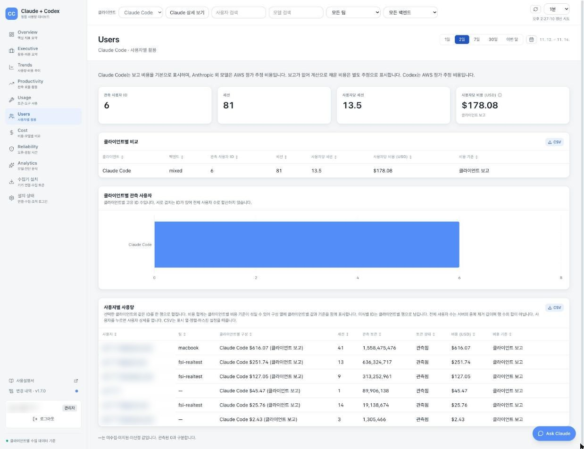
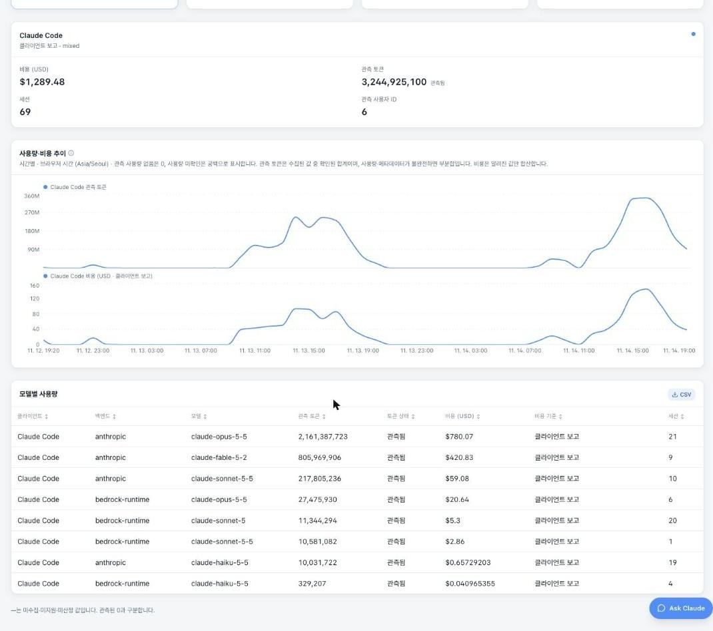
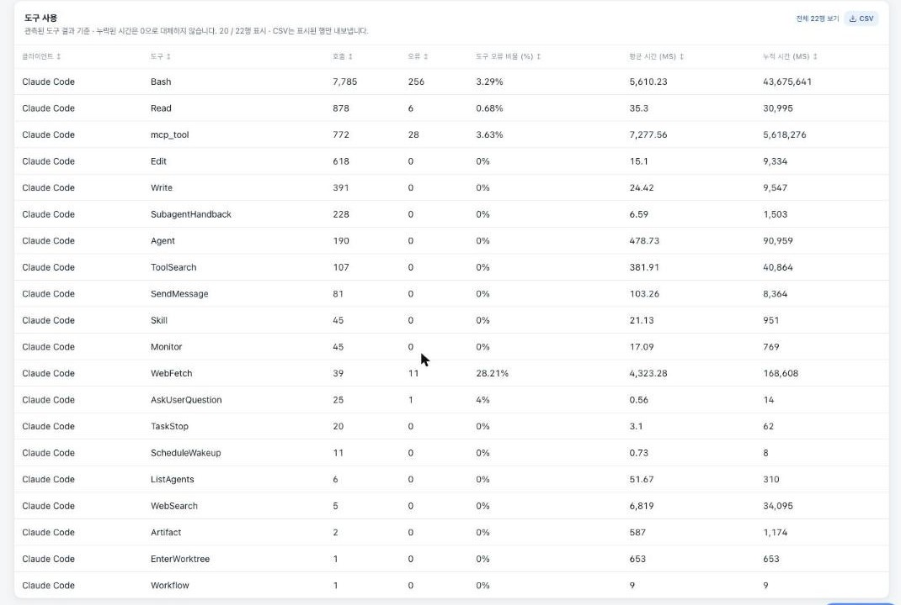
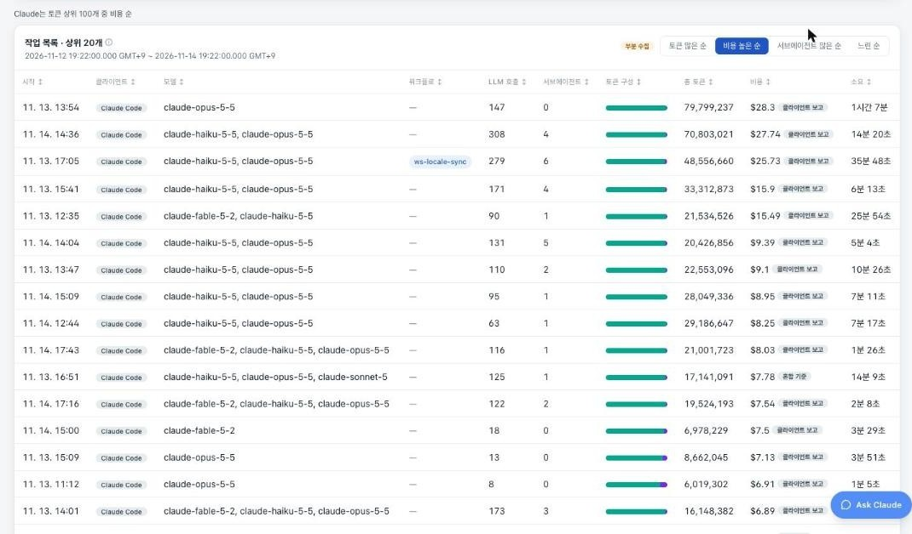
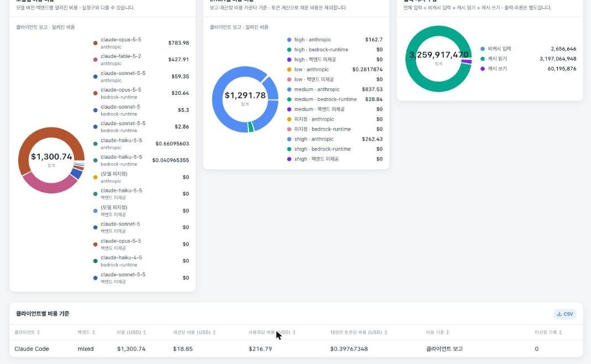
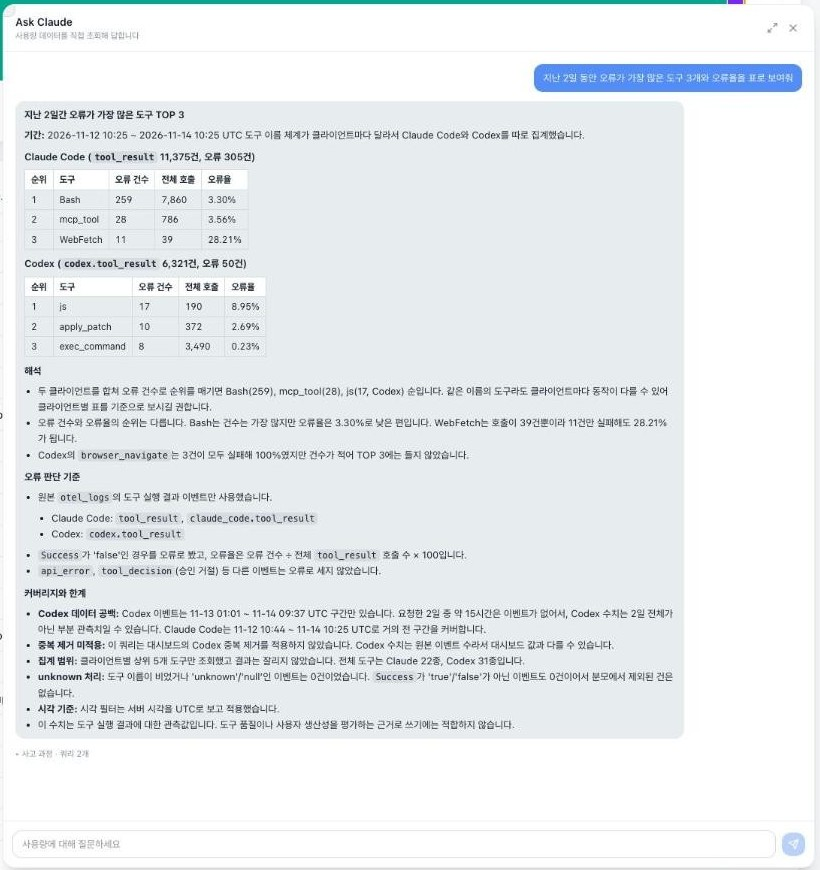
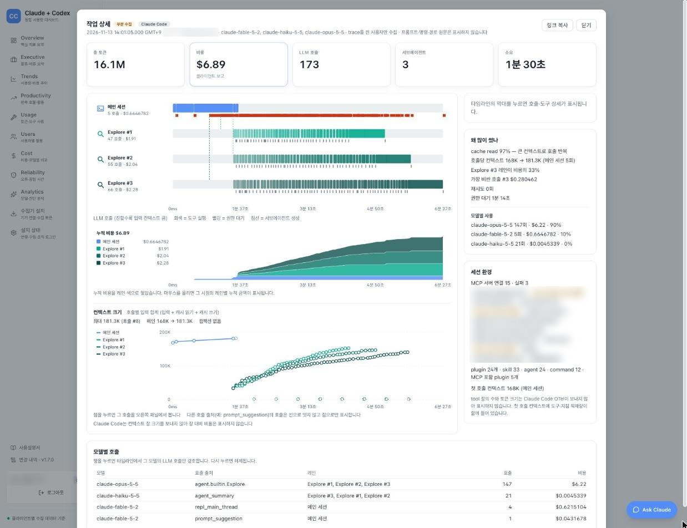

<!-- Slide 1: Cover -->
@type: cover
@background: linear-gradient(120deg, var(--surface-1) 0%, var(--surface-2) 70%, var(--surface-3) 100%)

# Chapter 6. 조직의 비용 보고 통제하기
## 쓴 만큼 보고, 넘치면 막는다 (Claude Code v2.1.319, 2026-11-08 리허설 검증)
Oh, Junseok
Sr. Solutions Architect
AWS Korea

:::script
(function(){function css(h){var has=[].some.call(document.querySelectorAll('link'),function(x){return x.getAttribute('href')===h;});if(has)return;var l=document.createElement('link');l.rel='stylesheet';l.href=h;document.head.appendChild(l);}css('assets/fsi.css');css('assets/ch6.css');if(!window.__fsiLoaded){window.__fsiLoaded=true;var s=document.createElement('script');s.src='assets/stepviz.js';document.head.appendChild(s);}})();
:::

:::notes
{timing: 0.5min}
[요약]
• Chapter 6 조직의 비용 보고 통제하기, 쓴 만큼 보고 넘치면 막는다
• Claude Code v2.1.319(2026-11-08 리허설 검증)와 Amazon Bedrock 기준
• 강의와 데모, 이어서 랩 TASK 01부터 03 (선택 TASK 04)

마지막 챕터에서는 조직이 쓴 비용을 보고,
필요할 때 한도로 통제하는 방법을 살펴보겠습니다.

{cue: transition}
사전 설문 결과부터 보겠습니다.
:::
---
<!-- Slide 2: Survey -->
@type: content
@fit: off

## 기대 주제 FinOps, 그리고 비용 가시화
사전 설문 결과로 정한 이 챕터의 목표

:::html

  

    PRE-SURVEY
    
26명

    
참가 확정자 <b>142명 중 26명</b>이 FinOps(모델 라우팅, 토큰 메터링, OTel 대시보드)를 기대 주제로 골랐습니다.

    
자유 의견에도 조직 사용 비용의 가시화, 사내 토큰 배분 정책을 묻는 질문이 있었습니다. 이 챕터는 OTel로 모은 사용량을 대시보드로 보고, 한도로 막는 법입니다.

  

  <figure class="shot">
    
    <figcaption>OTel로 모은 사용량, ccdash Users 화면 (랩 환경, 식별자 가림)</figcaption>
  </figure>

:::

:::script
(window.__fsiq = window.__fsiq || []).push(function (F) { F.countUp('#c6b-survey-num', 26, { suffix: '명' }); });
:::

:::notes
{timing: 1min}
[요약]
• 참가 확정자 142명 중 26명이 FinOps(모델 라우팅, 토큰 메터링, OTel 대시보드)를 기대 주제로 선택
• 자유 의견: 조직 사용 비용의 가시화, 사내 토큰 배분 정책
• 이 챕터는 OTel로 모은 사용량을 대시보드로 보고, 게이트웨이 한도로 막는 법

사전 설문에서 142분 중 26분이
FinOps를 기대 주제로 골라 주셨습니다.
자유 의견에도 조직의 비용을 파악하는 방법과
사내 토큰 배분 정책을 묻는 질문이 있었습니다.
오른쪽은 랩에서 OTel로 모은 사용량입니다.
사용자별 세션, 토큰, 추정 비용을 볼 수 있습니다.
이 데이터가 모이는 경로를 살펴보고,
게이트웨이 한도로 통제하는 방법까지 이어가겠습니다.

[출처]
• 이번 워크숍 사전 설문, 참가 확정자 142명 기준 (2026-11-14 집계)
• ccdash v1.7.0 Users 화면, 랩 환경 데이터 (사용자 식별자 가림)

{cue: transition}
그럼 순서부터 볼게요.
:::
---
<!-- Slide 3: Agenda -->
@type: content
@fit: off

## 강의와 데모, 그리고 랩
계측, 계약 단가, 게이트웨이 지출 한도의 순서

:::html

  

    
CHAPTER 06조직의 비용 통제OTel 대시보드, modelPricing, 게이트웨이 지출 한도강의와 데모

    
LAB / Ch6 LabTASK 01부터 03, 선택 TASK 04텔레메트리 경로, 그룹별 모델 정책, 지출 한도, 계약 단가강의 뒤 바로

  

  
MORE더 알아보기자주 묻는 세부 내용은 마지막에 모아 둡니다

:::

:::notes
{timing: 0.5min}
[요약]
• 강의와 데모를 짧게 하고, 이어서 랩
• OTel 계측, modelPricing, 게이트웨이 지출 한도
• 랩 TASK 01, TASK 02와 03, 선택 TASK 04

Bedrock 비용을 파악하는 방법부터 살펴보고,
계약 단가와 AWS 도구로 수치를 맞춰 보겠습니다.
이어서 게이트웨이의 그룹 정책과 한도를 다룹니다.
데모 뒤에는 TASK 01부터 03을 실습하고,
선택 TASK 04도 해 보실 수 있습니다.
:::
---
<!-- Slide 4: Part 02 divider -->
@type: content
@fit: off

:::html

  CHAPTER 06
  
조직의 비용 통제

  
쓴 만큼 보고, 넘치면 막는다

  <ol>
    <li><b>01</b>Bedrock에서 비용을 보는 법</li>
    <li><b>02</b>OTel 대시보드</li>
    <li><b>03</b>modelPricing과 AWS 쪽 도구</li>
    <li><b>04</b>Claude Apps Gateway (참가자 실습)</li>
  </ol>

:::

:::notes
{timing: 0.5min}
[요약]
• Chapter 6은 조직의 비용 통제, 쓴 만큼 보고 넘치면 막는다
• Bedrock 비용 보기, OTel 대시보드, modelPricing과 AWS 도구, Claude Apps Gateway 실습

Chapter 5에서는 개인이 덜 쓰는 방법을 봤습니다.
이제 조직이 사용량을 파악하고 통제할 차례입니다.
사용량을 사람과 팀에 연결해야
필요한 한도를 정할 수 있습니다.
계측으로 비용이 발생한 경로를 확인한 뒤,
게이트웨이로 한도를 적용해 보겠습니다.
:::
---
<!-- Slide 5: Cost by setup -->
@type: content
@fit: off

## Bedrock 가시성, 콘솔과 자체 계측뿐
셋업별 비용 관리 방법

:::html

  

    <button class="pick" data-key="bedrock">이 워크숍Amazon Bedrock</button>
    <button class="pick" data-key="team">구독Claude Team, Enterprise</button>
    <button class="pick" data-key="console">APIClaude Console</button>
  

  

    
<h4>Claude Team, Enterprise</h4>
지출 보기조직 Analytics

지출 한도관리 콘솔 지출 한도

사용자별CSV, Analytics API

    
<h4>Claude Console</h4>
지출 보기Console Usage

지출 한도Workspace limit

사용자별Claude Code Analytics API

    
<h4>Amazon Bedrock</h4>
지출 보기AWS 청구 콘솔

지출 한도AWS 예산 도구

사용자별IAM principal, 태그(CUR 2.0), OTel, 게이트웨이

사용자별로 보려면 클라우드 콘솔만으로는 부족하고, 직접 설치한 계측이 필요합니다.

  

:::

:::script
(window.__fsiq = window.__fsiq || []).push(function (F) { F.pick('c6-setup', { start: 0 }); });
:::

:::notes
{timing: 1min}
[요약]
• Amazon Bedrock: AWS 청구 콘솔, AWS 예산 도구, 사용자별은 IAM principal과 태그(CUR 2.0), OTel, 게이트웨이
• Claude Team, Enterprise: 조직 Analytics, 관리 콘솔 지출 한도, CSV와 Analytics API
• Claude Console: Console Usage, Workspace limit, Claude Code Analytics API

구성에 따라 비용을 보는 방법이 달라집니다.
이번 워크숍의 Bedrock 비용은 AWS 청구 콘솔로,
예산 알림은 AWS 예산 도구로 확인합니다.
사용자 구분에는 IAM principal과 CUR 2.0 태그,
OTel과 게이트웨이의 계측을 함께 살펴야 합니다.
{cue: demo}
다른 구성도 비교해 보겠습니다.↓
Claude Team과 Enterprise는 조직 Analytics와
관리 콘솔 지출 한도를 제공합니다.↓
Console은 Workspace limit과 Analytics API로
관리합니다. Bedrock에서는 별도 계측이 필요합니다.
:::
---
<!-- Slide 6: Bedrock reality -->
@type: content
@fit: off

:::html

  BEDROCK REALITY
  
Bedrock에는 <em>Analytics</em> 대시보드가 없습니다

  
계측을 설치해야 보이고, 설치하지 않은 사람은 잡히지 않습니다.

:::

:::notes
{timing: 0.5min}
[요약]
• Bedrock에는 Analytics 대시보드가 없음
• 계측을 설치해야 보이고, 설치하지 않은 사람은 잡히지 않음

{cue: pause}
화면의 Analytics는 Claude 조직 Analytics입니다.
Bedrock에는 이 대시보드가 없습니다.
AWS의 관측 도구와는 구분하시면 됩니다.
사람별 사용량은 별도 계측이 필요하며,
설정 누락이나 연결 장애가 있으면 빠질 수 있습니다.
그래서 OTel로 직접 계측합니다. 먼저 요청 하나가 어떻게 숫자가 되는지 볼게요.
:::
---
<!-- Slide 7: Prompt to dashboard scene -->
@type: content
@fit: off

## 프롬프트 하나가 대시보드 숫자가 되기까지
요청 하나가 남기는 기록의 길 (랩 환경 기준)

:::html

  

  

    

    

    <pre class="fs-code"></pre>
    

    
<i></i>

  

:::

:::script
import('./assets/flowscene.js').then(function (m) { m.mount('#c6-flow', {
  aria: '개발자 PC의 Claude Code가 지표와 이벤트를 PC 안의 수집기로 보내고, 수집기가 프롬프트 본문을 지운 뒤 조직이 고른 곳(CloudWatch, ClickHouse, 또는 파일로 내보낸 뒤 DuckDB로 조회)으로 내보내며, 대시보드가 이를 읽어 관리자 화면과 Ask Claude 답변을 만드는 흐름',
  zones: [
    { box: [-0.4, 0, 0, 9.2, 4.2, 0.4], label: '개발자 PC', labelAt: [-0.2, 0, -1.05] },
    { box: [11.0, 0, 0, 7.6, 4.2, 0.4], label: 'OTel 저장소 (조직이 선택)', labelAt: [11.2, 0, -1.05] },
    { box: [19.6, 0, 0, 7.8, 4.2, 0.4], label: '대시보드와 질문', labelAt: [19.8, 0, -1.05] }
  ],
  parts: {
    pc: { boxes: [[1.4, 1.2, 0.4, 1.8, 1.4, 0.8], [1.7, 2.4, 1.2, 1.2, 0.15, 1.0]] },
    col: { boxes: [[5.4, 1.3, 0.4, 1.4, 1.4, 1.3]], rings: [[[6.1, 2.0, 0.42], 34, 12]] },
    cw: { boxes: [[11.6, 1.4, 0.4, 1.6, 1.0, 1.1]] },
    ch: { boxes: [[13.9, 1.4, 0.4, 0.75, 1.0, 1.5], [14.75, 1.4, 0.4, 0.75, 1.0, 1.5]] },
    duck: { boxes: [[16.2, 1.4, 0.4, 1.6, 1.0, 0.9]] },
    api: { boxes: [[20.4, 1.2, 0.4, 1.8, 1.6, 1.4]] },
    bedrock: { boxes: [[24.6, 2.4, 0.4, 2.0, 1.6, 2.0]] }
  },
  icons: [
    { part: 'cw', at: [12.4, 1.9, 1.75], name: 'CloudWatch', size: 28 },
    { part: 'bedrock', at: [25.6, 3.2, 2.7], name: 'Bedrock', size: 34 }
  ],
  tags: [
    { id: 'evt', at: [6.6, 3.2, 3.4], text: 'api_request: model, 토큰, cost_usd', show: ['emit'], overview: false },
    { id: 'scrub', at: [6.6, 3.2, 3.4], text: 'prompt 본문 ✕  prompt_length만', show: ['scrub'], overview: false },
    { id: 'file', at: [15.4, 4.2, 2.6], text: 'file exporter → JSON 파일', show: ['cw'], overview: false },
    { id: 'sql', at: [22.6, 4.0, 3.6], text: 'SELECT … (읽기 전용)', show: ['ask'], overview: false }
  ],
  wires: {
    emit: { pts: [[3.2, 1.9, 1.0], [5.4, 2.0, 1.0]] },
    toch: { pts: [[6.8, 2.0, 1.1], [9.8, 2.0, 1.1], [13.4, 2.0, 1.1], [14.7, 1.9, 1.9]] },
    tocw: { pts: [[6.8, 1.6, 0.9], [9.8, 0.6, 0.9], [12.4, 0.6, 0.9], [12.4, 1.9, 1.5]], cls: 'fs-alt' },
    toduck: { pts: [[6.8, 2.4, 1.2], [9.8, 3.6, 1.2], [17.0, 3.6, 1.2], [17.0, 1.9, 1.3]], cls: 'fs-alt' },
    read: { pts: [[15.5, 1.9, 1.9], [18.8, 2.0, 1.6], [20.4, 2.0, 1.4]] },
    view: { pts: [[22.2, 1.6, 1.2], [23.0, 0.6, 1.6]] },
    ask: { pts: [[22.2, 2.4, 1.4], [24.6, 3.2, 1.4]] }
  },
  callouts: [
    { id: 'pc', n: 1, anchor: [2.3, 1.2, 1.2], at: [40, 440], title: '개발자 PC, Claude Code', sub: 'OTel은 managed settings로 켜짐' },
    { id: 'col', n: 2, anchor: [6.1, 1.3, 1.7], at: [110, 70], title: '수집기 (PC 안)', sub: 'loopback 4317, 디스크 큐' },
    { id: 'cw', n: 3, anchor: [12.4, 1.4, 0.9], at: [320, 470], title: 'Amazon CloudWatch', sub: 'AWS 관리형 로그와 지표' },
    { id: 'ch', n: 4, anchor: [14.7, 1.4, 1.9], at: [300, 40], title: 'ClickHouse', sub: '대량 분석, ccdash' },
    { id: 'duck', n: 5, anchor: [17.0, 1.4, 1.3], at: [490, 40], title: 'DuckDB', sub: 'JSON 파일을 조회' },
    { id: 'api', n: 6, anchor: [21.3, 1.2, 1.8], at: [600, 470], title: '대시보드 (ccdash 등)', sub: '저장소를 읽어 화면으로' },
    { id: 'bedrock', n: 7, anchor: [25.6, 2.4, 2.4], at: [680, 180], title: 'Amazon Bedrock', sub: 'Ask Claude: 질문을 SQL로' }
  ],
  figures: [
    { at: [0.6, 1.9, 0.4], scale: 0.9, pose: 'type', act: { start: 'type', emit: 'type' } },
    { at: [23.0, 0.4, 0.4], scale: 0.9, dir: -1, colour: 'var(--info)', act: { view: 'raise', ask: 'raise' } }
  ],
  code: [
    'CLAUDE_CODE_ENABLE_TELEMETRY=1',
    'OTEL_METRICS_EXPORTER=otlp',
    'OTEL_LOGS_EXPORTER=otlp',
    'OTEL_EXPORTER_OTLP_PROTOCOL=grpc',
    'OTEL_EXPORTER_OTLP_ENDPOINT=',
    '  http://localhost:4317',
    '# 이벤트 claude_code.api_request',
    '#   model, input_tokens, output_tokens,',
    '#   cache_read_tokens,',
    '#   cost_usd, duration_ms',
    '# 프롬프트 본문: 기본 미전송 (길이만)'
  ],
  overview: { label: '전체 그림', title: '내 PC에서 관리자 화면까지', say: '프롬프트를 보내면 Claude Code는 답과 별도로 <b>무엇을 얼마나 썼는지</b>를 기록합니다. 그 기록이 PC 안의 수집기를 거쳐 <b>조직이 고른 저장소</b>에 쌓이고, 대시보드의 숫자가 됩니다.' },
  phases: [
    { key: 'start', d: 2.6, focus: ['pc'], cam: ['pc', 'col'], zoom: 0.3, badge: 'pc', lines: [1], label: '1  입력', title: '개발자가 프롬프트를 보낸다', say: '정책으로 OTel이 켜진 PC에서는 개발자가 따로 할 일이 없습니다. 평소처럼 Claude Code를 쓰면 <b>사용 기록이 자동으로</b> 남습니다.' },
    { key: 'emit', d: 2.8, focus: ['pc', 'col'], cam: ['pc', 'col'], zoom: 0.3, badge: 'col', lines: [2, 3, 7, 8, 9, 10], packet: { wire: 'emit' }, label: '2  기록', title: '요청마다 이벤트, 1분마다 지표', say: '모델 호출 한 번마다 <b>api_request</b> 이벤트가 생기고 모델, 토큰, 추정 비용이 담깁니다. token.usage 같은 지표는 기본 1분마다 모아서 보냅니다.' },
    { key: 'scrub', d: 2.6, focus: ['col'], cam: ['col'], zoom: 0.28, badge: 'col', lines: [11], label: '3  지우기', title: '본문은 보내지 않는다', say: '프롬프트 본문은 <b>기본으로 보내지 않고 길이만</b> 남깁니다. 랩 수집기는 내보내기 전에 로그 본문을 지우는 규칙으로 한 번 더 막습니다.' },
    { key: 'store', d: 3.2, focus: ['col', 'cw', 'ch', 'duck'], badge: 'ch', lines: [4, 5, 6], packet: { wire: 'toch' }, label: '4  저장', title: '수집기, 조직이 고른 저장소로', say: '수집기는 OTLP로 받아 <b>조직이 고른 저장소</b>로 내보냅니다. 이번 랩 대시보드(ccdash)는 <b>ClickHouse</b>에 쌓고, 끊겨도 디스크 큐에 모아 두었다가 다시 보냅니다.' },
    { key: 'cw', d: 3.2, focus: ['col', 'cw', 'duck'], badge: 'cw', lines: [], packet: { wire: 'tocw', colour: 'var(--info)' }, label: '5  다른 선택', title: 'CloudWatch, DuckDB도 된다', say: 'AWS 안에서 끝내려면 <b>CloudWatch</b>입니다. 수집기의 <b>file exporter</b>로 JSON 파일을 남기고 <b>DuckDB</b>로 조회하는 방법도 있습니다. 이번 랩은 CloudWatch에도 함께 보냅니다.' },
    { key: 'view', d: 3.0, focus: ['ch', 'api'], badge: 'api', lines: [], packet: { wire: 'read' }, label: '6  화면', title: '대시보드가 읽어서 화면으로', say: 'ccdash 같은 대시보드가 저장소를 <b>읽기 쿼리</b>로 조회해 Overview, Users, Cost 화면을 만듭니다. 브라우저는 데이터베이스에 직접 붙지 않습니다.' },
    { key: 'ask', d: 3.4, focus: ['api', 'bedrock'], badge: 'bedrock', lines: [], packet: { wire: 'ask', mode: 'pingpong', colour: 'var(--success)' }, label: '7  질문', title: 'Ask Claude, 말로 묻고 표로 받기', say: '“오류가 많은 도구는?”처럼 물으면 Bedrock의 Claude가 <b>읽기 전용 SQL</b>로 조회하고, 표와 해석으로 답합니다.' }
  ]
}); });
:::

:::notes
{timing: 2min}
[요약]
• 요청 하나가 남기는 기록의 길: Claude Code, PC 안 수집기, OTel 저장소, 대시보드, Ask Claude
• 모델 호출마다 api_request 이벤트(모델, 토큰, cost_usd), 지표는 기본 1분마다 전송
• 프롬프트 본문은 기본 미전송(길이만), 랩 수집기는 내보내기 전에 로그 본문을 한 번 더 지움
• 저장소는 조직이 선택: CloudWatch(AWS 관리형), ClickHouse(대량 분석, ccdash), 수집기 file exporter의 JSON 파일을 DuckDB로 조회
• 수집기는 디스크 큐로 끊겨도 다시 보냄, 대시보드는 읽기 쿼리로 화면 구성

{cue: demo}
OTel을 켜면 실제로 무슨 일이 일어나는지, 요청 하나를 따라가 볼게요.↓
개발자는 평소처럼 Claude Code에 프롬프트를 보내요. 정책으로 이미 켜져 있으니까 따로 할 일은 없습니다.↓
모델을 한 번 부를 때마다 api_request라는 이벤트가 생기는데요, 여기에 모델, 토큰, 추정 비용이 담겨요. 토큰 사용량 같은 지표는 기본 1분마다 모아서 보냅니다.↓
금융권에서 제일 많이 물어보시는 게 이거예요. 프롬프트 본문은 기본으로 보내지 않고 길이만 남깁니다. 랩 수집기는 내보내기 전에 로그 본문을 지우는 규칙으로 한 번 더 막아요.↓
PC 안의 수집기가 이걸 받아서 조직이 고른 저장소로 보내요. 이번 랩 대시보드인 ccdash는 ClickHouse에 쌓고요, 연결이 잠깐 끊겨도 디스크에 모아 뒀다가 다시 보냅니다.↓
저장소는 정하시기 나름이에요. AWS 안에서 끝내려면 CloudWatch고요, 수집기가 JSON 파일로 남기게 한 뒤 DuckDB로 조회하는 방법도 있습니다. 이번 랩은 CloudWatch에도 같이 보내요.↓
ccdash 같은 대시보드가 저장소를 읽어서 관리자가 보는 화면을 만듭니다.↓
그리고 Ask Claude에 말로 물어보면, Bedrock의 Claude가 읽기 전용 SQL로 조회해서 표로 답해 줘요.

{cue: transition}
그럼 이걸 모두에게 어떻게 켜는지 보겠습니다.

[출처]
• code.claude.com/docs/en/monitoring-usage (metrics, events, 기본 미전송 항목, export interval)
• github.com/Atom-oh/claude-code-usage-dashboard (docs/architecture.md: loopback 4317 수집기, 디스크 큐, ClickHouse, Express)
• OpenTelemetry Collector Contrib, file exporter (OTLP JSON 파일로 내보내기), DuckDB read_json
:::
---
<!-- Slide 8: OTel by policy -->
@type: content
@fit: off

## 정책으로 켜는 OTel
managed settings env 한 블록이면 모두에게

:::html

:::

:::script
(window.__fsiq = window.__fsiq || []).push(function (F) {
  var MS = {id:'ms',x:50,y:60,w:320,h:90,t:'managed settings',s:'env 한 블록',c:'danger',icon:'lock'};
  var CC = {id:'cc',x:50,y:300,w:320,h:90,t:'Claude Code',s:'지표와 로그 생성',c:'accent',icon:'terminal'};
  var COL = {id:'col',x:460,y:300,w:320,h:90,t:'OTel 수집기',s:'OTLP 엔드포인트',c:'warning',icon:'pipe'};
  var DB = {id:'db',x:860,y:150,w:280,h:90,t:'대시보드',s:'팀별 집계',c:'info',icon:'chart'};
  var CW = {id:'cw',x:860,y:340,w:280,h:90,t:'CloudWatch',s:'랩 환경 이중 전송',c:'info',icon:'aws:CloudWatch'};
  var Z = [{x:20,y:20,w:1140,h:440,l:'텔레메트리 경로'}];
  var N = [MS, CC, COL, DB, CW];
  var env = ['"env": {','  "CLAUDE_CODE_ENABLE_TELEMETRY": "1",','  "OTEL_METRICS_EXPORTER": "otlp",','  "OTEL_LOGS_EXPORTER": "otlp",','  "OTEL_EXPORTER_OTLP_PROTOCOL": "http/protobuf",','  "OTEL_EXPORTER_OTLP_ENDPOINT":','    "https://otel.corp.example.internal",','  "OTEL_RESOURCE_ATTRIBUTES":','    "department=platform,team.id=core"','}'];
  F.stepviz('#c6-sv-otel', [
    {kicker:'STEP 1', title:'정책으로 켜면 모두가 계측됩니다',
     body:'OTel(OpenTelemetry)은 켜야 생깁니다. <b>managed settings의 env 한 블록</b>으로 배포하면 사용자가 끌 수 없고, 빠지는 사람이 없습니다.',
     facts:['CLAUDE_CODE_ENABLE_TELEMETRY: 1','managed settings로 배포','설치하지 않은 사람이 없게'],
     zones:Z, nodes:N, hot:['ms','cc'],
     edges:[{f:'ms',t:'cc',c:'danger',l:'env 배포',o:0}],
     snip:{hd:'managed-settings.json (env)',path:'OTel을 정책으로 켜기',lines:env,hl:[2],note:'엔드포인트는 예시 주소입니다.'}},
    {kicker:'STEP 2', title:'OTLP로 조직 수집기에 보냅니다',
     body:'지표와 로그를 <b>OTLP(OpenTelemetry 전송 규격), http/protobuf</b>로 조직이 정한 수집기 엔드포인트에 보냅니다.',
     facts:['OTEL_METRICS_EXPORTER: otlp','OTEL_LOGS_EXPORTER: otlp','목적지는 조직 수집기'],
     zones:Z, nodes:N, hot:['cc','col'],
     edges:[{f:'cc',t:'col',c:'warning',l:'OTLP, http/protobuf',o:0}], loop:true,
     snip:{hd:'managed-settings.json (env)',path:'내보내기 설정',lines:env,hl:[3,4,5,6,7],note:'목적지가 회사 안이라는 점이 Bedrock 경로의 장점입니다.'}},
    {kicker:'STEP 3', title:'대표 지표',
     body:'수집기에서 대시보드로 가는 대표 지표는 <b>token.usage, cost.usage, session.count</b>와 코드 산출물 지표입니다.',
     facts:['claude_code.token.usage','claude_code.cost.usage','claude_code.session.count','lines_of_code, commit, PR'],
     zones:Z, nodes:N, hot:['col','db'],
     edges:[{f:'cc',t:'col',c:'warning',o:0},{f:'col',t:'db',c:'info',l:'지표',o:1}], loop:true,
     snip:{hd:'대표 지표',path:'OTel metrics',lines:['claude_code.token.usage','claude_code.cost.usage','claude_code.session.count','claude_code.lines_of_code.count','claude_code.commit.count','claude_code.pull_request.count'],hl:[1,2,3],note:'cost.usage는 추정 비용입니다. 정산은 AWS입니다.'}},
    {kicker:'STEP 4', title:'resource 속성으로 팀별 집계',
     body:'<b>OTEL_RESOURCE_ATTRIBUTES</b>에 부서와 팀을 넣으면 대시보드에서 <b>팀별로 집계</b>할 수 있습니다.',
     facts:['department=platform','team.id=core','팀마다 다른 값으로 배포'],
     zones:Z, nodes:N, hot:['ms','db'],
     edges:[{f:'col',t:'db',c:'info',l:'팀별',o:0}],
     snip:{hd:'managed-settings.json (env)',path:'팀 속성',lines:env,hl:[8,9],note:'값은 예시입니다. 팀별 managed settings로 다르게 배포합니다.'}},
    {kicker:'LAB', title:'랩 환경은 두 곳으로 보냅니다',
     body:'이번 랩 환경은 <b>otelcol</b>이 받아 내보내기 전에 <b>scrub_logs</b>로 프롬프트 본문을 지우고, <b>CloudWatch와 중앙 대시보드</b>로 이중 전송합니다.',
     facts:['otelcol, fanout 타이머 active','scrub_logs: 내보내기 전 프롬프트 본문 삭제','exporters: CloudWatch + 중앙 대시보드'],
     zones:Z, nodes:[MS, CC, {id:'col',x:460,y:300,w:320,h:90,t:'otelcol',s:'scrub_logs로 본문 삭제',c:'warning',icon:'pipe'}, {id:'db',x:860,y:150,w:280,h:90,t:'중앙 대시보드',s:'이틀간 사용량',c:'info',icon:'chart'}, CW], hot:['cc','col','db','cw'],
     edges:[{f:'cc',t:'col',c:'warning',o:0},{f:'col',t:'db',c:'info',o:1},{f:'col',t:'cw',c:'info',o:1}], loop:true,
     snip:{hd:'TASK 01에서 확인',path:'랩 환경',lines:['# settings.json의 OTEL_* 환경 변수','# otelcol, fanout 타이머 active','# scrub_logs: 프롬프트 본문 삭제 규칙','# exporters: CloudWatch + 중앙 대시보드'],hl:[],note:'프롬프트 본문을 <b>내보내기 전에 지우는</b> 규칙이 금융권 운영의 기본입니다.'}}
  ], {legend:[['danger','관리자가 강제'],['accent','Claude Code'],['warning','수집기'],['info','보는 곳']]});
});
:::

:::notes
{timing: 1.5min}
[요약]
• managed settings env 한 블록으로 OTel을 모두에게 켬 (CLAUDE_CODE_ENABLE_TELEMETRY 1)
• OTLP http/protobuf로 조직 수집기 엔드포인트에 지표와 로그 전송
• 대표 지표: claude_code.token.usage, cost.usage, session.count, lines_of_code, commit, PR
• OTEL_RESOURCE_ATTRIBUTES로 팀별 집계
• 랩 환경: otelcol, scrub_logs로 프롬프트 본문 삭제, CloudWatch와 중앙 대시보드 이중 전송

{cue: demo}
managed settings의 env로 OTel을 켭니다.
사용자가 끌 수 없는 정책으로 배포하되,
수집기 연결과 실제 수신도 확인해야 합니다.↓
OTLP로 조직 수집기에 지표와 로그를 보냅니다.↓
토큰과 추정 비용, 세션 수로 사용량을 보고,
코드 줄 수와 커밋, PR도 함께 집계합니다.↓
resource 속성에 부서와 팀을 넣으면
팀별로 나누어 볼 수 있습니다.↓
랩에서는 otelcol이 프롬프트 본문을 지운 뒤,
CloudWatch와 중앙 대시보드로 보냅니다.
이 경로를 TASK 01에서 확인하겠습니다.

[약어]
• OTLP: OpenTelemetry Protocol
:::
---
<!-- Slide 9: What OTel sends -->
@type: content
@fit: off

## OTel이 보내는 것, 보내지 않는 것
지표와 이벤트는 전송, 본문은 기본 미전송

:::html

  

    지표 (기본 1분마다)
    <h4>숫자로 쌓이는 8가지</h4>
    <ul>
      <li><code>token.usage</code> 입력, 출력, 캐시 읽기, 캐시 쓰기</li>
      <li><code>cost.usage</code> 추정 비용 (USD)</li>
      <li><code>session.count</code>, <code>active_time.total</code></li>
      <li><code>lines_of_code.count</code>, <code>commit.count</code>, <code>pull_request.count</code></li>
      <li><code>code_edit_tool.decision</code> 편집 허용, 거부</li>
    </ul>
  

  

    이벤트 (기본 5초마다)
    <h4>한 건씩 남는 기록</h4>
    <ul>
      <li><code>api_request</code> 모델, 토큰, cost_usd, 걸린 시간</li>
      <li><code>tool_result</code> 도구 이름, 성공 여부, 걸린 시간</li>
      <li><code>tool_decision</code> 허용, 거부와 그 출처</li>
      <li><code>user_prompt</code> 프롬프트 <b>길이</b></li>
      <li><code>api_error</code> 상태 코드, 재시도</li>
    </ul>
  

  

    기본으로 보내지 않음
    <h4>켜야만 나가는 내용</h4>
    <ul>
      <li>프롬프트 본문 <code>OTEL_LOG_<wbr>USER_PROMPTS</code></li>
      <li>도구 인자 <code>OTEL_LOG_<wbr>TOOL_DETAILS</code></li>
      <li>응답 본문 <code>OTEL_LOG_<wbr>ASSISTANT_RESPONSES</code></li>
      <li>API 원문 <code>OTEL_LOG_<wbr>RAW_API_BODIES</code></li>
    </ul>
    
금융권 운영은 이 스위치를 <b>끈 채로</b> 두고, 수집기에서 한 번 더 지웁니다.

  

  
모든 지표 이름 앞에는 <code>claude_code.</code>가 붙습니다. 비용 지표는 추정치이고, 정산은 AWS 청구서가 기준입니다.

:::

:::notes
{timing: 1min}
[요약]
• 지표 8가지(기본 1분 간격): token.usage, cost.usage, session.count, active_time, lines_of_code, commit, PR, code_edit_tool.decision
• 이벤트(기본 5초 간격): api_request, tool_result, tool_decision, user_prompt(길이), api_error
• 기본 미전송: 프롬프트 본문, 도구 인자, 응답 본문, API 원문. 각각 스위치를 켜야만 전송
• 비용 지표는 추정치, 정산 기준은 AWS 청구서

그럼 OTel로 정확히 뭐가 나가는지 볼게요.
왼쪽은 지표예요. 토큰, 추정 비용, 세션 수, 코드 줄 수와 커밋, PR 같은 숫자 여덟 가지가 기본 1분마다 쌓입니다.
가운데는 이벤트인데요, 모델 호출이나 도구 실행 한 건마다 남는 기록이에요. 대시보드에서 어떤 도구가 자주 실패하는지 같은 건 여기서 나옵니다.
오른쪽이 제일 중요해요. 프롬프트 본문, 도구 인자, 응답 본문은 기본으로 보내지 않습니다. 스위치를 켜야만 나가요. 금융권에서는 이 스위치를 끈 채로 두고, 수집기에서 한 번 더 지우시면 됩니다.
{cue: pause}
그리고 비용 지표는 추정치예요. 정산은 AWS 청구서가 기준입니다.

[출처]
• code.claude.com/docs/en/monitoring-usage (Available metrics, Events, Privacy and content logging, Cost metrics are approximations)
:::
---
<!-- Slide 10: ccdash architecture -->
@type: content
@fit: off

## ccdash, 워크숍 사용량 대시보드
OTel을 받아 쌓고, 화면과 질문으로 보여 주는 구조

:::html

:::

:::script
(window.__fsiq = window.__fsiq || []).push(function (F) {
  var PC = {id:'pc',x:40,y:60,w:260,h:90,t:'Claude Code',s:'참가자 PC',c:'accent',icon:'terminal'};
  var COL = {id:'col',x:40,y:320,w:260,h:90,t:'수집기',s:'loopback 4317, 디스크 큐',c:'warning',icon:'pipe'};
  var CH = {id:'ch',x:410,y:320,w:280,h:90,t:'ClickHouse',s:'지표, 로그, 시간별 롤업',c:'info',icon:'server'};
  var API = {id:'api',x:410,y:60,w:280,h:90,t:'ccdash',s:'Express API + React 화면',c:'info',icon:'chart'};
  var CF = {id:'cf',x:820,y:60,w:320,h:90,t:'Amazon CloudFront',s:'브라우저 HTTPS 접속',c:'success',icon:'aws:CloudFront'};
  var BD = {id:'bd',x:820,y:320,w:320,h:90,t:'Amazon Bedrock',s:'Ask Claude가 SQL을 작성',c:'accent',icon:'aws:Bedrock'};
  var Z = [{x:20,y:20,w:300,h:420,l:'참가자 PC'},{x:390,y:20,w:320,h:420,l:'EKS',tone:'info'}];
  var N = [PC, COL, CH, API, CF, BD];
  var col = ['# collector-config.yaml (요약)','receivers:','  otlp: grpc 127.0.0.1:4317, http 4318','processors:','  Claude Code 지표 8개만 허용','  로그 본문은 지우고 내보냄','exporters:','  clickhouse: 디스크 큐, 재시도'];
  F.stepviz('#c6-sv-dash', [
    {kicker:'OVERVIEW', title:'받고, 쌓고, 보여 주고, 답한다',
     body:'ccdash는 이 워크숍을 위해 만든 <b>사용량 대시보드</b>입니다. GitHub에서 소스를 볼 수 있지만 라이선스는 proprietary라 사용과 복제는 별도 허락이 필요합니다. 참가자 PC의 수집기가 보낸 OTel을 ClickHouse에 쌓고, 화면과 Ask Claude로 보여 줍니다.',
     facts:['github.com/Atom-oh/claude-code-usage-dashboard (proprietary)','Claude Code와 Codex 사용량','숫자는 관측값과 추정치, 청구서가 아님'],
     zones:Z, nodes:N,
     edges:[{f:'pc',t:'col',c:'accent',o:0},{f:'col',t:'ch',c:'warning',o:1},{f:'ch',t:'api',c:'info',o:2},{f:'api',t:'cf',c:'success',o:3},{f:'api',t:'bd',c:'accent',o:3}],
     loop:true, stagger:0.6,
     snip:{hd:'구성 요소',path:'docs/architecture.md',lines:['Claude Code  → 수집기 (PC 안)','수집기       → ClickHouse','ClickHouse   → Express API, React','브라우저     → CloudFront → API','Ask Claude   → Amazon Bedrock'],hl:[],note:'브라우저는 ClickHouse에 <b>직접 붙지 않습니다</b>. 모든 조회는 API를 거칩니다.'}},
    {kicker:'STEP 1', title:'수집: PC 안의 수집기가 먼저 받는다',
     body:'Claude Code는 같은 PC의 <b>loopback 4317</b>로 보냅니다. 수집기는 Claude Code 지표 여덟 개만 통과시키고, 로그 본문은 지운 뒤 내보냅니다.',
     facts:['OTLP gRPC 4317, HTTP 4318','지표 허용 목록','디스크 큐, 끊겨도 다시 보냄'],
     zones:Z, nodes:N, hot:['pc','col','ch'],
     edges:[{f:'pc',t:'col',c:'accent',l:'OTLP',o:0},{f:'col',t:'ch',c:'warning',l:'내보내기',o:1}], loop:true, stagger:0.7,
     snip:{hd:'수집기 설정',path:'collector-config.yaml',lines:col,hl:[2,3,4,5,6]}},
    {kicker:'STEP 2', title:'저장: ClickHouse와 시간별 롤업',
     body:'원본 지표와 로그는 <b>ClickHouse</b>에 쌓이고, 지표는 시간별 롤업 표로도 모입니다. 긴 기간 화면은 롤업을 읽어 빠르게 그립니다.',
     facts:['원본: 지표, 로그, 선택 시 트레이스','롤업: 시간별 지표','기본 2일, 최대 90일 범위'],
     zones:Z, nodes:N, hot:['ch','api'],
     edges:[{f:'ch',t:'api',c:'info',l:'읽기 쿼리',o:0}], loop:true,
     snip:{hd:'화면 범위',path:'환경 변수',lines:['DEFAULT_RANGE_DAYS=2','RANGE_CAP_DAYS=90','PII_MASK_ENABLED  # 화면, CSV, 채팅 가림', '                  # 표시용, 권한 경계 아님'],hl:[1,2],note:'이 워크숍 화면도 <b>최근 2일</b>이 기본입니다.'}},
    {kicker:'STEP 3', title:'화면: 로그인한 사람만, 역할대로',
     body:'관리자는 브라우저로 <b>CloudFront</b>를 거쳐 접속합니다. ccdash의 조직 OIDC 로그인(선택)을 켜면 viewer, analyst, admin 그룹대로 볼 수 있는 범위가 나뉩니다.',
     facts:['Overview, Users, Usage, Cost 등 메뉴','조직 OIDC(선택), viewer / analyst / admin','식별자 가림은 표시용, 권한 경계 아님'],
     zones:Z, nodes:N, hot:['api','cf'],
     edges:[{f:'api',t:'cf',c:'success',l:'HTTPS',o:0}], loop:true,
     snip:{hd:'메뉴',path:'ccdash 왼쪽 메뉴',lines:['Overview    핵심 지표 요약','Users       사용자별 활동','Usage       토큰, 도구 사용','Cost        비용, 모델별 비교','Reliability 오류, 응답 시간','Analytics   모델, 진단 분석'],hl:[1,2,3,4]}},
    {kicker:'STEP 4', title:'Ask Claude: 말로 묻고 표로 받기',
     body:'질문을 하면 Bedrock의 Claude가 <b>SQL을 작성해 읽기 전용으로</b> 조회하고, 표와 해석, 데이터의 한계까지 함께 답합니다.',
     facts:['인증된 사용자만 사용','읽기 전용 ClickHouse 세션','답에 쿼리와 커버리지 한계 표시'],
     zones:Z, nodes:N, hot:['api','bd'],
     edges:[{f:'api',t:'bd',c:'accent',l:'SQL 도구',o:0}], loop:true,
     snip:{hd:'예시 질문',path:'Ask Claude',lines:['지난 2일 동안 오류가 가장 많은','도구 3개와 오류율을 표로 보여줘'],hl:[1,2],note:'답의 숫자는 <b>관측값</b>입니다. 도구 품질이나 사람의 생산성 평가에 쓰지 않습니다.'}}
  ], {legend:[['accent','Claude Code, Bedrock'],['warning','수집기'],['info','저장, API'],['success','접속']]});
});
:::

:::notes
{timing: 1.5min}
[요약]
• ccdash: 이 워크숍용 사용량 대시보드, GitHub에서 소스 열람 가능 (라이선스 proprietary, 사용과 복제는 별도 허락)
• 수집: PC 안 수집기(loopback 4317)가 Claude Code 지표 8개만 통과, 로그 본문 삭제, 디스크 큐
• 저장: ClickHouse 원본과 시간별 롤업, 기본 2일, 최대 90일
• 화면: CloudFront로 접속, 조직 OIDC와 viewer, analyst, admin 그룹
• Ask Claude: Bedrock의 Claude가 읽기 전용 SQL로 조회, 숫자는 관측값이고 평가 근거가 아님

{cue: demo}
이번 워크숍에서 쓰는 대시보드가 ccdash예요. GitHub에서 소스를 보실 수는 있는데, 라이선스가 proprietary라서 가져다 쓰시려면 별도 허락이 필요합니다. 받고, 쌓고, 보여 주고, 답하는 네 단계로 볼게요.↓
먼저 수집이에요. Claude Code는 같은 PC 안의 수집기로 보내고, 수집기는 Claude Code 지표 여덟 개만 통과시키고 로그 본문은 지운 뒤 내보냅니다.↓
저장은 ClickHouse예요. 원본과 시간별 롤업이 따로 있어서 긴 기간도 빠르게 그립니다. 화면은 기본 최근 2일이에요.↓
화면은 CloudFront를 거쳐 접속하고, 조직 OIDC 로그인을 켜면 역할대로 볼 수 있는 범위가 나뉩니다.↓
마지막이 Ask Claude예요. 말로 물으면 Bedrock의 Claude가 읽기 전용 SQL로 조회해서 표로 답해 줍니다. 다만 이 숫자는 관측값이라서, 사람의 생산성을 평가하는 데 쓰시면 안 돼요.

[출처]
• github.com/Atom-oh/claude-code-usage-dashboard (README, docs/architecture.md)
:::
---
<!-- Slide 11: ccdash tour -->
@type: content
@fit: off

## ccdash 화면 둘러보기
스크롤하고, 눌러 보면 보이는 것들 (리허설 데이터, 식별자 가림)

:::html

  

    <button class="pick" data-key="ov">Overview추이와 모델별 사용량</button>
    <button class="pick" data-key="tool">Usage도구별 호출과 오류율</button>
    <button class="pick" data-key="task">Users작업 목록, 비용 높은 순</button>
    <button class="pick" data-key="cost">Cost모델, effort, 캐시 구성</button>
    <button class="pick" data-key="ask">Ask Claude말로 묻고 표로 받기</button>
  

  

    <figure data-for="ov"><figcaption>피크는 실습을 돌린 구간입니다. 아래 표에서 어느 모델이 비용을 만들었는지 바로 보입니다.</figcaption></figure>
    <figure data-for="tool"><figcaption>Bash가 가장 많이 불리고, WebFetch는 호출은 적어도 오류율이 높습니다.</figcaption></figure>
    <figure data-for="task"><figcaption>정렬 탭을 <b>비용 높은 순</b>으로 바꾸면 비싼 작업이 위로 올라옵니다. 행을 누르면 작업 상세가 열립니다.</figcaption></figure>
    <figure data-for="cost"><figcaption>입력 토큰 대부분이 캐시 읽기입니다. Ch5에서 본 캐시가 실제로 일하고 있다는 뜻입니다.</figcaption></figure>
    <figure data-for="ask"><figcaption>질문 하나에 표, 해석, 판단 기준, 데이터의 한계까지 함께 돌아옵니다.</figcaption></figure>
  

:::

:::script
(window.__fsiq = window.__fsiq || []).push(function (F) { F.pick('c6-tour', { start: 0 }); });
:::

:::notes
{timing: 2min}
[요약]
• Overview: 시간별 토큰과 비용 추이, 모델별 사용량 표 (리허설 데이터)
• Usage: 도구별 호출, 오류, 오류율 (Bash 최다, WebFetch 오류율 높음)
• Users: 작업 목록 정렬 탭(토큰, 비용, 서브에이전트, 느린 순), 행을 누르면 작업 상세
• Cost: 모델별, effort와 백엔드별 비용, 입력 토큰 구성(캐시 읽기가 대부분)
• Ask Claude: 질문 하나에 표, 해석, 판단 기준, 커버리지 한계

{cue: demo}
데모 전에 화면을 미리 한 번 볼게요. Overview를 내려 보면 시간별 추이가 나오는데요, 솟은 구간이 실습을 돌린 때예요. 아래 표에서 어느 모델이 비용을 만들었는지 바로 보입니다.↓
Usage에서는 도구별로 봐요. Bash가 가장 많이 불리고, WebFetch는 호출은 적어도 오류율이 높죠.↓
Users에서 사용자를 누르면 작업 목록이 나오는데요, 정렬을 비용 높은 순으로 바꾸면 비싼 작업이 위로 올라옵니다. 행을 누르면 작업 상세가 열려요.↓
Cost에서는 입력 토큰 구성을 꼭 보세요. 대부분이 캐시 읽기예요. Chapter 5에서 본 캐시가 실제로 일하고 있다는 뜻입니다.↓
마지막으로 Ask Claude에 물어봤어요. 오류가 많은 도구 세 개를 표로 달라고 했더니, 표와 해석에 판단 기준, 데이터의 한계까지 같이 답해 줍니다.

{cue: transition}
이제 실제 대시보드를 같이 열어 보겠습니다.

[출처]
• ccdash 화면 캡처, 리허설 데이터 (github.com/Atom-oh/claude-code-usage-dashboard), 로그인 이름은 가림
:::
---
<!-- Slide 12: Demo dashboard -->
@type: content
@fit: off

## 이틀간 우리가 쓴 토큰
DEMO, 강사 대시보드 (URL은 현장 안내)

:::html

  
DEMO

  <ol class="steps">
    <li><b>1</b>랩 환경은 Day 1부터 OTel 수집 중 (참가 안내문 고지)</li>
    <li><b>2</b>전체 토큰, 비용 추이, Capstone 구간 피크 확인</li>
    <li><b>3</b>모델별, 도구별 분포, 캐시 적중률</li>
    <li><b>4</b>내 참가자 ID로 내 사용량 찾기</li>
    <li><b>5</b>가장 비용이 컸던 패턴을 Ch5의 원리로 해석</li>
  </ol>
  
화면에는 참가자 ID만 표시합니다. 회사별 사용량은 노출하지 않습니다.

  <figure class="shot">
    
    <figcaption>작업 상세: 레인별 호출, 누적 비용, 비용이 커진 이유 (식별자 가림)</figcaption>
  </figure>

:::

:::notes
{timing: 10min}
{cue: demo}
[요약]
• 강사 대시보드(URL은 현장 안내), 랩 환경은 Day 1부터 OTel 수집 중 (참가 안내문에 고지)
• 전체 추이와 Capstone 피크, 모델별과 도구별 분포, 캐시 적중률, 내 참가자 ID로 찾기
• 가장 비용이 컸던 패턴을 Ch5의 원리로 해석
• 화면에는 참가자 ID만, 회사별 사용량은 노출하지 않음

참가 안내문에 고지한 대로 랩에서는
Day 1부터 OTel을 수집하고 있습니다.
이틀간 수집된 사용량의 전체 추이를 보며,
Capstone 구간에서 사용량이 늘어난 지점을
찾아보겠습니다.
모델과 도구별 분포, 캐시 적중률을 살펴본 뒤,
참가자 ID로 본인 사용량을 찾아보시면 됩니다.
값이 없으면 계측 연결도 확인하시면 됩니다.
비용이 컸던 패턴은 Chapter 5의 원리로 해석합니다.
화면에는 참가자 ID만 표시하며,
회사별 사용량은 보여 드리지 않습니다.
:::
---
<!-- Slide 13: modelPricing -->
@type: content
@fit: off

## 추정 비용을 청구서에 가깝게
계약 단가로 보여 주는 modelPricing

:::html

  

    
managed-settings.json

    <pre class="c6-code">{  "modelPricing": {    "multiplier": 0.9  }}# /usage, Total cost … at your organization's configured rates</pre>
    <ul>
      <li>managed settings에서만 유효 (v2.1.242+)</li>
      <li>multiplier가 1보다 작으면 할인, 크면 할증</li>
      <li>모델별 단가는 overrides로</li>
      <li><b>표시만 바꿈, 청구는 그대로</b></li>
      <li>숫자는 계약 단가를 입력</li>
    </ul>
  

  

    

      
목록가 기준 추정 (예시 세션)<b>$0.55</b>

      <input type="range" min="0.5" max="1.5" step="0.05" value="0.9" id="c6-price-in" aria-label="modelPricing multiplier">
      
multiplier<b id="c6-price-m">0.90</b>

      
$0.50

      
예시: 원리 1의 /usage 세션 $0.55에 배수를 곱한 표시 금액입니다.

    

    
실제 정산은 AWS 청구서입니다. modelPricing은 /usage와 대시보드의 숫자를 청구서에 가깝게 맞추는 표시 설정입니다.

  

:::

:::script
(window.__fsiq = window.__fsiq || []).push(function (F) {
  var inp = document.getElementById('c6-price-in');
  function draw() {
    var m = +inp.value;
    document.getElementById('c6-price-m').textContent = m.toFixed(2);
    document.getElementById('c6-price-out').textContent = '$' + (0.55 * m).toFixed(2);
    document.getElementById('c6-price-line').textContent = '    "multiplier": ' + (+m.toFixed(2));
  }
  inp.addEventListener('input', draw);
  inp.addEventListener('change', function () { inp.blur(); });
  F.onEnter(inp, function () { inp.value = 0.9; draw(); });
  draw();
});
:::

:::notes
{timing: 1min}
[요약]
• managed-settings.json modelPricing.multiplier로 계약 단가를 표시 (managed settings에서만, v2.1.242+)
• 1보다 작으면 할인, 크면 할증, 모델별 단가는 overrides
• 표시만 바꾸고 청구는 그대로, 숫자는 계약 단가로

/usage와 대시보드 비용은 목록가 기준 추정치입니다.
계약 단가가 다르면 청구서와 차이가 납니다.
modelPricing으로 표시 단가를 맞춥니다.
{cue: demo}
multiplier를 바꿔 보겠습니다.
원리 1의 0.55달러 세션에 0.9를 곱하면
0.50달러로 표시됩니다.
1보다 작으면 할인, 크면 할증을 반영하고,
모델별 차이는 overrides로 설정합니다.
managed settings에서만 적용되며,
표시를 바꿀 뿐 실제 청구는 바꾸지 않습니다.
정산은 AWS 청구서와 대사하시면 됩니다.
:::
---
<!-- Slide 14: AWS side tools -->
@type: content
@fit: off

## AWS 쪽에서 보는 비용
Claude Code 계측과 별개로 계정에서 보이는 것, 둘을 대사

:::html

  

    
01Application inference profile 태그Ch2의 modelOverrides로 팀별 경로를 만들고 Cost Explorer에서 봅니다.

    
02AWS Budgets계정, 태그 단위 예산 알람

    
03전용 AWS 계정Claude Code 비용을 계정 경계로 분리 (공식 권장)

    
04TPM 쿼터라이브 교육 같은 동시 사용 급증은 사전 증액

  

:::

:::notes
{timing: 0.5min}
[요약]
• Application inference profile 태그: Ch2 modelOverrides로 팀별 경로, Cost Explorer
• AWS Budgets: 계정과 태그 단위 예산 알람
• 전용 AWS 계정으로 비용 분리 (공식 권장)
• TPM 쿼터: 동시 사용 급증은 사전 증액
• Claude Code 계측과 AWS 쪽 숫자를 대사해야 정확

Claude Code 계측은 AWS 계정의 비용과 대사합니다.
Ch2의 modelOverrides로 팀별 경로를 만들고,
application inference profile의 태그를
Cost Explorer에서 나누어 볼 수 있습니다.
AWS Budgets는 계정과 태그 단위로 알림을 줍니다.
전용 AWS 계정으로 비용을 분리하는 것이
공식 권장 방식입니다.
동시 사용이 몰리는 교육은 TPM 쿼터도
미리 증액해 두셔야 합니다.

[약어]
• TPM: Tokens Per Minute
:::
---
<!-- Slide 15: Claude Apps Gateway -->
@type: content
@fit: off

## Bedrock 앞단의 게이트웨이
Claude Apps Gateway, 공식 구성과 이번 랩 구성

:::html

  ALB
  ECS Fargate
  RDS
  Bedrock
  Route 53
  Cognito
  CloudFront

:::

:::script
(window.__fsiq = window.__fsiq || []).push(function (F) {
  var DEV = {id:'dev',x:40,y:200,w:230,h:96,t:'개발자',s:'/login, 디바이스 인증',c:'accent',icon:'user'};
  var ALB = {id:'alb',x:320,y:200,w:230,h:96,t:'Internal ALB',s:'IPv4 전용, idle 3600초',c:'info',icon:'aws:Elastic-Load-Balancing'};
  var GW = {id:'gw',x:600,y:200,w:260,h:96,t:'게이트웨이',s:'ECS Fargate, RDS PostgreSQL',c:'warning'};
  var BR = {id:'br',x:910,y:200,w:230,h:96,t:'Amazon Bedrock',s:'IAM 역할로 호출',c:'info',icon:'aws:Bedrock'};
  var IDP = {id:'idp',x:600,y:50,w:260,h:84,t:'OIDC IdP',s:'SSO, 그룹',c:'success',icon:'badge'};
  var OT = {id:'ot',x:600,y:360,w:260,h:84,t:'OTLP 중계',s:'텔레메트리',c:'muted',icon:'pipe'};
  var Z = [{x:20,y:20,w:1140,h:440,l:'사설망 (PRIVATE ONLY)',tone:'info'}];
  var N = [DEV, ALB, GW, BR, IDP, OT];
  F.stepviz('#c6-sv-gw', [
    {kicker:'OVERVIEW', title:'SSO, 그룹 정책, 지출 한도를 한곳에서',
     body:'Claude Apps Gateway는 Bedrock 앞단에 <b>직접 운영하는</b> 게이트웨이로, SSO(Single Sign-On) 로그인, IdP(사내 인증 시스템) 그룹별 모델과 정책, 사용자별 지출 한도, OTLP 중계를 맡습니다.',
     facts:['SSO 로그인','IdP 그룹별 모델과 정책','사용자별 지출 한도','OTLP 중계'],
     zones:Z, nodes:N, hot:['dev','gw','br','idp','ot'],
     edges:[{f:'dev',t:'gw',c:'accent',side:'b',curve:70,o:0},{f:'gw',t:'idp',c:'success',o:1},{f:'gw',t:'br',c:'info',o:2},{f:'gw',t:'ot',c:'muted',o:2}],
     snip:{hd:'claude 바이너리에 포함',path:'게이트웨이 실행',lines:['claude gateway --config gateway.yaml'],hl:[1],note:'별도 제품 설치가 아니라 <b>claude 바이너리의 하위 명령</b>입니다.'}},
    {kicker:'STEP 1', title:'개발자: /login으로 정책을 받습니다',
     body:'개발자는 <b>/login</b>으로 디바이스 인증을 하고, 소속 그룹에 맞는 정책을 받습니다.',
     facts:['/login, 디바이스 인증','그룹별 정책 수신','로그인 브라우저도 사설망 안에'],
     zones:Z, nodes:N, hot:['dev','alb','gw','idp'],
     edges:[{f:'dev',t:'alb',c:'accent',l:'/login',o:0},{f:'alb',t:'gw',c:'info',o:1},{f:'gw',t:'idp',c:'success',l:'OIDC',o:2}],
     snip:{hd:'개발자 쪽',path:'Claude Code',lines:['/login','# 디바이스 인증','# 그룹별 정책 수신'],hl:[1],note:'<b>/login은 게이트웨이 호스트가 사설 IP로만 resolve될 때만</b> 통과합니다.'}},
    {kicker:'STEP 2', title:'Internal ALB와 사설 존',
     body:'공식 AWS 예제는 <b>internal ALB</b>(Application Load Balancer, IPv4 전용, idle 3600초)와 <b>Route 53 사설 존</b>을 씁니다. 사설망 전용 구성입니다.',
     facts:['IPv4 전용','idle 3600초','Route 53 사설 존'],
     zones:Z, nodes:N, hot:['dev','alb'],
     edges:[{f:'dev',t:'alb',c:'accent',o:0}], loop:true,
     snip:{hd:'공식 AWS 예제',path:'사설망 전용, internal ALB, IPv4',lines:['# Internal ALB','IPv4 전용','idle timeout 3600초','# DNS','Route 53 사설 존'],hl:[2,3,5],note:'인터넷에 열지 않는 것이 전제입니다.'}},
    {kicker:'STEP 3', title:'게이트웨이: ECS Fargate와 RDS',
     body:'게이트웨이는 <b>ECS Fargate</b>에서 돌고, 상태는 <b>RDS PostgreSQL</b>에, 로그인은 <b>OIDC IdP</b>(OpenID Connect 표준으로 로그인하는 인증 시스템)에 맡깁니다.',
     facts:['ECS Fargate','RDS PostgreSQL','OIDC IdP'],
     zones:Z, nodes:N, hot:['gw','idp'],
     edges:[{f:'gw',t:'idp',c:'success',o:0}],
     snip:{hd:'공식 AWS 예제',path:'게이트웨이',lines:['ECS Fargate','RDS PostgreSQL','OIDC IdP'],hl:[1,2,3],note:'지출 기록과 사용자 정보가 이 DB에 쌓입니다. 뒤에서 개인정보 항목을 봅니다.'}},
    {kicker:'STEP 4', title:'Bedrock은 공유 자격증명 하나로',
     body:'게이트웨이가 <b>IAM 역할</b>로 Bedrock을 호출합니다. 개발자마다 AWS 자격증명을 나눠 줄 필요 없이 <b>공유 자격증명 하나</b>입니다.',
     facts:['IAM 역할로 호출','공유 자격증명 하나','개발자 PC에 AWS 키 없음'],
     zones:Z, nodes:N, hot:['gw','br'],
     edges:[{f:'gw',t:'br',c:'info',o:0}], loop:true,
     snip:{hd:'공식 AWS 예제',path:'Amazon Bedrock',lines:['# 게이트웨이의 IAM 역할로 호출','# 공유 자격증명 하나'],hl:[],note:'사용자 구분은 게이트웨이의 OIDC sub로 합니다.'}},
    {kicker:'LAB', title:'이번 랩 전용 구성: 계정마다 VPC 안에 한 대',
     body:'랩에서는 참가자 계정마다 VPC(AWS 안의 사설 네트워크) 안에 게이트웨이가 한 대 있습니다. 로그인 브라우저만 <b>CloudFront에서 ccb-endpoint nginx</b>로 노출하고, 게이트웨이는 VPC CIDR(그 네트워크의 IP 주소 범위)만 허용합니다. 운영 환경은 사설망 전용입니다.',
     facts:['ccb-endpoint(참가자 실습 PC): use_gateway(모드 전환 스크립트)로 managed settings에 forceLoginGatewayUrl','gateway.workshop.internal, 자체 서명 TLS(전송 암호화 인증서)','게이트웨이 EC2: Docker, PostgreSQL, Cognito OIDC (alice, bob)','Bedrock: 인스턴스 역할, us-east-1, global 추론 프로필의 5.5 모델'],
     zones:[{x:20,y:20,w:1140,h:440,l:'참가자 VPC',tone:'info'}],
     nodes:[{id:'dev',x:40,y:200,w:230,h:96,t:'ccb-endpoint',s:'use_gateway',c:'accent',icon:'terminal'},{id:'alb',x:320,y:200,w:230,h:96,t:'Route 53 사설 존',s:'gateway.workshop.internal',c:'info',icon:'aws:Route-53'},{id:'gw',x:600,y:200,w:260,h:96,t:'게이트웨이 EC2',s:'Docker, PostgreSQL',c:'warning',icon:'aws:EC2-Instance'},{id:'br',x:910,y:200,w:230,h:96,t:'Amazon Bedrock',s:'인스턴스 역할',c:'info',icon:'aws:Bedrock'},{id:'idp',x:600,y:50,w:260,h:84,t:'Cognito OIDC',s:'alice, bob',c:'success',icon:'aws:Cognito'}],
     edges:[{f:'dev',t:'alb',c:'accent',o:0},{f:'alb',t:'gw',c:'info',o:1},{f:'gw',t:'idp',c:'success',o:2},{f:'gw',t:'br',c:'info',o:2}], loop:true,
     snip:{hd:'랩 토폴로지',path:'TASK 02, 03',lines:['use_gateway','# managed settings에 forceLoginGatewayUrl','# gateway.workshop.internal (자체 서명 TLS, trust 확인)','use_bedrock_direct   # 실습 끝나면 원복'],hl:[1,4],note:'각자 계정의 게이트웨이로 실습합니다.'}}
  ], {legend:[['accent','개발자'],['info','네트워크와 Bedrock'],['warning','게이트웨이'],['success','IdP'],['muted','텔레메트리 중계']]});
});
:::

:::notes
{timing: 2min}
[요약]
• Claude Apps Gateway: Bedrock 앞단에 직접 운영, SSO 로그인, IdP 그룹별 모델과 정책, 사용자별 지출 한도, OTLP 중계 (claude gateway --config gateway.yaml)
• 공식 AWS 예제: 사설망 전용, internal ALB(IPv4, idle 3600초), Route 53 사설 존, ECS Fargate, RDS PostgreSQL, OIDC IdP, IAM 역할로 Bedrock 호출
• /login은 게이트웨이 호스트가 사설 IP로만 resolve될 때만 통과, 로그인 브라우저도 사설망
• 랩 전용 구성(운영 환경은 사설망): 참가자 계정 VPC마다 게이트웨이 EC2, Cognito OIDC alice와 bob, us-east-1, global 추론 프로필의 5.5 모델
• ccb-endpoint는 참가자 실습 PC, use_gateway는 모드 전환 스크립트

{cue: demo}
이제 지출을 통제해 보겠습니다.
Claude Apps Gateway는 Bedrock 앞단에서
직접 운영하며, claude 바이너리에 포함됩니다.↓
공식 AWS 예제에서 개발자는 /login으로
디바이스 인증을 하고 그룹 정책을 받습니다.↓
네트워크는 internal ALB와
Route 53 사설 존을 사용합니다.↓
ECS Fargate의 게이트웨이로 이어집니다.
상태는 RDS PostgreSQL, 인증은 OIDC IdP가
담당합니다.↓
Bedrock은 IAM 역할로 호출합니다.
운영 구성은 사설망 전용입니다.
/login은 게이트웨이 호스트가
사설 IP로만 해석될 때 통과하며,
로그인 브라우저도 사설망 안에 있어야 합니다.↓
랩은 각 계정의 VPC 안에 게이트웨이가 한 대씩 있고,
alice와 bob으로 실습합니다.

[약어]
• SSO: Single Sign-On
• IdP: Identity Provider
• OIDC: OpenID Connect
• ALB: Application Load Balancer
:::
---
<!-- Slide 16: Spend limits -->
@type: content
@fit: off

## 사용자별 지출 한도를 실시간으로
지출 한도의 범위, 기간, 초과 시 동작

:::html

  

    
<i id="c6-spend-fill"></i><b class="mk" style-left="75"></b><b class="mk" style-left="95"></b><b class="mk" style-left="100"></b>

    
<b class="tk" style-left="75">75%</b><b class="tk" style-left="95">95%</b><b class="tk up" style-left="100">100%</b>

    <input type="range" min="0" max="110" step="5" value="40" id="c6-spend-in" aria-label="한도 대비 사용액(%)">
    

    
한도 대비 사용액은 설명용 예시입니다.

  

  

    
범위user (OIDC sub), rbac_group, organization<em>그룹, 조직 한도는 1인당 기본값</em>

    
기간daily, weekly, monthly (UTC 기준 리셋)<em>기간별로 각각 적용</em>

    
초과 시429 billing_error + 리셋 시각<em>75%, 95%에서 사전 경고</em>

    
단가pricing.overrides, 목록가, 미지 모델 $5/$25 순<em>추정치, 정산은 AWS</em>

    
설정Admin API POST /v1/organizations/spend_limits<em>gateway.yaml이 아님</em>

  

:::

:::script
(window.__fsiq = window.__fsiq || []).push(function (F) {
  var inp = document.getElementById('c6-spend-in'), bar = document.getElementById('c6-spend-bar');
  document.querySelectorAll('#c6-spend .mk, #c6-spend .tk').forEach(function (m) { m.style.left = (m.getAttribute('style-left') / 110 * 100) + '%'; });
  function draw() {
    var v = +inp.value, st = document.getElementById('c6-spend-st');
    document.getElementById('c6-spend-fill').style.width = (Math.min(v, 110) / 110 * 100) + '%';
    bar.classList.toggle('w75', v >= 75 && v < 100); bar.classList.toggle('w100', v >= 100);
    st.className = 'state' + (v >= 100 ? ' w100' : v >= 75 ? ' w75' : '');
    if (v >= 100) st.innerHTML = '한도 도달. 다음 요청은 <code>429 billing_error</code>와 리셋 시각을 받습니다.';
    else if (v >= 95) st.textContent = '95% 사전 경고. 곧 한도에 닿습니다.';
    else if (v >= 75) st.textContent = '75% 사전 경고.';
    else st.textContent = '한도 대비 ' + v + '%, 정상 사용 중입니다.';
  }
  inp.addEventListener('input', draw);
  F.onEnter(inp, function () { inp.value = 40; draw(); });
  var stops = [40, 75, 95, 100];
  function idx() { var v = +inp.value, k = 0; stops.forEach(function (s, i) { if (v >= s) k = i; }); return k; }
  F.bindKeys(inp, {
    down: function () { var i = idx(); if (+inp.value < stops[stops.length - 1]) { inp.value = stops[+inp.value < stops[i] ? i : Math.min(i + 1, stops.length - 1)]; draw(); return true; } return false; },
    up: function () { var i = idx(); if (+inp.value > stops[0]) { inp.value = stops[+inp.value > stops[i] ? i : Math.max(i - 1, 0)]; draw(); return true; } return false; },
    state: function () { return { cur: +inp.value >= stops[stops.length - 1] ? stops.length - 1 : idx(), total: stops.length - 1 }; }
  });
  inp.addEventListener('change', function () { inp.blur(); });
  draw();
});
:::

:::notes
{timing: 1min}
[요약]
• 범위: user(OIDC sub), rbac_group, organization, 그룹과 조직 한도는 1인당 기본값
• 기간: daily, weekly, monthly, UTC 기준 리셋
• 초과 시 429 billing_error와 리셋 시각, 75%와 95%에서 사전 경고
• 단가: pricing.overrides, 목록가, 미지 모델 $5/$25, 추정치이고 정산은 AWS
• 설정은 Admin API POST /v1/organizations/spend_limits, gateway.yaml이 아님

{cue: demo}
사용자별 한도에 가까워질 때의 동작을 보겠습니다.
지금은 한도 대비 40%로 정상 사용 중입니다.↓
75%에서 사전 경고가 나옵니다.↓
95%에서 다시 경고합니다.↓
100%에 닿으면 다음 요청은
429 billing_error와 리셋 시각을 받습니다.
범위는 사용자, 그룹, 조직이며,
그룹과 조직 한도는 공유 풀이 아닌 1인당 기본값입니다.
일, 주, 월 단위로 UTC 기준에 맞춰 리셋됩니다.
한도 판단은 추정 비용이며 정산은 AWS와 대사합니다.
설정은 gateway.yaml 대신 Admin API로 합니다.
:::
---
<!-- Slide 17: Two decisions before operation -->
@type: content
@fit: off

## 운영 전에 정할 두 가지
기본값이 금융권 기대와 다를 수 있습니다

:::html

  

    

      <h4>저장소 장애 시</h4>
      
<button class="btn btn-sm" data-cycle>설정 바꿔 보기</button>

      

      <ul><li>기본은 fail-open: 요청 통과, 경고 로그</li><li>enforcement.fail_closed_on_error: true면 차단</li><li>추론 중단과 미계측 지출 중 선택</li></ul>
    

    

      <h4>개인정보</h4>
      <ul><li>principal_emails 테이블에 이메일, 이름, 그룹 저장</li><li>기본 90일 보존 (identity_retention_days)</li><li>퇴사, 열람 요청 시 해당 행 삭제</li><li>spend, audit은 OIDC sub만 참조</li></ul>
    

  

:::

:::script
(window.__fsiq = window.__fsiq || []).push(function (F) {
  F.cycle('#c6-ops-fail', 2, function (i) {
    document.getElementById('c6-ops-cur').textContent = i === 0 ? 'fail-open (기본값)' : 'fail_closed_on_error: true';
    document.getElementById('c6-ops-res').textContent = i === 0 ? '저장소 장애 중에도 요청은 통과하고 경고 로그만 남습니다. 그동안의 지출은 계측되지 않을 수 있습니다.' : '저장소 장애 중에는 요청을 차단합니다. 지출은 지켜지지만 추론이 멈춥니다.';
  });
});
:::

:::notes
{timing: 1min}
[요약]
• 저장소 장애 시 기본은 fail-open(요청 통과, 경고 로그), fail_closed_on_error: true면 차단, 추론 중단과 미계측 지출 중 선택
• principal_emails에 이메일, 이름, 그룹 저장, 기본 90일 보존(identity_retention_days)
• 퇴사나 열람 요청 시 행 삭제, spend와 audit은 OIDC sub만 참조

{cue: question}
운영 전 보안 검토에서 장애 처리와
개인정보 보존 정책을 확인하시면 됩니다.
저장소 장애 시 기본은 fail-open입니다.
요청은 통과시키고 경고를 남깁니다.↓
fail_closed_on_error를 켜면 요청을 차단합니다.
추론 중단과 계측되지 않는 지출 중
무엇을 감수할지 정하는 선택입니다.
이메일과 이름, 그룹은 기본 90일 보존합니다.
퇴사나 열람 요청을 처리하는 절차와
필요한 행을 삭제하는 기준도 정해 두시면 됩니다.
:::
---
<!-- Slide 18: Quick check 2 -->
@type: content
@fit: off

## 그룹 한도와 사용자 한도, 누가 이기나
QUICK CHECK, 손을 들어 답해 주세요

:::html

  
standard-users 그룹 한도가 $50/일인데 bob에게만 1센트 사용자 한도를 걸면?

  

    <button class="opt"><b>A</b>그룹 한도 $50이 우선한다</button>
    <button class="opt right"><b>B</b>사용자 한도가 우선해 다음 요청부터 429로 막힌다</button>
    <button class="opt"><b>C</b>진행 중인 응답까지 즉시 끊긴다</button>
  

  
정답 B. 사용자 한도가 그룹 기본값보다 우선합니다. 진행 중인 응답은 끝까지 갑니다.

:::

:::script
(window.__fsiq = window.__fsiq || []).push(function (F) { F.quickCheck('#c6-qc-3'); });
:::

:::notes
{timing: 0.5min}
{cue: poll}
[요약]
• 정답 B, 사용자 한도가 그룹 기본값보다 우선해 다음 요청부터 429
• 진행 중인 응답은 끝까지 감

standard-users의 하루 기본 한도는 50달러입니다.
bob에게만 1센트 한도를 걸면 어떻게 될까요?↓
{cue: pause}
정답은 B입니다. 사용자 한도가 우선합니다.
집계된 지출이 한도에 닿으면
다음 요청부터 429로 거절됩니다.
진행 중인 응답은 끝까지 갑니다.
이 동작을 랩에서 확인하겠습니다.
:::
---
<!-- Slide 19: Lab TASK 01 -->
@type: content
@fit: off

## 텔레메트리는 어디로 가는가
LAB, Chapter 6 TASK 01

:::html

  <ol class="steps">
    <li><b>1</b>settings.json의 OTEL_* 환경 변수 읽기</li>
    <li><b>2</b>otelcol, fanout 타이머 active 확인</li>
    <li><b>3</b>scrub_logs: 내보내기 전 프롬프트 본문 삭제 규칙 찾기</li>
    <li><b>4</b>exporters에서 CloudWatch + 중앙 대시보드 이중 전송 확인</li>
  </ol>
  
Hands-on Lab 포털에서 Chapter 6 TASK 01을 엽니다.

:::

:::notes
{timing: 0.5min}
[요약]
• LAB, Chapter 6 TASK 01
• OTEL_* 환경 변수, otelcol과 fanout 타이머, scrub_logs 규칙, CloudWatch와 중앙 대시보드 이중 전송 확인

{cue: demo}
Chapter 6 TASK 01에서 계측 경로를 확인합니다.
settings.json의 OTEL 환경 변수를 읽고,
otelcol과 fanout 타이머가 실행 중인지 봅니다.
이어서 프롬프트 본문을 지우는 scrub_logs와
두 곳으로 보내는 exporters를 찾아보시면 됩니다.
프롬프트 본문이 외부로 나가기 전에 지워지는지
직접 확인하는 과정입니다.
:::
---
<!-- Slide 20: Lab TASK 02 to 03 -->
@type: content
@fit: off

## 모델 정책과 지출 한도
LAB, 게이트웨이 실습 Chapter 6 TASK 02부터 03까지

:::html

  <ol class="steps">
    <li><b>1</b>use_gateway, alice 로그인, /model에 Opus 포함, /usage Spend limit 확인</li>
    <li><b>2</b>bob으로 재로그인, Opus 없음, 질문 1개로 지출 기록</li>
    <li><b>3</b>Terminal 2: Admin API로 bob 조회, 사용자 한도 1센트</li>
    <li><b>4</b>bob 다음 요청이 지출 한도 메시지로 거절</li>
    <li><b>5</b>한도 DELETE, 그룹 한도 복원, use_bedrock_direct</li>
  </ol>
  
각자 계정의 게이트웨이로 진행합니다. Hands-on Lab 포털, Chapter 6 TASK 02부터 03. 게이트웨이 장애 팀은 강사 화면을 봅니다.

:::

:::notes
{timing: 0.5min}
[요약]
• LAB, Chapter 6 TASK 02부터 03, 각자 계정의 게이트웨이
• alice와 bob으로 그룹별 모델 정책 비교, Admin API로 bob 한도 1센트, 거절 확인
• 끝나면 한도 DELETE, 그룹 한도 복원, use_bedrock_direct로 원복

{cue: demo}
각자 계정에서 use_gateway로 전환합니다.
alice로 로그인해 /model의 Opus와
/usage의 한도를 확인합니다.
bob으로 다시 로그인하면 Opus가 없습니다.
질문 하나로 지출 기록을 만든 뒤,
다른 터미널의 Admin API로 bob을 조회하고
1센트 한도를 설정합니다.
다음 요청의 거절을 확인하되, 집계가 늦으면
한두 번 더 요청해 보시면 됩니다.
끝나면 한도를 삭제하고 적용 한도와 출처가
이전 상태로 돌아왔는지 확인한 뒤,
use_bedrock_direct로 복구합니다.
게이트웨이에 문제가 있으면 제 화면을 보시면 됩니다.
:::
---
<!-- Slide 21: Optional lab TASK 04 -->
@type: content
@fit: off

## 내 계정에 비용 설정 적용
선택 LAB, Chapter 6 선택 TASK 04

:::html

  <ol class="steps">
    <li><b>1</b>managed settings에 modelPricing.multiplier 병합</li>
    <li><b>2</b>/usage에서 configured rates 표시 확인</li>
    <li><b>3</b>대시보드에서 적용 전후 내 사용량 비교</li>
    <li><b>4</b>백업으로 원복</li>
  </ol>
  
각자 Bedrock 직결로 진행합니다. Hands-on Lab 포털, Chapter 6 선택 TASK 04.

:::

:::notes
{timing: 0.5min}
[요약]
• 선택 LAB, Chapter 6 선택 TASK 04, 각자 Bedrock 직결
• modelPricing.multiplier 병합, /usage configured rates 확인, 대시보드 전후 비교, 백업으로 원복

선택 랩은 Bedrock 직결 상태에서 진행합니다.
managed settings에 modelPricing을 넣고,
/usage의 configured rates 표시와
대시보드의 적용 전후를 비교해 보시면 됩니다.
끝나면 백업으로 복구합니다.
:::
---
<!-- Slide 22: Deep dive FAQ -->
@type: content
@fit: off

## 자주 받는 질문
더 알아보기, OTel 지표, 이상 징후, Admin API

:::html

  

    <button class="pick" data-key="met">1OTel 지표 모음</button>
    <button class="pick" data-key="anom">2이상 징후 패턴</button>
    <button class="pick" data-key="api">3Admin API로 한도 운영</button>
  

  

    
<h4>대시보드의 숫자는 어디서 오나</h4>
      

        
지표속성용도

        
token.usagetype: input, output, cacheRead, cacheCreation캐시 효율, 모델별 사용량

        
cost.usagemodel추정 비용 (정산은 AWS)

        
session.countuser, team 속성활성 사용자

        
lines_of_code.counttype: added, removed생산성 지표

        
commit.count, pull_request.count없음산출물

        
active_time.total없음실제 사용 시간

      

지표 이름 앞에는 모두 <code>claude_code.</code> 접두사가 붙습니다.

    
<h4>숫자를 보고 무엇을 의심하나</h4>
      

        
패턴의심처방

        
cacheRead 비율이 낮음긴 휴식 후 재개, 접두부가 자주 바뀜세션 위생, CLAUDE.md 안정화

        
input 토큰 급증큰 로그, 파일을 통째로 읽음출력 필터 훅, Subagent 격리

        
Opus 비중이 높음기본 모델 미고정ANTHROPIC_DEFAULT_*, availableModels

        
특정 사용자 급증자동화 루프, 병렬 남용게이트웨이 사용자 한도

        
분류기 호출 비중 큼auto mode 분류기가 큰 모델로 폴백CLAUDE_CODE_AUTO_MODE_MODEL 명시 (Ch2 Lab 2)

      

    
<h4>그룹 기본값 + 예외 사용자</h4>
      <pre class="c6-code"># 그룹 기본값: standard-users 1인당 하루 $50curl -X POST "$GW/v1/organizations/spend_limits" \  -H "x-api-key: $WRITE" \  -H "Content-Type: application/json" \  -d '{"scope":{"type":"rbac_group",             "rbac_group_id":"standard-users"},       "amount":"5000","period":"daily"}'# 현재 적용 한도와 사용액curl -G "$GW/v1/organizations/spend_limits/effective" \  --data-urlencode 'period[]=daily' -H "x-api-key: $READ"</pre>
      
amount는 US 센트 문자열입니다. 그룹 한도는 공유 풀이 아닌 1인당 기본값이고, 사용자 한도가 그룹보다 우선합니다. write 키는 소수만, 비밀 저장소에 보관합니다.

  

:::

:::script
(window.__fsiq = window.__fsiq || []).push(function (F) { F.pick('c6-dd2', { start: 0 }); });
:::

:::notes
{timing: 0.5min}
[요약]
• OTel 지표: token.usage(type별), cost.usage, session.count, lines_of_code.count, commit과 PR, active_time.total
• 이상 징후: cacheRead 낮음, input 급증, Opus 비중, 특정 사용자 급증, 분류기 호출 비중과 각 처방
• Admin API: 그룹 기본값 POST, effective 조회, amount는 US 센트 문자열, 사용자 한도 우선, write 키는 소수만

질문에 따라 필요한 세부 내용을 살펴보겠습니다.
{cue: demo}
token.usage의 type 속성으로 캐시 효율을 보고,
cost.usage로 추정 비용을 확인합니다.↓
cacheRead 비율이 낮으면 긴 휴식 뒤 재개나
접두부 변경을 살펴보고 세션 위생을 점검합니다.
Opus 비중이 높으면 기본 모델 설정을 확인합니다.
분류기 호출이 많으면 Ch2 Lab 2처럼
auto mode 분류기 모델을 명시합니다.↓
Admin API로 그룹 기본값과 사용자 예외를 둡니다.
amount는 US 센트 문자열로,
하루 50달러는 5000으로 설정합니다.
:::
---
<!-- Slide 23: Key Takeaways -->
@type: content
@fit: off

## 보고, 막기
Chapter 6 Key Takeaways

:::html

  

    
<b>01</b>Bedrock은 Analytics가 없다. OTel을 정책으로 켠다

    
<b>02</b>modelPricing으로 계약 단가 표시, 정산은 AWS와 대사

    
<b>03</b>게이트웨이: SSO, 그룹 정책, 지출 한도, 사설망 전용

  

:::

:::notes
{timing: 1min}
[요약]
• 보기: Bedrock은 Analytics가 없으니 OTel을 정책으로
• modelPricing으로 계약 단가 표시, 정산은 AWS와 대사
• 막기: 게이트웨이의 SSO, 그룹 정책, 지출 한도, 사설망 전용

조직의 비용 관리를 정리하겠습니다.
{cue: pause}
OTel을 정책으로 켜서 사용량을 보고,
modelPricing으로 계약 단가를 반영합니다.
실제 정산은 AWS 청구서와 맞춰 확인합니다.
게이트웨이의 그룹 정책과 한도로 통제하면,
Chapter 5에서 본 비용 절감이 조직 관리로 이어집니다.
:::
---
<!-- Slide 24: Thank you -->
@type: thankyou
@toc: toc.html
@message: 다음은 Capstone 쇼케이스와 Closing입니다. 질문은 Slack #20261116-claude-code-workshop-for-fsi 채널에 언제든 편하게 남겨 주세요.

:::notes
{timing: 0.5min}
[요약]
• 다음은 Capstone 쇼케이스와 Closing
• 질문은 Slack #20261116-claude-code-workshop-for-fsi

감사합니다. 여섯 개 챕터를 모두 마쳤습니다.
다음은 Capstone 쇼케이스와 Closing입니다.
질문은 Slack 채널
#20261116-claude-code-workshop-for-fsi에
편하게 남겨 주시면 됩니다.
:::
